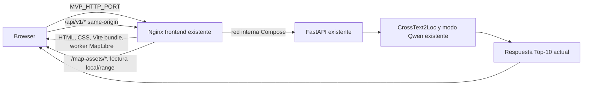

# Modernización cartográfica local del frontend

## Estado y alcance

La implementación conserva Vite/JavaScript, el contrato de FastAPI y el
ranking Top-10. MapLibre GL JS 6.16.0 y PMTiles 4.5.0 se empaquetan en la imagen
frontend. Nginx, que ya existe en `compose.mvp.yaml`, sirve los recursos desde
`/map-assets/` y mantiene el proxy `/api/`.

El checkout dispone ahora del snapshot F2, del PBF regional F4 y de los manifests
canónicos F1 de 25/50 m. El PMTiles local se genera desde la fuente F4 y se sirve
por el Nginx existente. Las extrusiones usan únicamente atributos OSM `height`
numéricos explícitos; la cobertura es parcial y el resto de los edificios queda
en 2D. F1, F2 y F4 conservan identidades y procedencias separadas.

## Arquitectura de ejecución



No hay token Mapbox, servicio de teselas adicional ni petición automática a
Mapbox, OSM tile server, OpenFreeMap o MapTiler. El navegador pide PMTiles,
provenance y GeoJSON por el mismo origen. El middleware Vite y el browser-check
leyeron el PMTiles real mediante Range; la respuesta de Nginx/Compose queda
pendiente de smoke en un host con Docker.
El estilo actual no referencia sprites ni URLs de glyphs externos; MapLibre usa
su fallback tipográfico local para las etiquetas.

## Geometrías de celda

`scripts/build_madrid_map_assets.py` valida los manifests geométricos F1 frente a
los hashes de las selecciones F4 y compara cada ID, centro y polígono con F1
canónico antes de exportar GeoJSON. La salida contiene 1.115 celdas de 25 m y
253 de 50 m, con `candidate_key = gallery_id:candidate_id` y geometría WGS84
transformada desde EPSG:25830.

Los manifests locales `manifest-25m.json` y `manifest-50m.json` son geometrías F1
v2 con `osm_snapshot_id: null`; las selecciones F4 fijan sus SHA-256 y el
builder comprobó conteos, IDs, centros y polígonos exactos. La comprobación se
ejecutó en una carpeta temporal. Los GeoJSON existentes no se sobrescribieron y
conservan estos hashes:

```bash
python scripts/build_madrid_map_assets.py --regenerate-grid
```

Para regenerar la cuadrícula solamente —sin afirmar provenance OSM— se mantiene
disponible el comando anterior. Para validar manifests de selección en una salida
separada:

```bash
python scripts/build_madrid_map_assets.py \
  --manifest-25m data/processed/catalog/manifest-25m.json \
  --manifest-50m data/processed/catalog/manifest-50m.json \
  --output-dir /tmp/madrid-map-assets-validation
```

El builder valida los manifests de selección y produce un derivado temporal para
comprobar el contrato; no reemplaza `data/processed/map-assets/`. El builder no
deriva celdas desde centros, no modifica el ranking y no usa ground truth. Si el
frontend no encuentra la geometría exacta de un ID devuelto, conserva su
marcador y anuncia que no dibuja ese polígono.

Los hashes de la salida regenerada en este checkout son:

| Recurso | SHA-256 |
|---|---|
| `cells-25m.geojson` | `4ad0cfd9551e058fb963bf302075956ce95ca66159caef496d963bdf52de30ae` |
| `cells-50m.geojson` | `b720962e3a183c5acba98ff02a4a4b2198db53e0fc88dcf49c198e35022c8ed2` |

Los archivos están en `data/processed/`, excluida de Git, y se pueden regenerar
con el comando anterior.

## Snapshot F2, fuente F4 y edificios

F2 está en
`data/raw/osm/snapshots/osm-madrid-pilot-osmxml-sha256-f2152555c742ab5fbe54b02fe7145c144757d00ed3941695856db9a52b983141/`.
El hash comprobado de `source.osm` es
`f2152555c742ab5fbe54b02fe7145c144757d00ed3941695856db9a52b983141`; tamaño
8.420.815 bytes, adquisición Overpass `2026-10-06T08:52:43.930134Z`, bbox D004
exacta y licencia ODbL-1.0. Se validaron provenance, `sha256.txt`, tamaño e ID.
F2 solo aporta D004; sus relations están conservadas como contexto y no
expandidas.

F4 está en `data/raw/osm/f4_sources/madrid-geofabrik-20261014/`. El PBF tiene
85.306.514 bytes y SHA-256
`9ef85f5c728a26995712a835a68f0cb30e01a32af6d2a7facd6744f3a3840db8`. Su
provenance coincide con `config/madrid_f4_osm_source_provenance.json`: Geofabrik
Madrid regional, fecha de datos `2026-10-14T20:21:12Z`, licencia ODbL-1.0 y bbox
`west=-4.589539`, `south=39.881157`, `east=-3.050423`, `north=41.16864`. PyOsmium
4.3.2 leyó el PBF completo: 8.771.004 nodos, 1.345.682 ways y 30.557 relations,
sin violaciones del orden ascendente por tipo; cabecera, bbox y timestamp
coinciden con la provenance. SHA-256 de `provenance.json`:
`dff044685808f284a69b2dc37337037d514dedcacd126d9ac7ec070e1d3b936d`.
La provenance F4 no declara un campo CRS explícito; el PBF se interpreta con las
coordenadas geográficas OSM de cabecera y se transforma mediante EPSG:25830 para
el buffer y EPSG:3857 para las teselas MVT. Los manifests F1 sí declaran
`source_crs: EPSG:4326` y `projected_crs: EPSG:25830`.

F2 y F4 **no son el mismo snapshot**: difieren en fuente, fecha y extensión. El
basemap procede exclusivamente del PBF F4; no se presentan sus objetos como si
pertenecieran al snapshot F2.

Los manifests guardados en `data/processed/catalog/` tienen SHA-256
`a23d3f3b54958661db76914dff9ff40a3f01a133ee86499fb9e4ddf706a49f11` (25 m) y
`ad35d5cb3b602a9ce313e06e10f913f169430d62a948c0f5e77b396bc810f2aa` (50 m).
Son manifests geométricos F1 (`phase1-manifest-v2`, `osm_snapshot_id: null`); las
selecciones F4 referencian esos hashes y el builder valida las identidades y
geometrías antes de exportar. No contienen asociaciones OSM F3 ni se sustituyeron
las celdas F1 locales.

La auditoría F2 de solo lectura está en
`results/generated/madrid-osm-building-audit-maplibre-20261106.json`. Cuenta
2.377 building ways cerrados y 365 relations de edificios en D004; 2.742
candidatos de huella usando el denominador documentado (ways cerrados más
relations etiquetadas). No deben interpretarse como objetos únicos deduplicados:
los ways miembros de relations pueden aparecer por separado. Detectó 6 alturas
numéricas explícitas (0,2188 %), 1.761 footprint candidates con niveles sin
conversión a metros y 975 sin altura ni niveles suficientes. `min_height` aparece
en 24 objetos, pero no determina por sí solo la altura total.

La auditoría F4, que cubre D004 y un buffer de 250 m, está en
`results/generated/madrid-osm-building-audit-f4-buffer250-final-v2-20261106.json` y en
la provenance PMTiles. El área se construye en EPSG:25830 y el contexto se
publica en WGS84 como bbox
`west=-3.7120544`, `south=40.4096689`, `east=-3.6959477`, `north=40.4223308`.
Se cuentan 3.517 edificios base únicos tras excluir dos ways miembros de
multipolígonos cuyo área de relation está disponible, y 2.510 partes de edificio
separadas. Hay 6/3.517 edificios base con altura numérica explícita (0,1706 %) y
105/2.510 partes (4,1833 %). Otros 735 edificios base tienen
`building:levels` sin altura explícita; esos niveles no se convierten a metros.
Las alturas métricas siguen siendo desconocidas para 3.511 edificios base
(99,8294 %) y 2.405 partes (95,8167 %). Se registran 53 tags `min_height` en
partes; solo sirven como base cuando existe también una altura superior válida.

El área geométrica de unión de edificios cubre 480.946,911 m² de los 765.444,611
m² de D004 (62,8324 %) y 1.180.285,417 m² del contexto (62,4304 %). La auditoría
encontró 6.029 geometrías de área de edificio utilizables en el contexto, cero
ways abiertos y cero anillos inválidos de edificios en el bbox candidato. Una
relation de edificio regional que Osmium no pudo ensamblar,
`Monasterio de San Jerónimo de Guisando` (relation 21178666), tiene sus nueve
ways miembros alrededor de `[-4.45584, 40.36228, -4.45495, 40.36299]`, lejos de
D004. Otra relation regional no ensamblable, el área industrial `La Arboleda`
(21401751), tiene sus dos ways alrededor de `[-3.63242, 40.38313, -3.62241,
40.39035]`, también fuera del contexto. Son dos errores de construcción de área
en el extracto regional, no geometrías inválidas dentro del área cartografiada;
no se repararon ni se incorporaron al PMTiles.

El flujo de auditoría y construcción está fijado en
`requirements-cartography.txt`; usa un entorno virtual fuera del repositorio,
PyOsmium para leer PBF, Shapely para validar/recortar y `mapbox-vector-tile` +
`pmtiles` para codificar. No requiere `osmium-tool`, Java, Docker ni servicios de
teselas. Ejemplo PowerShell sin instalación global:

```powershell
$cartographyEnv = Join-Path $env:TEMP "tfg-cartography"
$reproPmtiles = Join-Path $env:TEMP ("madrid-repro-" + [guid]::NewGuid().ToString("N") + ".pmtiles")
python -m venv $cartographyEnv
& "$cartographyEnv\Scripts\python.exe" -m pip install -r requirements-cartography.txt
& "$cartographyEnv\Scripts\python.exe" scripts\audit_madrid_osm_pbf_buildings.py --margin-m 250 --output results\generated\madrid-osm-building-audit-f4-buffer250.json
& "$cartographyEnv\Scripts\python.exe" scripts\build_madrid_pmtiles.py --margin-m 250 --min-zoom 11 --max-zoom 17 --output $reproPmtiles
```

El builder rechaza sobrescribir un PMTiles existente. Para promover un build
nuevo a `data/processed/map-assets/madrid.pmtiles` se requiere comparar la
provenance/hashes y mantener ese destino ausente; no se debe borrar ni reemplazar
el archive validado automáticamente.

`scripts/audit_madrid_osm_buildings.py` conserva además la auditoría XML F2
específica de D004. No convierte `building:levels` a metros. Su denominador
incluye ways cerrados y relations etiquetadas y no equivale a edificios únicos
deduplicados; la auditoría F4 con geometrías ensambladas es la cifra usada para
el PMTiles.

## PMTiles local generado

El artefacto generado es `data/processed/map-assets/madrid.pmtiles`; su sidecar de
provenance es `madrid.pmtiles.provenance.json`. El PMTiles es v3 MVT con
compresión GZIP, 1.961.605 bytes, SHA-256
`b267ebc4bb8de10e0ec0c7e6ba024793cb5ce0bc11dfb951cd6d9fe25541e093`, 77 tiles
no vacías y zoom 11–17. El sidecar SHA-256 es
`e4c1c086e7493169bafcbebca03f1623770ae5868b24f5b8f27055d164046112`. Una
regeneración independiente produjo el mismo hash de archive antes de refrescar
el sidecar con sus hashes de scripts/dependencias. Contiene
`building`, `transportation`,
`transportation_name`, `landuse`, `landcover`, `water` y `place`, con geometrías
recortadas al buffer de 250 m.

Para edificios, el perfil conserva `height` y `min_height` solo como números
explícitos interpretables en metros. No estima alturas desde `building:levels`.
El control 3D se activa solo si la capa `building` declara `height`, el sidecar
declara alturas explícitas y el tamaño servido del archive coincide con su
provenance. La interfaz muestra por separado la cobertura de edificios base y
partes, y mantiene las celdas/marcadores por encima de las capas de edificios.

Contrato verificado del archive:

- archive PMTiles v3 de tipo MVT y GZIP;
- bounds que cubren D004 más el buffer proyectado de 250 m;
- esquema `madrid-osm-explicit-height-v1` y metadatos `vector_layers`;
- attribution y provenance ODbL que referencian fuente F4, fecha y SHA-256;
- geometrías OSM originales transformadas a EPSG:3857 para teselas;
- campos de edificio auditables; `height` numérico solo para tags explícitos
  aceptados, `min_height` únicamente si es menor que `height`.

La interfaz comprueba encabezado, tipo de tesela, bounds, capas, provenance y
campo de altura antes de activar edificios 3D. Las 711 features de tesela con
altura incluyen copias de la misma feature a distintos zooms; representan 111
objetos OSM únicos con `height` explícita, no 711 edificios distintos. La vista
3D es cartográfica, no un levantamiento topográfico. No se añade DEM.

El comando de regeneración PMTiles offline es:

```bash
repro_dir=$(mktemp -d)
python scripts/build_madrid_pmtiles.py --margin-m 250 --min-zoom 11 --max-zoom 17 \
  --output "$repro_dir/madrid.pmtiles"
```

El script vuelve a verificar el PBF/provenance, valida ambos manifests F1 contra
las selecciones F4 en una carpeta temporal, y publica PMTiles/provenance solo si
los nombres destino no existen. No modifica `source.osm`, el PBF ni los GeoJSON
F1; no se ejecuta al arrancar Compose.

El perfil custom local evita usar el perfil OpenMapTiles que podría descargar
datos auxiliares. Las dependencias cartográficas no forman parte de la imagen del
MVP; se instalan en un venv separado mediante el lock
[`requirements-cartography.txt`](../requirements-cartography.txt). Toolchain de
esta materialización: Python 3.13.15, PyOsmium 4.3.2, Shapely 2.1.2, NumPy
2.5.4, mapbox-vector-tile 2.2.0, PMTiles writer 3.8.1 y Mercantile 1.2.1.
La regeneración byte-idéntica registró SHA-256 del generador
`scripts/build_madrid_pmtiles.py`:
`a3c39ae6e706a6ba9f06e14d66f5d2693038db6f600f89bcacd3aa3003637e08`; del módulo
`src/tfg_phase0/madrid_osm_cartography.py`:
`db682e1d45aefec30ac78d96f579255d254ca1b9d1630fb42caf4349c8f23141`; del lock
`requirements-cartography.txt`:
`28d186e1b029136b5a1271dc249fee31bb71e26aa240f3bf083f772ffbe0e294`.

## Compose, recursos y costes

El servicio `frontend` existente monta:

```text
${MVP_MAP_ASSETS_DIR:-./data/processed/map-assets}:
  /usr/share/nginx/map-assets:ro
```

Nginx tiene un alias estático `/map-assets/` y anuncia `Accept-Ranges`; el
middleware Vite local implementa Range y se probó contra el PMTiles real. La
respuesta 206 de Nginx queda pendiente de smoke con Docker. Si falta
`madrid.pmtiles`,
Compose no inicia servicios adicionales ni descarga nada: el mapa indica el
estado incompleto, muestra las celdas/Top-10 cuando su GeoJSON está listo y
desactiva 3D. La API, pesos y ranking no se modifican.

Los únicos costes cartográficos variables externos quedan fuera de la
implementación: no hay solicitudes a APIs de mapas. El host, almacenamiento y
transferencia de la infraestructura donde se ejecute Compose mantienen sus
costes propios.

## Dependencias y licencias

- `maplibre-gl@6.16.0`: BSD-3-Clause; ESM y worker Vite `?worker&url`.
- `pmtiles@4.5.0`: BSD-3-Clause; lector browser con Range requests.
- PyOsmium 4.3.2: BSD-2-Clause; Shapely 2.1.2: BSD-3-Clause; NumPy 2.5.4:
  licencias BSD/0BSD/MIT/Zlib/CC0.
- `mapbox-vector-tile` 2.2.0: MIT; writer Python PMTiles 3.8.1: BSD-3-Clause;
  Mercantile 1.2.1: BSD. Versiones fijadas en `requirements-cartography.txt`.
- Datos OSM: ODbL 1.0; incluir atribución visible y provenance si se sirve la
  base local.
- El profile MVT es código propio; la licencia de redistribución del repositorio
  no está declarada. En cualquier derivado basado en OSM sigue aplicando ODbL y
  atribución; la distribución del archive no está aprobada todavía.

## Validaciones ejecutadas y pendientes

Validado en este checkout: SHA/provenance F2 y F4; parsing completo y orden del
PBF con PyOsmium; manifests F1/F4-selections; auditoría real de edificios;
PMTiles leído y todas sus teselas MVT decodificadas; `npm test`; build Vite;
browser-check con PMTiles y GeoJSON F1 reales, API de prueba, HTTP Range, control
2D/3D, selección sincronizada y cero solicitudes externas. La API real y
FastAPI/Docker no participaron en ese browser-check.

Pendiente: validar Nginx/HTTP Range y `docker compose -f compose.mvp.yaml up` en
un host con Docker; smoke en PGX/ARM64 y pruebas de rendimiento en hardware
objetivo. Este entorno Windows no tiene Docker CLI, así que el arranque real de
Compose no se declara validado.

En el host de integración autorizado, con los artefactos obligatorios del MVP
ya disponibles, ejecutar:

```bash
docker compose -f compose.mvp.yaml config
docker compose -f compose.mvp.yaml up --build
```

En otra terminal del mismo host, comprobar API y Range:

```bash
curl -fsS http://127.0.0.1:8080/api/v1/health/ready
curl -sS -D - -H 'Range: bytes=0-126' -o /dev/null \
  http://127.0.0.1:8080/map-assets/madrid.pmtiles
```

La segunda respuesta debe ser `206 Partial Content`, con
`Content-Range: bytes 0-126/1961605`. El smoke browser de Compose existente puede
ejecutarse adicionalmente mediante `scripts/smoke_mvp3_stack.sh`; no se ha
ejecutado desde este Windows.
