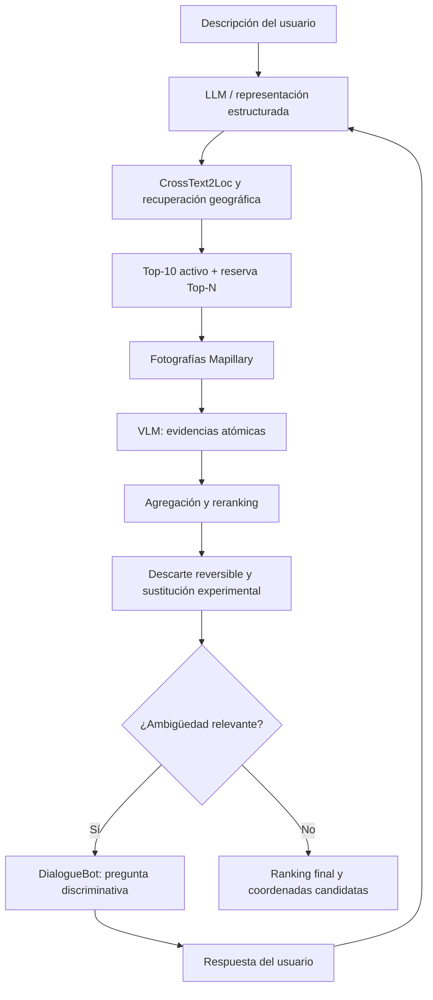

# Hoja de ruta futura: VLM, candidatos ampliados y diálogo

## Estado

Este documento registra planificación, no funcionalidad implementada ni
autorización de ejecución. El baseline CrossText2Loc permanece congelado. La
validación atómica actual de Qwen3-VL-2B no permite reranking o descarte.

## Arquitectura objetivo

El flujo puede iterar, con límites de turnos, presupuesto visual y condiciones
de parada. Diálogo y VLM son opcionales cuando la evidencia inicial sea
suficiente.

## Fase 2: reranking, descarte y sustitución

Funciones diferenciadas:

- **verificación:** decidir claims observables;
- **reranking:** cambiar orden sin alterar el conjunto;
- **filtrado:** ocultar temporalmente según una regla explícita;
- **descarte:** retirar del conjunto activo conservando auditoría y reversión;
- **sustitución:** incorporar desde una reserva congelada;
- **nueva recuperación:** volver a ejecutar retrieval con una consulta actualizada.

El descarte nunca puede basarse en ausencia, `unverifiable`, confianza declarada
o relaciones egocéntricas sin orientación. Exige contradicción atómica validada,
trazabilidad por fotografía y evaluación de falsos descartes. Los candidatos
retirados permanecen en los artefactos.

La ampliación estudiará una reserva Top-20/Top-50 o recuperación dinámica. Un
candidato nuevo no se considera mejor por ocupar una plaza liberada: debe pasar
el mismo protocolo visual y evaluación posterior. El GT no participa en
selección, descarte o sustitución.

Criterio de entrada: un verificador que demuestre validez contractual y
contradicciones suficientemente fiables en development. El 2B actual no lo
cumple.

## Fase 3: DialogueBot

El DialogueBot debe formular preguntas que separen candidatos, no pedir datos
genéricos. Entradas posibles:

- ambigüedades y claims no verificables;
- diferencias OSM/visuales entre candidatos activos y reserva;
- orientación o sentido desconocidos;
- rótulos potencialmente legibles por el usuario.

Salidas:

- pregunta discriminativa y evidencia que la motiva;
- respuesta normalizada con procedencia;
- actualización de descripción/consulta estructurada;
- nueva recuperación, ampliación o verificación cuando proceda.

Debe limitar turnos y finalizar cuando la ganancia esperada no justifique coste o
esfuerzo. No se implementa todavía. Se estudiará con texto original y
`en_cartographic`, sin asumir mejora.

## Fase 4: variantes y ablaciones

| Variante | Componentes |
|---|---|
| V0 | CrossText2Loc |
| V1 | LLM + CrossText2Loc |
| V2 | CrossText2Loc + VLM |
| V3 | LLM + CrossText2Loc + VLM |
| V4 | CrossText2Loc + VLM + DialogueBot |
| V5 | LLM + CrossText2Loc + VLM + DialogueBot |

Cuando sea viable se añadirán diálogo sin VLM, reranking, descarte, sustitución y
recuperación ampliada como ablaciones separadas.

Métricas:

- Recall@1/5/10, distancia Top-1, media/mediana y transiciones;
- acuerdo visual, falsas coincidencias/contradicciones, abstenciones, cobertura,
  descartes correctos y falsos descartes;
- candidatos nuevos, paso desde fuera del Top-10, recuperación/pérdida de
  candidatos relevantes;
- turnos, preguntas útiles, ambigüedades resueltas y mejora atribuible al diálogo;
- latencia, memoria, imágenes y llamadas por componente.

Development, calibración y test deben estar separados. Modelos, prompts, reglas,
pesos y políticas se congelan antes del test. Respuestas simuladas de diálogo se
declaran y no incorporan GT.

## Fase 5: generalización geográfica

Dos alternativas posteriores:

1. ampliar Madrid, regenerando catálogo, OSM, imágenes, embeddings, consultas y
   cobertura Mapillary;
2. preparar una segunda zona urbana independiente y evaluar sin reajuste.

No se ejecuta ninguna ampliación en la fase actual.

## Modelo visual alternativo

Una comparación futura con Qwen3-VL-8B usaría las mismas imágenes, claims,
contratos y métricas. Requiere autorización expresa, estimación de disco/RAM/VRAM
y no presupone superioridad. No se descargan pesos adicionales ahora.

## Dependencias y orden

1. Corregir y validar el contrato visual en un nuevo conjunto de desarrollo.
2. Evaluar contradicciones y falsos descartes antes de reranking/descarte.
3. Implementar reserva y sustitución solo después del verificador.
4. Implementar DialogueBot después del flujo visual controlado.
5. Ejecutar ablaciones con configuración congelada.
6. Evaluar generalización en Madrid ampliado o segunda zona.
