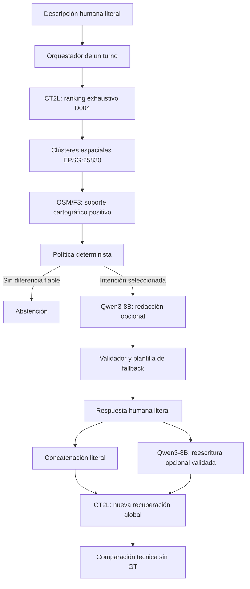

# MVP de geolocalización interactiva de un turno

## Estado y alcance

Esta fase implementa infraestructura para solicitar una aclaración humana y
repetir una recuperación global CrossText2Loc. Está inspirada en el principio de
recuperación iterativa de DialogueVPR, pero no reproduce DQ-pilot, CMPL, su
entrenamiento SFT/GRPO, su testigo sintético ni sus resultados.

El MVP no recibe *ground truth*, no abre H38–H61, no evalúa precisión geográfica
y no integra Qwen3-VL-8B. Una diferencia entre rankings es un resultado técnico,
no una mejora de localización.

## Arquitectura



El código principal está en
[`interactive_dialogue.py`](../src/tfg_phase0/interactive_dialogue.py). La CLI es
[`run_interactive_dialogue.py`](../scripts/run_interactive_dialogue.py) y la
configuración congelable inicial está en
[`interactive_dialogue_mvp.json`](../config/interactive_dialogue_mvp.json).

## Responsabilidades

| Componente | Responsabilidad | No hace |
|---|---|---|
| `OneTurnDialogueOrchestrator` | Estado, transiciones, eventos, fallbacks y límite de un turno | Inferencia CT2L, lectura directa de OSM o selección de ubicación correcta |
| `ResidentCT2LAdapter` | Invocar `CrossText2LocRetriever` con `k=gallery_count` | Preselección, acceso a GT o fusión de rankings |
| `F3EvidenceIndex` | Unir objetos y asociaciones F3 y exponer soporte cartográfico positivo | Inferir visibilidad o contradicción por ausencia |
| Política determinista | Agrupar candidatos y seleccionar una intención respaldada | Tratar scores como probabilidades o entrenar un questioner |
| `QwenDialogueAdapter` | Redactar la intención y proponer una reescritura | Cambiar la intención, modificar rankings o aportar entidades candidatas |

## Qwen3-8B

El adaptador real exige exactamente:

- modelo `Qwen/Qwen3-8B`;
- revisión `b968826d9c46dd6066d109eabc6255188de91218`;
- runtime existente `QwenTransformersAdapter`;
- decodificación no-thinking y sin muestreo.

Se reutiliza una única instancia para dos prompts diferenciados:

1. `redact_question`: verbaliza una intención ya seleccionada;
2. `rewrite_query`: propone una consulta que combina descripción y respuesta.

La redacción se rechaza si cambia la intención, introduce vocabulario no
autorizado, resulta sugestiva o elimina la opción «no puedo comprobarlo». La
reescritura se rechaza salvo que conserve literalmente la descripción y la
aclaración validadas, permitiendo solo conectores mínimos. Un fallo activa una plantilla determinista
o elimina solo la variante reescrita; nunca se repara silenciosamente.

Estas validaciones son deliberadamente conservadoras y se han probado con un
adaptador falso. No se ha autorizado ni ejecutado inferencia real en esta fase.

## CrossText2Loc y límite textual

Cada consulta usa la galería completa configurada. La reserva `Top-20` se emplea
solo para seleccionar preguntas. El ranking inicial permanece inmutable y cada
consulta aceptada genera otro ranking global independiente.

El runtime CT2L usa contexto de 300 tokens con truncamiento a la derecha. La
sesión registra esta política. La concatenación literal coloca primero la nueva
aclaración para reducir el riesgo de perderla, pero conserva separadamente e
íntegra la descripción original. Esta protección no demuestra que CT2L aproveche
la aclaración; eso requiere evaluación humana posterior.

No se fusionan similitudes de consultas distintas y no se interpretan como
probabilidades.

## OSM/F3 y preguntas

La política inicial reconoce únicamente categorías cartográficas acotadas:

- plaza;
- iglesia o lugar de culto;
- monumento;
- parque o jardín;
- comercio o equipamiento;
- intersección aproximada por dos o más vías asociadas.

Las asociaciones exclusivamente de borde no generan soporte. Familias con más
de cuatro objetos quedan ambiguas y no originan preguntas. Los candidatos se
agrupan por conectividad a un radio configurable de 75 m en EPSG:25830 para no
tratar celdas vecinas como hipótesis independientes.

Una pregunta requiere al menos dos hipótesis y debe separar hipótesis con soporte
de otras cuyo estado es desconocido. El segundo grupo no se etiqueta como
contradicción. F3 nunca se presenta como prueba de visibilidad.

## Contratos y procedencia

El schema externo es
[`interactive_dialogue_session.schema.json`](../schemas/interactive_dialogue_session.schema.json).
El validador Python añade invariantes entre campos y rechaza en cualquier nivel:

- `ground_truth`;
- `ground_truth_candidate`;
- `target_candidate_id`;
- `reference_coordinate`;
- `correct_candidate`.

La sesión conserva literalmente descripción, pregunta y respuesta. Las salidas
Qwen se guardan como propuestas separadas. Los eventos se escriben como un log
append-only de aplicación, están ordenados y encadenan el SHA-256 del evento
anterior, incluido el timestamp. Esta cadena detecta alteraciones accidentales,
pero no es una firma frente a quien pueda recalcular el fichero completo. Se escriben:

- `session.json`: estado materializado;
- `events.jsonl`: decisiones y transiciones auditables.

Los estados de evidencia reservados para evolución son `supported`,
`contradicted`, `unknown`, `unobservable` y `low_confidence`. En este MVP F3 solo
emite `supported`; la falta de soporte conserva `unknown`. No se cambia la
semántica de contratos visuales históricos.

## Ejecución CPU

El modo predeterminado usa una galería y F3 sintéticos sin modelos ni GPU:

```bash
python scripts/run_interactive_dialogue.py \
  --mode fake \
  --output-dir /tmp/dialogue-smoke \
  --description "Estoy en una calle urbana" \
  --answer "Veo una iglesia"
```

El modo real está implementado como integración, pero no debe ejecutarse sin una
autorización posterior. Requiere los recursos locales ya existentes:

```bash
python scripts/run_interactive_dialogue.py \
  --mode real \
  --output-dir results/local/dialogue-session \
  --f3-bundle /ruta/al/bundle-f3 \
  --cvg-utils-sha256 HASH \
  --clip-weights /ruta/ViT-L-14-336px.pt \
  --qwen-model-dir /ruta/Qwen3-8B-b968826d9c46
```

Omitir `--qwen-model-dir` mantiene preguntas y concatenación deterministas. La
CLI no descarga recursos ni activa un VLM.

## Pruebas

Las pruebas CPU están en `tests/test_interactive_dialogue.py`:

```bash
python -m unittest tests.test_interactive_dialogue
```

Cubren un turno, transiciones inválidas, abstención, respuestas desconocidas o
contradictorias, fallos y alucinaciones del fake Qwen, reescritura inválida,
ranking global, entrada desde fuera del orden inicial, asociaciones F3 positivas,
ausencias desconocidas, bordes, ambigüedad, clústeres, eventos, schema y rechazo
de GT.

## Limitaciones y trabajo pendiente

- No se ha cargado Qwen3-8B ni CrossText2Loc real.
- No se ha validado un bundle F3 físico mediante esta CLI.
- No se ha medido latencia, memoria o calidad de redacción real.
- No existe evaluación geográfica ni diálogo humano nuevo.
- No se interpretan respuestas complejas como claims estructurados.
- No se admiten correcciones posteriores porque el límite es un turno.
- Qwen3-VL-8B y evidencia fotográfica quedan fuera del alcance.
- La política y sus umbrales necesitan congelarse antes de cualquier evaluación
  científica nueva, sin reajustarlos sobre H26–H37.
