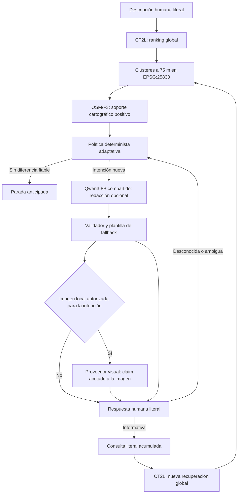
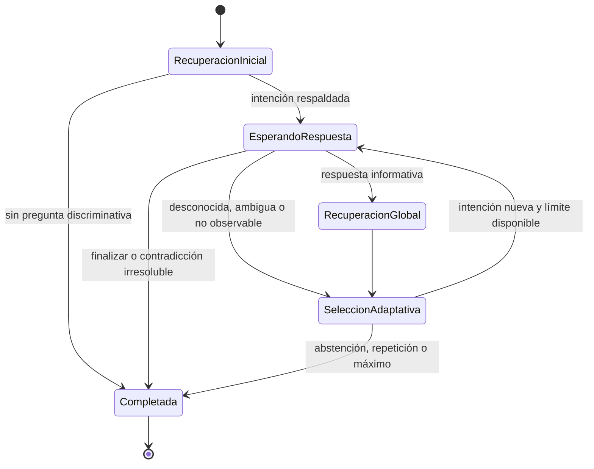

# MVP de geolocalización interactiva adaptativa

## Estado y alcance

El MVP solicita hasta tres aclaraciones humanas adaptativas y repite una
recuperación global CrossText2Loc después de cada respuesta informativa. Está
inspirado en el principio iterativo de DialogueVPR, pero no reproduce DQ-pilot,
CMPL, su entrenamiento SFT/GRPO, su testigo sintético ni sus resultados.

No recibe *ground truth*, no abre conjuntos reservados y no evalúa precisión
geográfica. El contrato v3 puede orquestar evidencia visual mediante un proveedor
CPU simulado; no ejecuta Qwen3-VL-8B real. Un cambio entre rankings es un
resultado técnico, no una mejora demostrada de localización.

El contrato histórico `interactive-dialogue-session-v1` y sus artefactos se
mantienen legibles y sin cambios. Las sesiones nuevas utilizan
`interactive-dialogue-session-v2`. Configurar `max_questions=1` conserva el
límite funcional anterior; `--legacy-one-turn` permite escribir expresamente v1.
La evidencia visual opt-in utiliza `interactive-dialogue-session-v3`; v1 y v2 no
se migran ni reescriben.

## Arquitectura



El código histórico está en
[`interactive_dialogue.py`](../src/tfg_phase0/interactive_dialogue.py) y el
orquestador v2 en
[`interactive_dialogue_multiturn.py`](../src/tfg_phase0/interactive_dialogue_multiturn.py).
La CLI común es
[`run_interactive_dialogue.py`](../scripts/run_interactive_dialogue.py).
La configuración v1 permanece en `config/interactive_dialogue_mvp.json`; v2 usa
`config/interactive_dialogue_multiturn.json`.

| Componente | Responsabilidad | No hace |
|---|---|---|
| `MultiTurnDialogueOrchestrator` | Turnos, adaptación, parada, eventos y fallbacks | Inferencia directa, selección del candidato correcto o acceso a GT |
| `OneTurnDialogueOrchestrator` | Compatibilidad de escritura v1 | Evolución multivuelta |
| `ResidentCT2LAdapter` | Recuperación con `k=gallery_count` y conteo textual | Preselección o fusión de rankings |
| `F3EvidenceIndex` | Soporte cartográfico positivo por candidato | Inferir visibilidad o contradicción por ausencia |
| Política determinista | Intención respaldada y familia semántica | Tratar scores como probabilidades |
| `QwenDialogueAdapter` | Redactar y proponer reescrituras auditables | Cambiar intención o ranking |
| `FakeVisualEvidenceProvider` | Simular claims visuales deterministas en CPU | Cargar modelos, GPU o red |
| `Qwen3VLDialogueEvidenceAdapter` | Preparar una petición para un ejecutor VLM externo ya cargado | Instanciar Qwen3-VL o modificar CT2L |
| `VisualMultiTurnDialogueOrchestrator` | Enlazar imagen, intención, claim, evento y conflicto | Fusionar scores o convertir píxeles en GT |

## Máquina de estados



Una respuesta desconocida bloquea su familia semántica, pero no finaliza por sí
sola. El sistema intenta otra pregunta independiente. `terminar`, `finalizar`,
`parar` y equivalentes producen `human_requested_stop`.

## Secuencia

```mermaid
sequenceDiagram
    actor U as Usuario
    participant O as Orquestador
    participant C as CT2L global
    participant F as OSM/F3
    participant Q as Qwen3-8B compartido
    U->>O: descripción literal
    O->>C: consulta inicial, K = galería completa
    C-->>O: ranking global
    loop Hasta 3 preguntas mientras exista información útil
        O->>F: Top-20 del ranking actual
        F-->>O: soporte positivo por hipótesis
        O->>Q: redactar intención determinista
        Q-->>O: propuesta auditada o fallo
        O->>U: pregunta validada o plantilla
        U->>O: respuesta literal
        alt aclaración informativa
            O->>C: consulta acumulada, K = galería completa
            C-->>O: nuevo ranking canónico
        else desconocida o ambigua
            O->>O: no ejecutar CT2L; probar otra familia
        end
    end
```

## Contrato por turno

Cada elemento de `turns` conserva:

- índice y ranking de entrada inmutable;
- hash del ranking y clústeres espaciales;
- referencias F3 consideradas;
- intención y familia semántica;
- pregunta determinista y pregunta final;
- auditoría Qwen y fallback;
- respuesta humana literal e interpretación;
- corrección o conflicto, cuando exista;
- consulta canónica y fragmentos omitidos;
- variantes textuales y ranking posterior global;
- comparación técnica y razón de continuación o parada.

Las familias `square`, `church`, `monument`, `intersection`, `park` y
`commercial` son identificadores deterministas. Dos redacciones sobre una
iglesia pertenecen a `church` y no pueden preguntarse dos veces. No se delega en
Qwen la detección de equivalencia.

## Política adaptativa OSM/F3

En cada turno se toma exclusivamente el ranking canónico vigente, se reserva su
Top-20 para formar hipótesis conectadas a 75 m y se buscan diferencias con
soporte positivo F3. La recuperación CT2L siempre cubre la galería completa.

Una pregunta exige al menos dos hipótesis y separa hipótesis con soporte de
otras en estado desconocido. La falta de asociación nunca se convierte en
evidencia negativa y una asociación no demuestra visibilidad. Se excluyen las
familias mencionadas, preguntadas o declaradas no observables.

## Respuestas y contradicciones

Se conservan todas las respuestas literales. La interpretación determinista
distingue afirmación, negación, desconocimiento, imposibilidad de observar,
respuesta parcial, ambigüedad, corrección y finalización. Una negación aporta
texto a CT2L, pero no descarta candidatos por ausencia OSM.

Una corrección explícita conserva ambos claims, desactiva el anterior y enlaza
el nuevo con `supersedes`. Si no se puede identificar de manera determinista qué
claim se corrige, la sesión se abstiene con `unresolvable_contradiction`; Qwen no
inventa la resolución.

Las razones de parada son:

- `max_questions_reached`;
- `no_discriminative_question`;
- `repeated_question`;
- `human_requested_stop`;
- `unresolvable_contradiction`;
- `insufficient_supported_evidence`;
- `runtime_failure`.

## Consulta canónica y 300 tokens

La política `literal-clarifications-newest-first-300-v1` coloca primero las
aclaraciones activas, de más nueva a más antigua, y después la descripción
original. Usa el tokenizer CT2L real cuando el adaptador lo expone. Nunca envía
más de 300 tokens y registra cada omisión. Una consulta reducida declara
`is_complete_transcript=false`; la descripción y respuestas completas siguen
intactas en la sesión.

`literal_concatenation` es la única variante que alimenta el turno siguiente.
`controlled_rewrite` es experimental: se audita, pero no genera el ranking
canónico, no se mezcla con otras variantes y no selecciona preguntas.

## Qwen3-8B

Se reutiliza una única instancia de `Qwen/Qwen3-8B`, revisión
`b968826d9c46dd6066d109eabc6255188de91218`, en modo no-thinking y sin muestreo.
El diálogo no carga un modelo adicional.

Cada llamada conserva prompt efectivo, salida bruta, salida validada, motivo de
rechazo, fallback, tokens, semilla e identidad del runtime. No se almacena
razonamiento interno. Una redacción inválida usa la plantilla determinista; una
reescritura inválida se omite sin afectar a la consulta canónica.

## Extensión VLM inerte

## Evidencia visual opcional v3

El contrato `dialogue-visual-evidence-v1` enlaza una imagen autorizada con una
sesión, turno, intención, pregunta y ranking de entrada. Exige SHA-256,
procedencia, autorización, productor, salida bruta, estado, limitaciones y hash
content-addressed. Los estados son:

- `supported`: evidencia favorable dentro de los píxeles de esa imagen; no es
  verdad geográfica;
- `contradicted`: evidencia visible explícitamente incompatible; la ausencia no
  cuenta como contradicción;
- `unverifiable`: encuadre, autorización, integridad, procedencia, salida o
  relación con el observador insuficientes.

La política predeterminada v2 conserva `vlm_enabled=false`. El modo v3 es opt-in,
requiere imagen local y no descarga nada. Con `require_observer_relation=true`,
una fotografía cuya relación con el observador sea desconocida solo puede
producir `unverifiable`.

La evidencia visual se almacena separada de `claims` humanos y de `f3`. Nunca se
añade a `literal_concatenation`, no ejecuta CT2L, no cambia rankings y no elimina
candidatos. Si contradice una respuesta humana, ambas fuentes se conservan y se
registra `preserve_human_query_and_record_conflict`. Si F3 contiene una asociación
y la imagen no verifica el objeto, la salida permanece `unverifiable`.

`Qwen3VLDialogueEvidenceAdapter` fija la identidad
`Qwen/Qwen3-VL-8B-Instruct` revisión
`0c351dd01ed87e9c1b53cbc748cba10e6187ff3b`, BF16/SDPA y reutiliza el prompt
atómico existente. En este BUILD es exclusivamente constructor de petición y
parser de respuesta: se abstiene con `runtime_not_initialized`, no acepta un
callable síncrono, no importa PyTorch ni carga pesos. La futura ejecución real
deberá aislarse en un proceso con timeout efectivo y verificar de nuevo el hash
de los bytes consumidos para evitar una ventana TOCTOU.

El worker preparado está en `scripts/qwen3_vl_dialogue_worker.py` y su supervisor
en `scripts/run_dialogue_v3_visual_worker_smoke.py`. El supervisor crea un grupo
de proceso propio, aplica timeout total real y termina solo ese grupo. El worker
aplica además alarmas separadas a carga e inferencia, valida una petición JSON
cerrada, limita imágenes a `/authorized-images/<nombre>`, comprueba SHA-256 antes
de validar y justo antes de abrir, desactiva red mediante el contenedor y ejecuta
como máximo una generación. La salida se analiza con
`parse_qwen3_vl_dialogue_output`; una salida inválida es fail-closed.

Una imagen `synthetic_transport_only` puede validar worker, transporte y
persistencia, pero nunca se convierte en evidencia v3. Solo `observer_view`
explícitamente autorizado es elegible para el orquestador visual.

La plantilla de incorporación está en
`config/dialogue_observer_image_manifest.template.json` y su schema en
`schemas/dialogue_observer_image_manifest.schema.json`. Permanece
`template_incomplete` y `authorized=false` hasta documentar ruta, hash, fuente,
autor, licencia/autorización, fecha, procedencia, prueba de perspectiva del
observador, restricciones, exclusión de conjuntos reservados, sesión e intención.
No se completan campos por inferencia ni se seleccionan imágenes usando GT.

## Contratos e integridad

Los schemas son:

- [`interactive_dialogue_session.schema.json`](../schemas/interactive_dialogue_session.schema.json), v1;
- [`interactive_dialogue_session_v2.schema.json`](../schemas/interactive_dialogue_session_v2.schema.json), v2.
- [`interactive_dialogue_session_v3.schema.json`](../schemas/interactive_dialogue_session_v3.schema.json), v3 visual opt-in;
- [`dialogue_visual_evidence.schema.json`](../schemas/dialogue_visual_evidence.schema.json), evidencia por imagen.

Ambos rechazan GT. El validador v2 comprueba además universo global, continuidad
entre ranking posterior y turno siguiente, familias únicas, presupuesto textual,
variante canónica, VLM inactivo y cadena SHA-256 de eventos.

## CLI CPU

```bash
python scripts/run_interactive_dialogue.py \
  --mode fake \
  --output-dir /tmp/dialogue-smoke-v2 \
  --description "Estoy en una calle urbana" \
  --answers "Sí" "No puedo comprobarlo" "No"
```

Escenario visual fake CPU explícito:

```bash
python scripts/run_interactive_dialogue.py \
  --mode fake \
  --max-questions 1 \
  --output-dir /tmp/dialogue-visual-v3 \
  --description "Una calle urbana" \
  --answers "Sí" \
  --fake-visual-manifest /ruta/manifest-autorizado.json \
  --fake-visual-state contradicted
```

La CLI solicita respuestas que falten y muestra el Top-5 técnico después de cada
turno. `--max-questions 1` prueba compatibilidad funcional. El modo real reutiliza
los adaptadores actuales, pero no se ejecutó en este BUILD.

### Worker visual real preparado

La CLI admite `--visual-image-manifest` únicamente en modo `real` multivuelta.
Esta opción no basta para abrir GPU: exige además `--authorize-visual-gpu`, un
snapshot local mediante `--visual-model-dir` y un directorio nuevo mediante
`--visual-worker-output`. Es incompatible con `--fake-visual-manifest`.

Antes de invocar el worker se valida
`dialogue-observer-image-manifest-v1`, su estado `authorized`, el SHA-256, la
procedencia, `observer_view`, la evidencia de esa relación y la exclusión literal
`confirmed_not_from_ground_truth_h26_h37_h38_h61_or_other_reserved_sets`. El
`session_id` y la `intent_family` deben coincidir con la sesión y el turno que
solicitan evidencia; cualquier divergencia se cierra sin ejecutar el worker.

El proveedor real delega en `scripts/run_dialogue_visual_worker.py`. El proceso
principal no importa PyTorch ni carga Qwen3-VL. El ejecutor comprueba la imagen
Docker validada, aplica `stable-swap-v1`, crea una petición v2 de 192 tokens y
lanza un único contenedor sin red mediante el supervisor existente. La respuesta
se valida contra el schema atómico y el contrato semántico antes de convertirse
en evidencia v3. Un timeout, bloqueo o respuesta inválida produce evidencia
`unverifiable`; nunca modifica consulta, embeddings o ranking.

Comando previsto, **no ejecutado** y condicionado a un manifiesto completo cuyo
`session_id` corresponda a los mismos argumentos de sesión:

```bash
python scripts/run_interactive_dialogue.py \
  --mode real \
  --output-dir results/generated/dialogue-v3-real-session-v1 \
  --session-label <etiqueta-congelada> \
  --description "<descripcion-literal-congelada>" \
  --visual-image-manifest <directorio-autorizado>/manifest.json \
  --authorize-visual-gpu \
  --visual-worker-output results/generated/dialogue-v3-real-worker-v1 \
  --visual-model-dir <snapshot-local-qwen3-vl-8b> \
  --f3-bundle <bundle-f3> \
  --cvg-utils-sha256 <sha256> \
  --clip-weights <clip-local>
```

Este comando ejecutaría recuperación real y una inferencia visual, por lo que
requiere una autorización de ejecución posterior y no constituye una instrucción
para usar imágenes pendientes o conjuntos reservados.

| Preguntas usadas | Secuencia ilustrativa | Parada posible |
|---:|---|---|
| 1 | afirmación, sin otra diferencia respaldada | `no_discriminative_question` |
| 2 | desconocida, nueva familia, finalización voluntaria | `human_requested_stop` |
| 3 | tres aclaraciones y rankings globales sucesivos | `max_questions_reached` |

## Pruebas

```bash
python -m pytest \
  tests/test_interactive_dialogue.py \
  tests/test_interactive_dialogue_multiturn.py
```

Cubren cero a tres preguntas, selección desde el ranking posterior, respuestas
positivas, negativas, desconocidas y ambiguas, correcciones, contradicciones,
familias repetidas, recuperación global, inmutabilidad, fallos Qwen, presupuesto
de 300 tokens, schemas, hashes, rechazo de GT y ausencia de VLM/GPU.

## Limitaciones científicas

- La implementación multivuelta se validó con dobles CPU, no con modelos reales.
- No demuestra mejora geográfica ni usa referencias correctas.
- Las respuestas complejas solo tienen interpretación conservadora por reglas.
- El recorte explícito de textos largos necesita un smoke con tokenizer CT2L real.
- F3 no representa visibilidad y sus ausencias no son contradicciones.
- Qwen3-VL-8B real y las fotografías externas quedan fuera de este BUILD; los
  tests usan únicamente bytes locales sintéticos o temporales autorizados.
- La ruta visual v3 solo valida contratos y orquestación CPU; no valida calidad
  de Qwen3-VL, fotografías reales, mejora de ranking o precisión geográfica.
- Los umbrales de la política no se ajustaron con conjuntos reservados.
