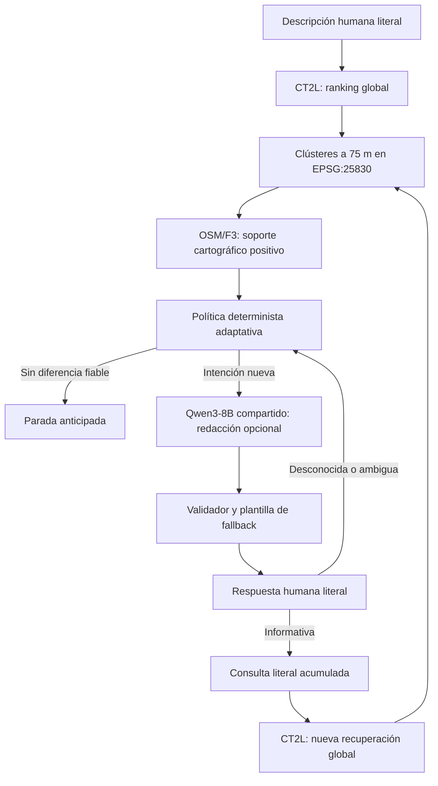
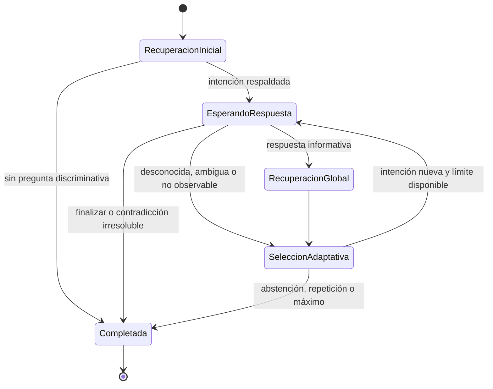

# MVP de geolocalización interactiva adaptativa

## Estado y alcance

El MVP solicita hasta tres aclaraciones humanas adaptativas y repite una
recuperación global CrossText2Loc después de cada respuesta informativa. Está
inspirado en el principio iterativo de DialogueVPR, pero no reproduce DQ-pilot,
CMPL, su entrenamiento SFT/GRPO, su testigo sintético ni sus resultados.

No recibe *ground truth*, no abre conjuntos reservados, no evalúa precisión
geográfica y no ejecuta Qwen3-VL-8B. Un cambio entre rankings es un resultado
técnico, no una mejora demostrada de localización.

El contrato histórico `interactive-dialogue-session-v1` y sus artefactos se
mantienen legibles y sin cambios. Las sesiones nuevas utilizan
`interactive-dialogue-session-v2`. Configurar `max_questions=1` conserva el
límite funcional anterior; `--legacy-one-turn` permite escribir expresamente v1.

## Arquitectura



El código histórico está en
[`interactive_dialogue.py`](../src/tfg_phase0/interactive_dialogue.py) y el
orquestador v2 en
[`interactive_dialogue_multiturn.py`](../src/tfg_phase0/interactive_dialogue_multiturn.py).
La CLI común es
[`run_interactive_dialogue.py`](../scripts/run_interactive_dialogue.py).
La configuración v1 permanece en `config/interactive_dialogue_mvp.json`; v2 usa
`config/interactive_dialogue_multiturn.json`.

| Componente | Responsabilidad | No hace |
|---|---|---|
| `MultiTurnDialogueOrchestrator` | Turnos, adaptación, parada, eventos y fallbacks | Inferencia directa, selección del candidato correcto o acceso a GT |
| `OneTurnDialogueOrchestrator` | Compatibilidad de escritura v1 | Evolución multivuelta |
| `ResidentCT2LAdapter` | Recuperación con `k=gallery_count` y conteo textual | Preselección o fusión de rankings |
| `F3EvidenceIndex` | Soporte cartográfico positivo por candidato | Inferir visibilidad o contradicción por ausencia |
| Política determinista | Intención respaldada y familia semántica | Tratar scores como probabilidades |
| `QwenDialogueAdapter` | Redactar y proponer reescrituras auditables | Cambiar intención o ranking |

## Máquina de estados



Una respuesta desconocida bloquea su familia semántica, pero no finaliza por sí
sola. El sistema intenta otra pregunta independiente. `terminar`, `finalizar`,
`parar` y equivalentes producen `human_requested_stop`.

## Secuencia

```mermaid
sequenceDiagram
    actor U as Usuario
    participant O as Orquestador
    participant C as CT2L global
    participant F as OSM/F3
    participant Q as Qwen3-8B compartido
    U->>O: descripción literal
    O->>C: consulta inicial, K = galería completa
    C-->>O: ranking global
    loop Hasta 3 preguntas mientras exista información útil
        O->>F: Top-20 del ranking actual
        F-->>O: soporte positivo por hipótesis
        O->>Q: redactar intención determinista
        Q-->>O: propuesta auditada o fallo
        O->>U: pregunta validada o plantilla
        U->>O: respuesta literal
        alt aclaración informativa
            O->>C: consulta acumulada, K = galería completa
            C-->>O: nuevo ranking canónico
        else desconocida o ambigua
            O->>O: no ejecutar CT2L; probar otra familia
        end
    end
```

## Contrato por turno

Cada elemento de `turns` conserva:

- índice y ranking de entrada inmutable;
- hash del ranking y clústeres espaciales;
- referencias F3 consideradas;
- intención y familia semántica;
- pregunta determinista y pregunta final;
- auditoría Qwen y fallback;
- respuesta humana literal e interpretación;
- corrección o conflicto, cuando exista;
- consulta canónica y fragmentos omitidos;
- variantes textuales y ranking posterior global;
- comparación técnica y razón de continuación o parada.

Las familias `square`, `church`, `monument`, `intersection`, `park` y
`commercial` son identificadores deterministas. Dos redacciones sobre una
iglesia pertenecen a `church` y no pueden preguntarse dos veces. No se delega en
Qwen la detección de equivalencia.

## Política adaptativa OSM/F3

En cada turno se toma exclusivamente el ranking canónico vigente, se reserva su
Top-20 para formar hipótesis conectadas a 75 m y se buscan diferencias con
soporte positivo F3. La recuperación CT2L siempre cubre la galería completa.

Una pregunta exige al menos dos hipótesis y separa hipótesis con soporte de
otras en estado desconocido. La falta de asociación nunca se convierte en
evidencia negativa y una asociación no demuestra visibilidad. Se excluyen las
familias mencionadas, preguntadas o declaradas no observables.

## Respuestas y contradicciones

Se conservan todas las respuestas literales. La interpretación determinista
distingue afirmación, negación, desconocimiento, imposibilidad de observar,
respuesta parcial, ambigüedad, corrección y finalización. Una negación aporta
texto a CT2L, pero no descarta candidatos por ausencia OSM.

Una corrección explícita conserva ambos claims, desactiva el anterior y enlaza
el nuevo con `supersedes`. Si no se puede identificar de manera determinista qué
claim se corrige, la sesión se abstiene con `unresolvable_contradiction`; Qwen no
inventa la resolución.

Las razones de parada son:

- `max_questions_reached`;
- `no_discriminative_question`;
- `repeated_question`;
- `human_requested_stop`;
- `unresolvable_contradiction`;
- `insufficient_supported_evidence`;
- `runtime_failure`.

## Consulta canónica y 300 tokens

La política `literal-clarifications-newest-first-300-v1` coloca primero las
aclaraciones activas, de más nueva a más antigua, y después la descripción
original. Usa el tokenizer CT2L real cuando el adaptador lo expone. Nunca envía
más de 300 tokens y registra cada omisión. Una consulta reducida declara
`is_complete_transcript=false`; la descripción y respuestas completas siguen
intactas en la sesión.

`literal_concatenation` es la única variante que alimenta el turno siguiente.
`controlled_rewrite` es experimental: se audita, pero no genera el ranking
canónico, no se mezcla con otras variantes y no selecciona preguntas.

## Qwen3-8B

Se reutiliza una única instancia de `Qwen/Qwen3-8B`, revisión
`b968826d9c46dd6066d109eabc6255188de91218`, en modo no-thinking y sin muestreo.
El diálogo no carga un modelo adicional.

Cada llamada conserva prompt efectivo, salida bruta, salida validada, motivo de
rechazo, fallback, tokens, semilla e identidad del runtime. No se almacena
razonamiento interno. Una redacción inválida usa la plantilla determinista; una
reescritura inválida se omite sin afectar a la consulta canónica.

## Extensión VLM inerte

El contrato reserva un `VisualEvidenceProvider` independiente para una futura
integración de `Qwen/Qwen3-VL-8B-Instruct`, revisión
`0c351dd01ed87e9c1b53cbc748cba10e6187ff3b`. Este BUILD exige `enabled=false` y
`calls=0`; intentar inyectar un proveedor produce error.

El punto futuro deberá recibir procedencia fotográfica, claims y presupuesto, y
devolver `supported`, `contradicted` o `unverifiable`. No habrá fusión implícita
de scores ni equivalencia entre una cámara Mapillary y el observador.

## Contratos e integridad

Los schemas son:

- [`interactive_dialogue_session.schema.json`](../schemas/interactive_dialogue_session.schema.json), v1;
- [`interactive_dialogue_session_v2.schema.json`](../schemas/interactive_dialogue_session_v2.schema.json), v2.

Ambos rechazan GT. El validador v2 comprueba además universo global, continuidad
entre ranking posterior y turno siguiente, familias únicas, presupuesto textual,
variante canónica, VLM inactivo y cadena SHA-256 de eventos.

## CLI CPU

```bash
python scripts/run_interactive_dialogue.py \
  --mode fake \
  --output-dir /tmp/dialogue-smoke-v2 \
  --description "Estoy en una calle urbana" \
  --answers "Sí" "No puedo comprobarlo" "No"
```

La CLI solicita respuestas que falten y muestra el Top-5 técnico después de cada
turno. `--max-questions 1` prueba compatibilidad funcional. El modo real reutiliza
los adaptadores actuales, pero no se ejecutó en este BUILD.

| Preguntas usadas | Secuencia ilustrativa | Parada posible |
|---:|---|---|
| 1 | afirmación, sin otra diferencia respaldada | `no_discriminative_question` |
| 2 | desconocida, nueva familia, finalización voluntaria | `human_requested_stop` |
| 3 | tres aclaraciones y rankings globales sucesivos | `max_questions_reached` |

## Pruebas

```bash
python -m pytest \
  tests/test_interactive_dialogue.py \
  tests/test_interactive_dialogue_multiturn.py
```

Cubren cero a tres preguntas, selección desde el ranking posterior, respuestas
positivas, negativas, desconocidas y ambiguas, correcciones, contradicciones,
familias repetidas, recuperación global, inmutabilidad, fallos Qwen, presupuesto
de 300 tokens, schemas, hashes, rechazo de GT y ausencia de VLM/GPU.

## Limitaciones científicas

- La implementación multivuelta se validó con dobles CPU, no con modelos reales.
- No demuestra mejora geográfica ni usa referencias correctas.
- Las respuestas complejas solo tienen interpretación conservadora por reglas.
- El recorte explícito de textos largos necesita un smoke con tokenizer CT2L real.
- F3 no representa visibilidad y sus ausencias no son contradicciones.
- Qwen3-VL-8B y las fotografías quedan fuera de este BUILD.
- Los umbrales de la política no se ajustaron con conjuntos reservados.
