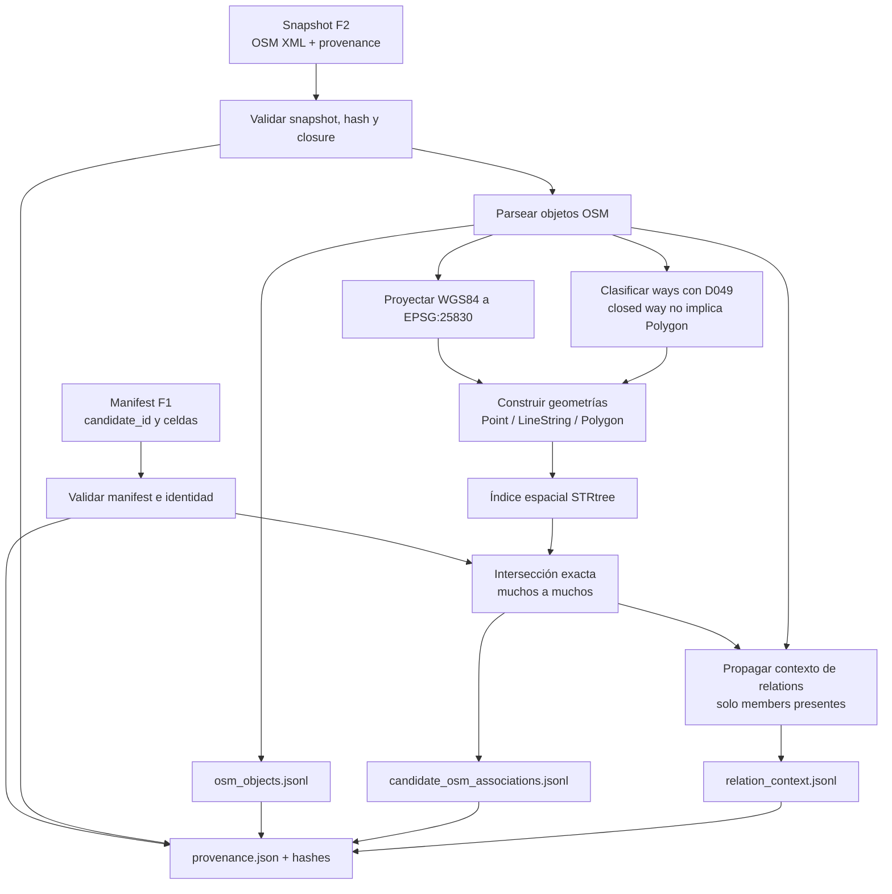

# Catálogo y evaluación de Madrid

Este documento define la organización de los datos de Madrid. La infraestructura
determinista del catálogo geométrico está implementada en Fase 1 y se documenta
en [PHASE1_GEOGRAPHIC_CATALOG.md](PHASE1_GEOGRAPHIC_CATALOG.md). La Fase 2 ha
adquirido y validado el primer snapshot OSM raw de D004, identificado como
`osm-madrid-pilot-osmxml-sha256-f2152555c742ab5fbe54b02fe7145c144757d00ed3941695856db9a52b983141`;
se documenta en [PHASE2_OSM_SNAPSHOT.md](PHASE2_OSM_SNAPSHOT.md) y permanece
fuera de Git. Todavía no se ha generado el catálogo visual. El piloto utiliza
la bounding box fijada en D004; la extensión definitiva de Madrid continúa
pendiente.

## 1. Separación de recursos

### Catálogo offline de referencia

El catálogo contiene localizaciones candidatas sobre las que se ejecuta la
búsqueda. Cada entrada debe conservar, como mínimo:

```text
candidate_id
latitude
longitude
```

También conservará la procedencia, la versión/fecha de OSM, la región, las
transformaciones y las representaciones disponibles.

Para CrossText2Loc, una entrada puede asociar:

- imagen OSM y referencia a su embedding visual;
- imagen satelital y referencia a su embedding, únicamente si se incorpora y
  se confirma su fuente y licencia.

Para GOTPR, una entrada puede asociar un OSM Scene Graph y su representación o
índice. La creación de OSM Scene Graphs de Madrid compatibles con el checkpoint
publicado sigue **PENDIENTE DE VALIDAR**; el repositorio oficial no proporciona
todo ese conversor.

Como extensión futura, una entrada podría asociar una o varias imágenes de
calle, satélite o *drone* y embeddings GeoBridge por modalidad. GeoBridge
original no consume la imagen OSM del catálogo. Estos campos no se añaden al
manifest actual: primero deben resolverse D038 (permisos) y D039 (modalidad,
footprint, orientación y transferencia a Madrid).

### Dataset de evaluación

El dataset de evaluación es independiente del catálogo como artefacto lógico.
Contiene descripciones, posición real y metadatos de procedencia. La posición
real solo se utiliza después de la inferencia para calcular métricas.

Una descripción de evaluación no se usa para entrenar ni ajustar los pesos.
Puede corresponder a una localización que también exista en el catálogo: eso es
necesario para medir recuperación. Lo que no puede ocurrir es que el
`ground_truth` se use para preseleccionar candidatos.

## 2. Flujo offline

```text
OSM/Overpass
    ↓
datos vectoriales raw y metadatos
    ↓
normalización y candidatos
    ├── renderizado de teselas → imágenes OSM → embeddings CrossText2Loc
    ├── OSM Scene Graphs → representaciones GOTPR (si se valida el formato)
    └╌ imágenes visuales autorizadas → embeddings GeoBridge (extensión)
```

Overpass devuelve datos OSM, geometrías y etiquetas; no devuelve imágenes
cartográficas ni scene graphs GOTPR. Las imágenes OSM se obtienen mediante un
servicio de teselas/renderizado compatible con el modelo. El script oficial de
CVG-Text usa `contextily` y `tile.openstreetmap.org`, pero contiene una
discrepancia: calcula `img_crop` y guarda `img`. La corrección y la validación
del tamaño/área deben vivir en un wrapper propio.

Los datos raw, procesados, imágenes, embeddings, grafos e índices se mantienen
separados y no se incorporan al repositorio Git.

### Qué generan F1 y F2

F1 y F2 producen recursos distintos e independientes. F1 define **dónde puede
buscar el sistema** mediante una cuadrícula de candidatos; F2 congela **qué
información vectorial de OSM estaba disponible** para la región. Ninguna de las
dos fases crea todavía la asociación entre candidatos y objetos OSM.

#### F1: catálogo geométrico de candidatos

F1 genera un manifest JSON a partir de la bbox del piloto y de una granularidad
indicada explícitamente, por ejemplo 25 m o 50 m. Cada entrada representa una
celda cuadrada estable de la cuadrícula y contiene:

- un `candidate_id` inmutable;
- el centro de la celda en WGS84;
- el centro métrico en EPSG:25830;
- el polígono WGS84 de la celda;
- fila, columna, tamaño y separación de la cuadrícula;
- versión, CRS, bbox, política de borde, hashes y provenance;
- referencias futuras a imágenes, embeddings y scenes, inicialmente `null`.

El manifest se materializa mediante `scripts/generate_madrid_catalog.py`. La
configuración base no fija 25 m frente a 50 m porque D003 continúa pendiente;
cada alternativa genera un manifest diferente. Los manifests comprobados hasta
ahora se crearon temporalmente para validar F1 y no existe todavía un manifest
definitivo persistido en `data/processed/catalog/`.

F1 no contiene objetos OSM, tags, imágenes, embeddings, consultas, ground truth
ni asociaciones con OSM. Su campo `osm_snapshot_id` permanece `null` y F3 no lo
modificará.

#### F2: snapshot vectorial OSM

F2 genera un directorio de snapshot local e inmutable:

```text
data/raw/osm/snapshots/<osm_snapshot_id>/
  source.osm
  provenance.json
  sha256.txt
```

`source.osm` es la respuesta OSM XML raw. Contiene nodes seleccionados por bbox,
ways que intersectan la bbox, todos los nodes necesarios para completar esos
ways y relations que referencian directamente objetos locales. El snapshot
actual contiene 25.537 nodes, 4.240 ways y 498 relations.

`provenance.json` registra la identidad del snapshot, bbox, consulta, endpoint,
fecha de adquisición, formato, tamaño, SHA-256, licencia, atribución, conteos,
selección y política de clausura. `sha256.txt` permite comprobar la integridad de
`source.osm`.

Los ways están completos respecto a sus `nd ref`. Las relations son solo
contexto parcial y no se expanden: `closure.relations = not_expanded`. F2 no
genera geometrías normalizadas, asociaciones con `candidate_id`, índices,
imágenes, embeddings, scene graphs ni datos de evaluación.

El snapshot actual contiene 25.537 nodes, 4.240 ways y 498 relations. Los
25.537 nodes se descomponen en 23.019 seleccionados por bbox y 2.518 añadidos
para completar ways. Las relations son contexto directo no expandido; sus
members ausentes se contabilizan y no implican corrupción del raw.

### Asociación geométrica propuesta para Fase 3

El contrato global está fijado en D050 y se desarrolla en
[PHASE3_GEOMETRIC_ASSOCIATIONS.md](PHASE3_GEOMETRIC_ASSOCIATIONS.md). La fase
continúa pendiente de implementación.

F3 debe:

1. Recibir un manifest F1 ya materializado.
2. Recibir un snapshot F2 local ya adquirido.
3. Validar schemas, identidades, hashes y compatibilidad de los inputs.
4. Leer nodes, ways y relations desde `source.osm`.
5. Reconstruir geometrías completas de nodes y ways.
6. Aplicar D049 a cada way.
7. Proyectar las coordenadas OSM a EPSG:25830 mediante la transformación de F1.
8. Construir un índice espacial temporal.
9. Asociar muchos-a-muchos los objetos geométricos elegibles y las celdas F1 mediante intersección.
10. Calcular predicados topológicos neutrales.
11. Calcular la distancia desde el centro F1 hasta la geometría OSM completa.
12. Propagar contexto parcial de relations desde members presentes asociados.
13. Escribir un dataset derivado canónico.
14. Registrar provenance, conteos, versiones e integridad.
15. Publicar el dataset de forma atómica e inmutable.

El siguiente diagrama describe la arquitectura propuesta, todavía no
implementada, para vincular de forma reproducible el manifest geométrico de
Fase 1 con la evidencia del snapshot OSM local de Fase 2. F3 no consulta
Overpass, no modifica el manifest F1 y registra el vínculo entre ambos inputs
en su propia provenance:



D049 fija `way_is_area-v1` y la copia versionada de
`osm-polygon-features` utilizada para distinguir áreas, líneas y closed ways
ambiguos. Los `unknown_closed_way` y las áreas inválidas no producen
asociaciones geométricas base. Las relations incompletas de F2 no reciben
geometría propia ni transmiten automáticamente sus tags o semántica a los
member ways.

## 3. Flujo online

```text
descripción + zona
        ↓
LLM → consulta geográfica estructurada
        ↓
OSM/Overpass + consulta estructurada
        ↓
candidate_id preseleccionados
        ├── CrossText2Loc: texto → embedding → representaciones visuales
        ├── GOTPR: texto → Text Scene Graph → OSM Scene Graphs
        └╌ GeoBridge: texto → embedding → imágenes de calle/satélite/drone
        ↓
Top-N
```

La preselección no utiliza las imágenes OSM, las imágenes satelitales ni sus
embeddings. Tampoco elimina físicamente representaciones del catálogo: solo
limita las entradas participantes en esa consulta.

Se conservará un modo de evaluación sin preselección y se medirá la cobertura
del filtro antes de medir Recall@K del recuperador.

## 4. Estado de viabilidad

| Pipeline | Estado | Evidencia | Falta |
| --- | --- | --- | --- |
| Madrid → candidatos → imágenes OSM → embeddings CrossText2Loc → retrieval | VIABLE CON ADAPTACIÓN | `dataset.py`, `model_loader.py`, `evaluate.py` y `download_osm_street.py` del commit auditado de CVG-Text | Fijar checkpoint, validar renderizado y crear índice/manifiesto propios |
| Madrid → candidatos → OSM Scene Graphs → GOTPR → retrieval | EXPERIMENTAL | `scene_graph.py`, `models.py`, `scene_graph_candidates_extraction.py` y `eval_utils.py` de GOTPR | Constructor OSM→scene graph, reglas espaciales, embeddings y compatibilidad del checkpoint |
| Madrid → Street View → VLM | BLOQUEADO/PENDIENTE | APIs y términos oficiales de Google Maps Platform | Confirmar legalmente descarga/procesamiento/caché/uso con VLM |
| Madrid → imágenes satelitales Google → embeddings | BLOQUEADO/PENDIENTE | Términos de Google Maps Platform | Fuente alternativa o permiso específico; no usar como supuesto del MVP |
| Madrid → imágenes autorizadas → embeddings GeoBridge → retrieval/reranking | EXTENSIÓN CONDICIONADA | Encoders y scoring del commit auditado de GeoBridge | D038, carga reproducible del checkpoint y experimento zero-shot D039 |

## 5. Criterio de publicación

El repositorio puede contener código propio, manifiestos sin contenido
restringido, consultas, identificadores, hashes, métricas y documentación. No
deben publicarse claves, checkpoints, imágenes de Google, datasets de terceros
ni índices derivados cuya licencia no permita redistribución.
