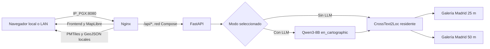

# MVP: arquitectura, despliegue y operación

Este es el único documento operativo del MVP. Consolida la API FastAPI de
MVP.1, el frontend Leaflet de MVP.2, el despliegue integrado de MVP.3 y el cierre
técnico. La evolución detallada de cada ejecución se conserva en
[EXPERIMENTS.md](EXPERIMENTS.md) y las decisiones en
[DECISIONS.md](DECISIONS.md).

## Arquitectura final

MVP.3 sirve el frontend compilado mediante Nginx y mantiene FastAPI únicamente
en la red de Docker Compose. El navegador utiliza un solo origen HTTP.



La API no publica ningún puerto en el host. Nginx es el único punto de entrada y
redirige `/api/` a `api:8000`. Uvicorn ejecuta un worker y carga una sola
instancia de `CrossText2LocRetriever` durante el lifespan. F5.11 carga además una
instancia Qwen opcional; el modo Con LLM solo está disponible si ambos runtimes
superan el arranque.

## Funcionalidad implementada

La respuesta Atlas v3 incorpora un postprocesador Qwen3-VL posterior a
CrossText2Loc. El modo operativo inicial es *precomputed-first*: valida un bundle
montado en solo lectura contra el texto efectivo, galería, datasets visuales y
ranking CT2L. Si existe una entrada compatible, devuelve ranking final y evidencia
estructurada; si no existe, declara `fallback_baseline` y conserva CT2L. La
inferencia Qwen3-VL online continúa experimental y no comparte residencia GPU con
los dos modelos actuales.

El contrato de bundle v2 fija una reserva interna Top-50. La API conserva y
devuelve el baseline CT2L Top-10, pero el postprocesador puede promover al ranking
final candidatos de ranks 11–50. Si texto efectivo, variante, galería, datasets o
reserva no coinciden exactamente con el bundle, devuelve `fallback_baseline`.

Configuración opcional:

```text
ATLAS_VISUAL_PROMOTION_ENABLED=true
MVP_VISUAL_BUNDLE_DIR=/ruta/host/a/bundles
ATLAS_VISUAL_PRECOMPUTED_BUNDLE_CONTAINER=/visual-bundles/atlas-visual-bundle.json
```

- descripción textual en español;
- selección de las galerías Madrid 25 m y 50 m;
- selección exclusiva de galería 25 m o 50 m;
- selección exclusiva Sin LLM o Con LLM experimental;
- Top-10 fijo para la combinación seleccionada;
- ranking exhaustivo CrossText2Loc con pesos congelados;
- API FastAPI con una instancia residente y un worker;
- frontend estático Nginx con MapLibre, geometrías de celdas y bbox D004;
- sincronización de tarjetas y marcadores;
- historial local, cancelación y errores contractuales;
- proxy `/api` del mismo origen y healthchecks;
- acceso local/LAN y browser-check ARM64 reproducible.

No forman parte del MVP: preselección OSM, GOTPR, fotografías/Street View,
inferencia Qwen3-VL en línea, DialogueVPR interactivo, HNSW, fine-tuning o
refinamiento TOLoc. El postprocesador visual opcional solo consume evidencia
Qwen3-VL precalculada; no carga ni ejecuta ese modelo durante la consulta. Qwen
textual se limita a la transformación F5 `en_cartographic`; no extrae coordenadas
ni ejecuta variantes adicionales.

## API FastAPI

Endpoints internos, accesibles desde el navegador mediante el proxy Nginx:

```text
GET  /api/v1/health/live
GET  /api/v1/health/ready
GET  /api/v1/capabilities
GET  /api/v1/progress/{query_id}   (SSE efímero)
POST /api/v1/retrievals
```

El POST usa `atlas-experimental-retrieval-request-v2`: `gallery_id` admite solo
`madrid-25m`/`madrid-50m`, `processing_mode` solo `no_llm`/`with_llm` y
`top_k=10`. La respuesta v3 conserva el texto original y declara texto efectivo,
modo, variante, identidad Qwen y tiempos. Las similitudes son coseno, no
probabilidades. Un lock cubre transformación y retrieval completos.

| Caso | HTTP | Código |
|---|---:|---|
| Body inválido | 422 | `INVALID_REQUEST` |
| Input de retrieval inválido | 422 | `INVALID_RETRIEVAL_INPUT` |
| Galería desconocida | 404 | `GALLERY_NOT_FOUND` |
| Runtime no listo u ocupado | 503 | `RUNTIME_NOT_READY` / `RUNTIME_BUSY` |
| Qwen no cargado | 503 | `LLM_NOT_READY` |
| Transformación fallida/rechazada | 503 | `TRANSFORMATION_FAILED` / `TRANSFORMATION_REJECTED` |
| Inferencia fallida | 503 | `INFERENCE_FAILED` |
| Error inesperado | 500 | `INTERNAL_ERROR` |

Las respuestas no exponen trazas, rutas privadas ni detalles CUDA e incluyen
`X-Request-ID`. Para diagnóstico aislado se conservan
`scripts/run_mvp1_api_docker.sh` y `scripts/smoke_mvp1_stack.sh`; no son el
procedimiento de despliegue principal.

### Seguimiento observable de la consulta

El POST síncrono mantiene el mismo contrato y respuesta. El navegador abre antes
un canal **Server-Sent Events** por `GET /api/v1/progress/{query_id}`; no reemplaza
la petición ni crea una cola de trabajos. FastAPI publica eventos efímeros en
memoria mientras el POST está activo, identificados por `query_id` y secuencia.
El canal no almacena texto, scores, coordenadas ni ground truth; sus colas tienen
tamaño limitado, se descartan al desconectar y no conservan historial. Si el SSE
no está disponible o se pierden eventos, el frontend muestra las etapas pendientes
como desconocidas y confirma el resultado al recibir la respuesta síncrona.

| Señal real | Representación | Límite |
|---|---|---|
| Modo `with_llm`: inicio y fin/error de Qwen3-8B | Etapa LLM activa/finalizada/error y tiempo de transformación devuelto por el adaptador | No expone tokens ni avance de generación |
| Codificación de texto y ranking exhaustivo de CT2L | Subfases y duraciones emitidas por el runtime residente | No hay porcentaje ni avance por candidato |
| Postprocesador visual experimental habilitado | Consulta de evidencia Qwen3-VL precalculada y resultado aplicado/fallback | No significa que Qwen3-VL se ejecute en línea ni que esté validado para producción |
| Sin bundle de postprocesado | Etapa visual omitida | El ranking CT2L se conserva |
| DialogueVPR | No disponible | No hay preguntas ni respuestas dentro del endpoint de este MVP |

Los estados de etapa son `pending`, `running`, `completed`, `failed`, `skipped`,
`unavailable`, `waiting_for_user` y `unknown`. `waiting_for_user` forma parte del
contrato visual extensible; el endpoint actual nunca lo emite porque DialogueVPR
no está integrado. El tiempo mostrado desde el envío mide la espera de extremo a
extremo en el navegador; no se convierte en avance porcentual. Los tiempos por
modelo solo se muestran cuando el backend los mide o devuelve.

La cancelación aborta la espera HTTP y cierra el canal del navegador; no garantiza
detener el hilo de inferencia que ya empezó en FastAPI. Un timeout o desconexión
deja las etapas no confirmadas como desconocidas. Nginx deshabilita buffering en
la ruta SSE, envía keep-alive, permite 900 s de lectura del stream y 120 s para la
respuesta API síncrona, por encima del timeout de cliente de 90 s del modo LLM.

## Frontend y mapa local

El frontend JavaScript/Vite compila MapLibre GL JS y PMTiles durante el build de
la imagen existente. Nginx sirve HTML, CSS, JS, `/api/` y `/map-assets/`; no se
añade un contenedor de teselas ni se solicita cartografía a proveedores externos.
`frontend/src/api.js` conserva el transporte; `retrieval.js` valida el contrato
actual; `pipeline.js` reduce eventos por consulta, `progress-stream.js` administra
el SSE y `main.js` presenta las etapas sin acoplarlas a MapLibre. `map.js` mantiene
una instancia MapLibre estable y `map-data.js` valida las geometrías GeoJSON antes
de asociarlas a resultados.

Las tarjetas, los marcadores y las celdas comparten `gallery_id:candidate_id`.
Las coordenadas de puntos usan `[longitude, latitude]` GeoJSON; las coordenadas
de inferencia continúan siendo WGS84 y no cambian. La bbox D004 se dibuja desde
`/capabilities`. La selección del mapa no modifica el ranking ni consulta GT.
El centro de una celda no confirma la posición del observador y la similitud
coseno no es una probabilidad.

Las celdas se publican como polígonos canónicos F1 en
`data/processed/map-assets/cells-{25,50}m.geojson`, no como rectángulos
latitud/longitud aproximados. El generador verifica IDs, CRS, anillos, conteos,
selección F4 y hashes cuando se le proporcionan los manifests F4 originales. La
opción `--regenerate-grid` recrea F1 desde la configuración y deja
`osm_snapshot_id: null`; no sustituye el manifest F4 usado por el recuperador.

El estilo local consume `madrid.pmtiles` con esquema MVT
`madrid-osm-explicit-height-v1`. Nginx lo sirve por HTTP Range desde el volumen
read-only `MVP_MAP_ASSETS_DIR`; no se genera cartografía durante el arranque.
MapLibre comprueba header, bounds, capas, provenance y tamaño del archive. La
capa `fill-extrusion` utiliza `height` numérico explícito y `min_height` como
base solo si es menor que esa altura. `building:levels` no se convierte a metros
y no se asignan alturas a edificios desconocidos.

La fuente de mapa es el PBF F4 regional Geofabrik, SHA-256
`9ef85f5c728a26995712a835a68f0cb30e01a32af6d2a7facd6744f3a3840db8`, ODbL 1.0,
recortado a D004 más 250 m en EPSG:25830. Los candidatos permanecen como GeoJSON
canónico F1, con `osm_snapshot_id: null`; el ranking no se regenera ni usa GT. El
sidecar PMTiles registra fuente, capas, cobertura, alturas y hash del archive.
La auditoría halló 6/3.517 edificios base y 105/2.510 partes con alturas OSM
explícitas. Esta cobertura parcial se muestra en la interfaz y no se presenta
como reconstrucción topográfica.

El fallback Leaflet no carga teselas externas: muestra el límite, polígonos
canónicos y marcadores en 2D cuando WebGL2 no está disponible. La lista Top-10
permanece utilizable con teclado y lector de pantalla en todos los casos.

El servidor Vite (`npm --prefix frontend run dev`) se conserva únicamente para
desarrollo. La aplicación desplegada no usa Vite dev server ni datos ficticios.

## Requisitos

El procedimiento paso a paso para actualizar la rama, verificar artefactos y
validar el stack en PGX está en
[MVP_PGX_DEPLOYMENT.md](MVP_PGX_DEPLOYMENT.md).

- Host Linux ARM64 con Docker, Docker Compose y NVIDIA Container Toolkit.
- GPU NVIDIA compatible con la imagen API. El entorno validado es una GB10.
- Imagen local unificada `crosstext2loc-gb10:f511`.
- Clon de CVG-Text en `external/CVG-Text` mediante el procedimiento del proyecto.
- Checkpoint CrossText2Loc y pesos CLIP fuera de Git.
- Catálogos, imágenes visuales y embeddings canónicos de 25 m y 50 m.
- Snapshot local Qwen3-8B en la revisión congelada.

La imagen API se reutiliza; el arranque no descarga datos, no renderiza OSM y no
recalcula embeddings.

## Artefactos externos

`scripts/run_mvp3_stack.sh` comprueba antes del arranque todas las rutas de
`config/madrid_f46_retriever.json`. Los elementos necesarios se dividen así:

### Archivos incluidos en Git

El usuario obtiene estos archivos al clonar el repositorio y no debe crear copias
ni cambiar sus rutas para una ejecución normal:

| Archivo | Función |
|---|---|
| `compose.mvp.yaml` | Servicios API, Nginx y browser-check opcional |
| `scripts/run_mvp3_stack.sh` | Preflight y arranque recomendado |
| `scripts/run_mvp1_api.sh` | Entry point Uvicorn interno del contenedor |
| `config/madrid.yaml` | Bbox y configuración geográfica del piloto |
| `config/madrid_f46_retriever.json` | Rutas del checkpoint y galerías residentes |
| `config/madrid_f4_visual_gallery_25m.json` | Selección canónica de 1.115 candidatos |
| `config/madrid_f4_visual_gallery_50m.json` | Selección canónica de 253 candidatos |
| `frontend/Dockerfile` | Build Vite y servidor Nginx de producción |
| `frontend/nginx.conf` | Archivos estáticos, `/healthz` y proxy `/api` |
| `.env.mvp.example` | Plantilla opcional de variables de entorno |

### Archivos locales obligatorios fuera de Git

El usuario o responsable de datos debe proporcionar estos artefactos antes de
arrancar. No deben añadirse a Git ni copiarse dentro de una imagen Docker:

| Archivo o directorio | Ubicación exacta relativa a la raíz |
|---|---|
| Clon CVG-Text fijado | `external/CVG-Text/` |
| Archivo auditado del clon | `external/CVG-Text/utils.py` |
| Checkpoint NewYork-mixed OSM | `checkpoints/CrossText2Loc/long_model_NewYork-mixed_1e-05_128_osm_epoch30_59.08.pth` |
| Pesos base CLIP | `$HOME/.cache/clip/ViT-L-14-336px.pt` |
| Manifest 50 m | `data/processed/catalog/manifest-50m.json` |
| Manifest 25 m | `data/processed/catalog/manifest-25m.json` |
| Bundle visual 50 m | `data/processed/visual/f4-madrid-visual-sha256-15310268e0fed30180085c7ec1f14fce696c4ba94e83bf9727970451cc82f564/` |
| Bundle visual 25 m | `data/processed/visual/f4-madrid-visual-sha256-ebe6c91b8ed5600d65c3021a53c768d6e65545777efda92d7b171f705a0d42e9/` |
| Bundle embeddings 50 m | `data/embeddings/f4-madrid-embeddings-sha256-199dae0e3eb38b206004557f20fae0ef98f620621458fc64c2dfa3f7ef7f84c1/` |
| Bundle embeddings 25 m | `data/embeddings/f4-madrid-embeddings-sha256-2874609b95005b65823ce6efb5b7888b9d1500b7ec2f6ba301dfc3083cb56c2a/` |
| Snapshot Qwen3-8B | Ruta host indicada por `MVP_QWEN_MODEL_DIR` |

El clon externo puede prepararse, después de revisar sus condiciones, con:

```bash
scripts/setup_external.sh
```

Ese script fija CVG-Text en
`6910d2747a94fbe985309bde60cd4732bcbbf50f`. No descarga el checkpoint, CLIP,
los mapas ni los embeddings. Los bundles deben proceder de la preparación F4
documentada o de una copia íntegra del entorno validado; no se deben crear
directorios vacíos para superar el preflight.

El checkpoint esperado tiene SHA-256:

```text
d0c2f684ec838fa22dc7e607f0f1dc790468aef6df050cf472720756c26da47d
```

### Imagen Docker obligatoria

La imagen API no es un archivo del repositorio. Debe existir localmente con el
nombre `crosstext2loc-gb10:f511`. Comprobarla con:

```bash
docker image inspect crosstext2loc-gb10:f511 \
  --format '{{.Id}} {{.Architecture}} {{.Os}}'
```

Si no existe, construirla para la arquitectura del host:

```bash
docker build \
  -f docker/crosstext2loc-gb10/Dockerfile \
  -t crosstext2loc-gb10:f511 \
  docker/crosstext2loc-gb10
```

En la PGX validada la imagen es Linux ARM64. Otra máquina debe verificar la
compatibilidad de la imagen, GPU, driver y NVIDIA Container Toolkit.

### Árbol mínimo esperado

```text
TFG-geolocalizacion-textual/
├── compose.mvp.yaml
├── config/
│   ├── madrid.yaml
│   ├── madrid_f46_retriever.json
│   ├── madrid_f4_visual_gallery_25m.json
│   └── madrid_f4_visual_gallery_50m.json
├── external/CVG-Text/utils.py
├── checkpoints/CrossText2Loc/
│   └── long_model_NewYork-mixed_1e-05_128_osm_epoch30_59.08.pth
├── data/
│   ├── processed/catalog/
│   │   ├── manifest-25m.json
│   │   └── manifest-50m.json
│   ├── processed/visual/<bundle-visual-25m>/
│   ├── processed/visual/<bundle-visual-50m>/
│   ├── embeddings/<bundle-embeddings-25m>/
│   └── embeddings/<bundle-embeddings-50m>/
└── frontend/
    ├── Dockerfile
    └── nginx.conf

$HOME/.cache/clip/
└── ViT-L-14-336px.pt
```

Para ubicar la caché CLIP en otro directorio, definir `MVP_CLIP_CACHE_DIR`. El
directorio se monta en solo lectura y no se copia a las imágenes Docker.

## Configuración

`.env.mvp.example` enumera las variables admitidas. Tanto Docker Compose como
`scripts/run_mvp3_stack.sh` leen `.env` desde la raíz; el archivo está excluido
de Git. Los valores principales son:

| Variable | Valor predeterminado | Función |
|---|---|---|
| `MVP_BIND_HOST` | `0.0.0.0` | Dirección publicada por Nginx |
| `MVP_HTTP_PORT` | `8080` | Puerto HTTP del frontend |
| `MVP_API_CONTAINER_NAME` | `atlas-mvp-api` | Nombre del contenedor FastAPI |
| `MVP_FRONTEND_CONTAINER_NAME` | `atlas-mvp-frontend` | Nombre del contenedor Nginx |
| `MVP_API_IMAGE` | `crosstext2loc-gb10:f511` | Imagen API unificada ARM64/GPU |
| `MVP_CLIP_CACHE_DIR` | `$HOME/.cache/clip` | Directorio host de pesos CLIP |
| `MVP_QWEN_MODEL_DIR` | `$HOME/models/hf/Qwen3-8B-b968826d9c46` | Snapshot local Qwen montado read-only |
| `MVP_MAP_ASSETS_DIR` | `./data/processed/map-assets` | Directorio local PMTiles/GeoJSON montado read-only en Nginx |

La ruta de recursos cartográficos es un bind mount de Compose; cambiarla no
requiere reconstruir la imagen frontend. No hay endpoint raster externo por
defecto ni descarga de teselas durante la build o el arranque.

No es obligatorio crear `.env`: los valores predeterminados funcionan en la PGX
si CLIP está en `$HOME/.cache/clip`. Para personalizar la ejecución:

```bash
cp .env.mvp.example .env
```

Después hay que sustituir el valor de ejemplo de `MVP_CLIP_CACHE_DIR` por un
directorio real. No versionar `.env`. Tampoco deben añadirse secretos: el MVP no
requiere credenciales.

Las variables exportadas en la shell tienen prioridad sobre `.env`. Por ejemplo:

```bash
MVP_HTTP_PORT=18080 scripts/run_mvp3_stack.sh -d
```

### Verificación previa manual

```bash
test -f external/CVG-Text/utils.py
test -f checkpoints/CrossText2Loc/long_model_NewYork-mixed_1e-05_128_osm_epoch30_59.08.pth
test -f data/processed/catalog/manifest-25m.json
test -f data/processed/catalog/manifest-50m.json
test -f "${MVP_CLIP_CACHE_DIR:-$HOME/.cache/clip}/ViT-L-14-336px.pt"
test -f "${MVP_QWEN_MODEL_DIR:-$HOME/models/hf/Qwen3-8B-b968826d9c46}/config.json"
docker image inspect crosstext2loc-gb10:f511 >/dev/null
```

No hace falta comprobar manualmente cada fichero interno de los bundles: el
runtime valida sus manifests, matrices e IDs durante el arranque.

## Construcción y arranque

Desde la raíz:

```bash
scripts/run_mvp3_stack.sh
```

También se puede arrancar directamente, con los artefactos locales requeridos:

```bash
docker compose -f compose.mvp.yaml up
```

El comando realiza el preflight y equivale a:

```bash
docker compose -f compose.mvp.yaml up --build
```

También puede invocarse Compose directamente, siempre que las rutas externas
requeridas existan:

```bash
docker compose -f compose.mvp.yaml up --build -d
```

Se recomienda el wrapper porque comprueba antes el checkpoint, CLIP, CVG-Text,
manifiestos y bundles. Compose no descarga ni reconstruye esos artefactos.

Para segundo plano:

```bash
scripts/run_mvp3_stack.sh -d
```

Abrir:

```text
http://127.0.0.1:8080/
```

El wrapper y Compose directo publican por defecto en todas las interfaces para
permitir acceso desde la LAN. Desde otro dispositivo autorizado se utiliza la IP
local de la PGX, por ejemplo `http://192.168.12.219:8080/`. La IP puede cambiar;
se consulta con `ip -4 -brief address show scope global`.

Si el puerto está ocupado:

```bash
MVP_HTTP_PORT=18080 scripts/run_mvp3_stack.sh -d
```

## Healthchecks

- API: `GET /api/v1/health/ready` desde la red Compose. Solo devuelve 200 cuando
  CrossText2Loc y ambas galerías están cargados. Declara por separado si Con LLM
  está disponible; el despliegue Compose F5.11 exige Qwen en startup.
- Frontend: `GET /healthz` sobre Nginx.
- Liveness API: `GET /api/v1/health/live`, accesible mediante el proxy.

Comprobación desde el host:

```bash
curl http://127.0.0.1:8080/healthz
curl http://127.0.0.1:8080/api/v1/health/live
curl http://127.0.0.1:8080/api/v1/health/ready
```

Readiness no repara ni recarga el checkpoint. Un error de integridad o de GPU
aborta el proceso API y evita que el frontend alcance el estado saludable.

## Estado y logs

```bash
docker compose -f compose.mvp.yaml ps
docker compose -f compose.mvp.yaml logs api
docker compose -f compose.mvp.yaml logs frontend
```

Los logs permiten distinguir construcción de imágenes, inicialización del
runtime, readiness, errores de integridad y fallos CUDA. Las respuestas HTTP no
incluyen trazas, rutas internas ni detalles CUDA; esos datos permanecen en logs
locales del operador.

Los contenedores operativos se llaman `atlas-mvp-api` y `atlas-mvp-frontend`.
Los nombres son configurables para permitir smokes aislados sin colisiones. No
aparece el sufijo automático `-1` porque Compose recibe nombres explícitos.

## Parada

```bash
docker compose -f compose.mvp.yaml down
```

No se necesita ni se debe usar `down -v`. El stack no crea volúmenes con los
pesos o galerías; los artefactos se montan en solo lectura.

## Diferencia entre los dos archivos Compose

| Archivo | Uso |
|---|---|
| `compose.mvp.yaml` | Despliegue de la aplicación completa: Nginx, proxy, FastAPI, runtime y browser-check opcional |
| `compose.cross-text2loc.yaml` | Entorno científico aislado para shell y reproducción; no sirve el frontend ni la API del MVP |

No deben levantarse ambos para servir la misma aplicación. El segundo conserva
`network_mode: none` deliberadamente y no puede actuar como backend del proxy.

## Acceso LAN y modo solo local

`scripts/run_mvp3_stack.sh` habilita el acceso LAN por defecto. Debe utilizarse
solo en una red autorizada; no modifica el firewall. La forma explícita es:

```bash
MVP_BIND_HOST=0.0.0.0 MVP_HTTP_PORT=8080 scripts/run_mvp3_stack.sh -d
```

Después se abre `http://IP_LOCAL:8080/`. `/api` continúa usando el mismo origen
y el proxy interno. No se modifican reglas de firewall automáticamente. Esta
configuración no debe exponerse directamente a Internet: el MVP no implementa
TLS, autenticación, rate limiting ni endurecimiento para un servicio público.

Para limitar la aplicación a la propia PGX:

```bash
MVP_BIND_HOST=127.0.0.1 scripts/run_mvp3_stack.sh -d
```

## Pruebas

### Smoke integrado real

```bash
MVP_HTTP_PORT=18080 scripts/smoke_mvp3_stack.sh
```

El script:

1. construye y arranca el stack;
2. espera los dos healthchecks;
3. comprueba un único proceso Uvicorn con `--workers 1`;
4. ejecuta las cuatro combinaciones Top-10 por Nginx;
5. comprueba coordenadas y repetibilidad exacta;
6. valida errores 422 y 404;
7. ejecuta Chromium ARM64 con API simulada;
8. ejecuta Chromium ARM64 contra Nginx, FastAPI y la GPU reales;
9. ejecuta `down` sin borrar volúmenes y comprueba que no queden contenedores.

La evidencia JSON local queda en
`results/generated/mvp3/stack-smoke.json`, una ruta excluida de Git.

### Navegador ARM64

El perfil `test` construye `frontend/Dockerfile.browser` sobre Debian ARM64 e
instala Chromium dentro de esa imagen. No modifica el sistema operativo host.

```bash
docker compose -f compose.mvp.yaml --profile test build browser-check
docker compose -f compose.mvp.yaml --profile test run --rm browser-check npm run test:browser
docker compose -f compose.mvp.yaml --profile test run --rm browser-check npm run test:browser:real
```

La primera prueba usa una API y eventos SSE simulados solo en el servidor de
test. Si `MVP_MAP_ASSETS_DIR` contiene recursos válidos, Chromium consume PMTiles
y GeoJSON F1 locales reales; si faltan, usa fixtures sintéticas para comprobar
el fallback. Verifica Top-10, selección tarjeta-marcador, persistencia del mapa,
responsive y ausencia de llamadas a proveedores cartográficos externos. No
valida FastAPI ni inferencia.
La segunda recorre navegador, Nginx, FastAPI, CrossText2Loc y GPU reales cuando se
ejecuta desde un host preparado con el stack.

### Regresión

```bash
.venv-geo/bin/python -m unittest discover -s tests -p 'test_*.py'
npm --prefix frontend test
npm --prefix frontend run build
```

### Check bilingüe histórico

El antiguo contrato HTTP permitió ejecutar pares ingles-español de F4.5. F5.11
acepta una descripción original española y compara Sin LLM frente a Qwen
`en_cartographic`, por lo que aquel script ya no es una prueba operativa del MVP.
Resultados y límites históricos:
[PHASE4_LINGUISTIC_ROBUSTNESS.md](PHASE4_LINGUISTIC_ROBUSTNESS.md#check-http-histórico-del-mvp).

## Estado de evaluación y métricas

### Resumen ejecutivo

| Dimensión | Métrica | Estado o valor actual | Interpretación |
|---|---|---|---|
| Precisión Madrid | Recall@1, Recall@5, Recall@10 | **No disponible** | No hay referencias evaluables con ground truth validado |
| Precisión Madrid | GeoRecall a 25/50/100/500 m | **No disponible** | No puede calcularse distancia al lugar real |
| Precisión Madrid | Error Top-1 medio/mediano/P90/P95 | **No disponible** | Falta una posición real independiente por consulta |
| Cobertura de búsqueda | Galería 50 m | 253 candidatos | Catálogo completo disponible para el MVP |
| Cobertura de búsqueda | Galería 25 m | 1.115 candidatos | Catálogo completo disponible para el MVP |
| Determinismo técnico | Repetición de una consulta de smoke | IDs, orden, scores y coordenadas idénticos | Confirma reproducibilidad de esa consulta, no precisión |
| Integración F5.11 | Cuatro combinaciones reales | Top-10 25/50 m con y sin Qwen completados | Confirma navegador/proxy/API/Qwen/CrossText2Loc/mapa |
| Robustez bilingüe | Top-1 igual inglés-español | 0/6 comparaciones | Sensibilidad lingüística alta en las sondas controladas |
| Robustez bilingüe | Candidatos compartidos Top-10 | Media 0,5 de 10 | Solapamiento muy bajo entre traducciones |
| Robustez bilingüe | Jaccard@10 medio | 0,027 | Estabilidad de conjunto baja; no es accuracy |
| Robustez bilingüe | Distancia entre Top-1 | Media 261,1 m; mediana 135,9 m | Distancia entre salidas, no error geográfico |
| Calidad software | Suite Python | 294 tests PASS | Regresión técnica |
| Calidad software | API / frontend | 7 tests API y 8 tests Node PASS | Contratos y comportamiento técnico |
| Despliegue | Browser-check y Compose | PASS | MVP técnicamente operativo en PGX ARM64/GB10 |

El estado actual puede resumirse como **MVP técnicamente completo, modelo aún no
evaluado geográficamente en Madrid**. No debe sustituirse «no disponible» por
`0 %`: cero indicaría que se evaluaron consultas y todas fallaron, lo cual no ha
ocurrido.

### Por qué no se publica Recall de Madrid

El borrador actual contiene tres sondas técnicas de desarrollo, pero:

- no proceden de observaciones humanas independientes *in situ*;
- sus coordenadas de referencia están pendientes;
- `ground_truth_candidate_id` no está validado;
- la partición final de evaluación no está congelada;
- las consultas humanas H01–H10 se usaron durante desarrollo y consolidación, no
  constituyen una prueba reservada independiente;
- H11–H25 forma una campaña posterior separada, aunque conserva limitaciones de
  referencia y revisión visual documentadas.

Por tanto:

```text
referencias validadas: 0
referencias evaluables: 0
metrics_available: false
```

Las métricas previstas son:

```text
Recall@K = consultas cuyo ground_truth_candidate_id aparece en Top-K
           / número de referencias evaluables
```

```text
GeoRecall@K,d = consultas con algún candidato Top-K a distancia <= d
                / número de referencias geográficamente evaluables
```

Además se calcularán error Haversine Top-1, distancia mínima dentro de Top-K,
media, mediana y, con al menos 20 observaciones, P90 y P95. Recall exacto y
GeoRecall deben presentarse por separado porque una celda vecina puede fallar el
primero y estar cerca según el segundo.

### Métricas que no son Recall

Los siguientes valores son útiles para diagnosticar el MVP, pero no miden si ha
localizado correctamente al usuario:

- similitud coseno y su representación multiplicada por 100;
- margen entre Top-1 y Top-2;
- coincidencia de rankings repetidos;
- Jaccard o candidatos compartidos entre español e inglés;
- distancia entre dos Top-1 producidos por variantes de texto;
- número de candidatos o tamaño de celda;
- porcentaje de tests de software superados.

En particular, un score `0,29` o `29/100` no significa 29 % de probabilidad de
acierto. Una traducción estable también puede mantener un candidato incorrecto.

### Referencia externa: reproducción oficial en Nueva York

La reproducción oficial NewYork-mixed OSM sí dispone de métricas publicadas:

| Protocolo | R@1 | R@5 | R@10 | Desviación media |
|---|---:|---:|---:|---:|
| Nueva York oficial, 1.200 consultas | 59,08 % | 82,75 % | 90,00 % | 0,18 km |

Estas cifras **no son resultados del MVP en Madrid**. El evaluador oficial usa la
coordenada real para seleccionar los 100 vecinos más cercanos antes del ranking,
mientras que el MVP busca exhaustivamente en una galería de Madrid sin utilizar
ground truth. Los protocolos no son directamente comparables. Detalles:
[CROSSTEXT2LOC.md](CROSSTEXT2LOC.md#resultado-de-la-reproducción-oficial).

### Trabajo necesario para obtener métricas de Madrid

1. Recoger descripciones humanas desde posiciones conocidas sin mostrar mapa,
   candidatos ni rankings a los participantes.
2. Capturar coordenada, precisión, método e instante de referencia.
3. Validar si cada punto está dentro de la bbox y si admite asignación inequívoca
   a las galerías de 25 m y 50 m.
4. Separar localizaciones y grupos derivados entre desarrollo y evaluación.
5. Congelar dataset, checkpoint, galerías, código y rankings antes de abrir las
   referencias reservadas.
6. Ejecutar el evaluador independiente descrito en
   [PHASE4_EVALUATION.md](PHASE4_EVALUATION.md).
7. Publicar conteos y casos sin ranking junto con Recall, GeoRecall y errores,
   sin seleccionar consultas después de observar resultados.

Hasta completar esos pasos, el criterio de éxito del proyecto es técnico y de
reproducibilidad, no un umbral de Recall.

## Validación realizada en la PGX

### Validación F5.11

La imagen unificada `crosstext2loc-gb10:f511` se construyó y ejecutó realmente.
Un smoke en un solo proceso cargó CrossText2Loc y Qwen3-8B, transformó texto y
recuperó Top-10. Mediciones CUDA observadas:

| Etapa | Asignada | Reservada | Pico asignado |
|---|---:|---:|---:|
| CrossText2Loc cargado | 1.712.462.336 B | 1.772.093.440 B | — |
| Ambos cargados | 18.093.952.512 B | 18.161.336.320 B | 18.093.952.512 B |
| Transformación + Top-10 | 18.107.846.144 B | 18.190.696.448 B | 18.141.917.696 B |

El smoke integrado posterior recorrió las cuatro combinaciones mediante
Chromium → Nginx → FastAPI → Qwen opcional → CrossText2Loc → Leaflet y terminó
`PASS`. Esto valida la coexistencia en la GB10 observada; otra GPU, driver o carga
concurrente requiere repetir la prueba.

El 19 de octubre de 2026 se ejecutaron en la PGX ARM64/GB10:

- 294 tests Python con `unittest discover`: PASS;
- 7 tests específicos de API MVP.1: PASS;
- 8 tests Node del frontend: PASS;
- build Vite: PASS;
- validación de `compose.mvp.yaml`: PASS;
- browser-check con API simulada en Chromium 155 ARM64: PASS;
- browser-check real Nginx → FastAPI → CrossText2Loc GPU: PASS;
- Top-10 de ambas galerías en modo Sin LLM: candidatos y marcadores válidos;
- Top-10 de ambas galerías en modo Con LLM: una transformación Qwen y un ranking válidos;
- repetición idéntica en IDs, orden, scores y coordenadas: PASS;
- errores 422, 404, `RUNTIME_BUSY`, cancelación y guard de respuesta obsoleta:
  PASS entre smoke HTTP, browser-check y tests Node;
- un worker Uvicorn y una instancia de runtime: comprobados;
- shutdown y ausencia de contenedores residuales: PASS.

`pytest` no es el runner reproducible configurado por el repositorio en esta PGX:
los entornos de API y geoespacial están separados. La suite completa se ejecutó
con el runner `unittest` documentado y las dependencias geoespaciales de
`.venv-geo`.

## Cierre y limitaciones

El MVP está cerrado técnicamente: puede construirse, arrancarse, probarse y
detenerse de forma reproducible. Esto no constituye una validación científica
de geolocalización en Madrid.

- El checkpoint fue preentrenado en Nueva York.
- El perfil de render OSM sigue siendo experimental.
- No existe todavía ground truth madrileño independiente suficiente.
- La precisión en español no está validada.
- La similitud y su escala porcentual no son probabilidades calibradas.
- Las coordenadas son centros de candidatos, no una posición continua nueva.
- El servicio es local/experimental y no está endurecido para Internet.
- D076 continúa pendiente: `en_cartographic` no es superioridad aprobada.
- La imagen unificada y la coexistencia GPU Qwen/CrossText2Loc deben validarse
  con el smoke F5.11 antes de declarar operativo Con LLM en la PGX.

## Diagnóstico

- **Puerto ocupado:** cambiar `MVP_HTTP_PORT`; no detener servicios ajenos.
- **API no saludable:** revisar `docker compose ... logs api`, GPU, checkpoint,
  pesos CLIP, clon externo y bundles configurados.
- **Frontend saludable pero `/api` devuelve 502:** la API no está disponible en
  la red Compose; revisar su contenedor y readiness.
- **`RUNTIME_BUSY`:** esperar a que termine la inferencia activa. El MVP rechaza
  una segunda consulta y no crea una cola externa.
- **PMTiles local ausente:** el ranking, los centros y las celdas canónicas
  siguen disponibles sobre fondo neutro; revisar `MVP_MAP_ASSETS_DIR` y la
  preparación offline. No se solicita una fuente externa como fallback.
- **Chromium no arranca:** reconstruir el servicio `browser-check`; no asumir que
  una imagen amd64 funciona en ARM64.

La siguiente fase científica debe definir una evaluación válida en Madrid antes
de afirmar precisión, utilidad real o generalización.
