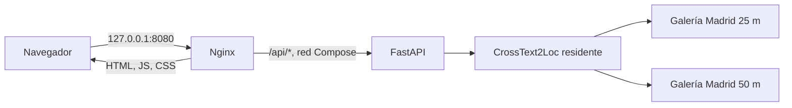

# MVP.3: despliegue integrado del MVP

## Arquitectura final

MVP.3 sirve el frontend compilado mediante Nginx y mantiene FastAPI únicamente
en la red de Docker Compose. El navegador utiliza un solo origen HTTP.



La API no publica ningún puerto en el host. Nginx es el único punto de entrada y
redirige `/api/` a `api:8000`. Uvicorn ejecuta un worker y carga una sola
instancia de `CrossText2LocRetriever` durante el lifespan.

## Requisitos

- Host Linux ARM64 con Docker, Docker Compose y NVIDIA Container Toolkit.
- GPU NVIDIA compatible con la imagen API. El entorno validado es una GB10.
- Imagen local `crosstext2loc-gb10:ngc26.02`.
- Clon de CVG-Text en `external/CVG-Text` mediante el procedimiento del proyecto.
- Checkpoint CrossText2Loc y pesos CLIP fuera de Git.
- Catálogos, imágenes visuales y embeddings canónicos de 25 m y 50 m.

La imagen API se reutiliza; el arranque no descarga datos, no renderiza OSM y no
recalcula embeddings.

## Artefactos externos

`scripts/run_mvp3_stack.sh` comprueba antes del arranque todas las rutas de
`config/madrid_f46_retriever.json`. Entre ellas se encuentran:

- `checkpoints/CrossText2Loc/long_model_NewYork-mixed_1e-05_128_osm_epoch30_59.08.pth`;
- `data/processed/catalog/manifest-25m.json` y `manifest-50m.json`;
- los dos bundles visuales inmutables declarados en la configuración;
- los dos bundles de embeddings inmutables declarados en la configuración;
- `external/CVG-Text/utils.py`;
- `$HOME/.cache/clip/ViT-L-14-336px.pt`.

Para ubicar la caché CLIP en otro directorio, definir `MVP_CLIP_CACHE_DIR`. El
directorio se monta en solo lectura y no se copia a las imágenes Docker.

## Configuración

`.env.mvp.example` enumera las variables admitidas. Docker Compose lee `.env`,
pero ese archivo está excluido de Git. Los valores principales son:

| Variable | Valor predeterminado | Función |
|---|---|---|
| `MVP_BIND_HOST` | `127.0.0.1` | Dirección publicada por Nginx |
| `MVP_HTTP_PORT` | `8080` | Puerto HTTP del frontend |
| `MVP_API_IMAGE` | `crosstext2loc-gb10:ngc26.02` | Imagen API ARM64/GPU |
| `MVP_CLIP_CACHE_DIR` | `$HOME/.cache/clip` | Directorio host de pesos CLIP |
| `VITE_TILE_URL` | endpoint público OSM | Plantilla Leaflet compilada |
| `VITE_TILE_ATTRIBUTION` | atribución OSM | Atribución visible del mapa |

La URL de teselas es una variable de compilación. Cambiarla requiere reconstruir
el frontend. El endpoint público predeterminado solo se usa para desarrollo
local y no autoriza precarga, descarga masiva ni un servicio público sostenido.

## Construcción y arranque

Desde la raíz:

```bash
scripts/run_mvp3_stack.sh
```

El comando realiza el preflight y equivale a:

```bash
docker compose -f compose.mvp.yaml up --build
```

Para segundo plano:

```bash
scripts/run_mvp3_stack.sh -d
```

Abrir:

```text
http://127.0.0.1:8080/
```

Si el puerto está ocupado:

```bash
MVP_HTTP_PORT=18080 scripts/run_mvp3_stack.sh -d
```

## Healthchecks

- API: `GET /api/v1/health/ready` desde la red Compose. Solo devuelve 200 cuando
  el modelo y ambas galerías están cargados.
- Frontend: `GET /healthz` sobre Nginx.
- Liveness API: `GET /api/v1/health/live`, accesible mediante el proxy.

Comprobación desde el host:

```bash
curl http://127.0.0.1:8080/healthz
curl http://127.0.0.1:8080/api/v1/health/live
curl http://127.0.0.1:8080/api/v1/health/ready
```

Readiness no repara ni recarga el checkpoint. Un error de integridad o de GPU
aborta el proceso API y evita que el frontend alcance el estado saludable.

## Estado y logs

```bash
docker compose -f compose.mvp.yaml ps
docker compose -f compose.mvp.yaml logs api
docker compose -f compose.mvp.yaml logs frontend
```

Los logs permiten distinguir construcción de imágenes, inicialización del
runtime, readiness, errores de integridad y fallos CUDA. Las respuestas HTTP no
incluyen trazas, rutas internas ni detalles CUDA; esos datos permanecen en logs
locales del operador.

## Parada

```bash
docker compose -f compose.mvp.yaml down
```

No se necesita ni se debe usar `down -v`. El stack no crea volúmenes con los
pesos o galerías; los artefactos se montan en solo lectura.

## Acceso LAN opcional

El acceso LAN está desactivado por defecto. En una red autorizada y temporal:

```bash
MVP_BIND_HOST=0.0.0.0 MVP_HTTP_PORT=8080 scripts/run_mvp3_stack.sh -d
```

Después se abre `http://IP_LOCAL:8080/`. `/api` continúa usando el mismo origen
y el proxy interno. No se modifican reglas de firewall automáticamente. Esta
configuración no debe exponerse directamente a Internet: el MVP no implementa
TLS, autenticación, rate limiting ni endurecimiento para un servicio público.

## Pruebas

### Smoke integrado real

```bash
MVP_HTTP_PORT=18080 scripts/smoke_mvp3_stack.sh
```

El script:

1. construye y arranca el stack;
2. espera los dos healthchecks;
3. comprueba un único proceso Uvicorn con `--workers 1`;
4. ejecuta Top-5 real en 50 m y Top-3 real en 25 m por Nginx;
5. comprueba coordenadas y repetibilidad exacta;
6. valida errores 422 y 404;
7. ejecuta Chromium ARM64 con API simulada;
8. ejecuta Chromium ARM64 contra Nginx, FastAPI y la GPU reales;
9. ejecuta `down` sin borrar volúmenes y comprueba que no queden contenedores.

La evidencia JSON local queda en
`results/generated/mvp3/stack-smoke.json`, una ruta excluida de Git.

### Navegador ARM64

El perfil `test` construye `frontend/Dockerfile.browser` sobre Debian ARM64 e
instala Chromium dentro de esa imagen. No modifica el sistema operativo host.

```bash
docker compose -f compose.mvp.yaml --profile test build browser-check
docker compose -f compose.mvp.yaml --profile test run --rm browser-check npm run test:browser
docker compose -f compose.mvp.yaml --profile test run --rm browser-check npm run test:browser:real
```

La primera prueba utiliza una API simulada y verifica contrato UI, selectores,
Leaflet, selección tarjeta-marcador, responsive y ausencia de datos ficticios.
La segunda recorre navegador, Nginx, FastAPI, CrossText2Loc y GPU reales.

### Regresión

```bash
.venv-geo/bin/python -m unittest discover -s tests -p 'test_*.py'
npm --prefix frontend test
npm --prefix frontend run build
```

## Validación realizada en la PGX

El 19 de octubre de 2026 se ejecutaron en la PGX ARM64/GB10:

- 294 tests Python con `unittest discover`: PASS;
- 7 tests específicos de API MVP.1: PASS;
- 8 tests Node del frontend: PASS;
- build Vite: PASS;
- validación de `compose.mvp.yaml`: PASS;
- browser-check con API simulada en Chromium 155 ARM64: PASS;
- browser-check real Nginx → FastAPI → CrossText2Loc GPU: PASS;
- Top-5 de la galería 50 m: cinco candidatos y marcadores válidos;
- Top-3 de la galería 25 m: tres candidatos y marcadores válidos;
- repetición idéntica en IDs, orden, scores y coordenadas: PASS;
- errores 422, 404, `RUNTIME_BUSY`, cancelación y guard de respuesta obsoleta:
  PASS entre smoke HTTP, browser-check y tests Node;
- un worker Uvicorn y una instancia de runtime: comprobados;
- shutdown y ausencia de contenedores residuales: PASS.

`pytest` no es el runner reproducible configurado por el repositorio en esta PGX:
los entornos de API y geoespacial están separados. La suite completa se ejecutó
con el runner `unittest` documentado y las dependencias geoespaciales de
`.venv-geo`.

## Diagnóstico

- **Puerto ocupado:** cambiar `MVP_HTTP_PORT`; no detener servicios ajenos.
- **API no saludable:** revisar `docker compose ... logs api`, GPU, checkpoint,
  pesos CLIP, clon externo y bundles configurados.
- **Frontend saludable pero `/api` devuelve 502:** la API no está disponible en
  la red Compose; revisar su contenedor y readiness.
- **`RUNTIME_BUSY`:** esperar a que termine la inferencia activa. El MVP rechaza
  una segunda consulta y no crea una cola externa.
- **Teselas ausentes:** el ranking y los marcadores siguen operativos sobre el
  fondo neutro; revisar URL, red y atribución del proveedor.
- **Chromium no arranca:** reconstruir el servicio `browser-check`; no asumir que
  una imagen amd64 funciona en ARM64.

## Limitaciones

Este despliegue demuestra integración técnica local. No demuestra precisión
geográfica en Madrid. El checkpoint fue preentrenado en Nueva York; las
descripciones españolas y el render OSM de Madrid no cuentan todavía con una
evaluación formal basada en referencias independientes validadas.
