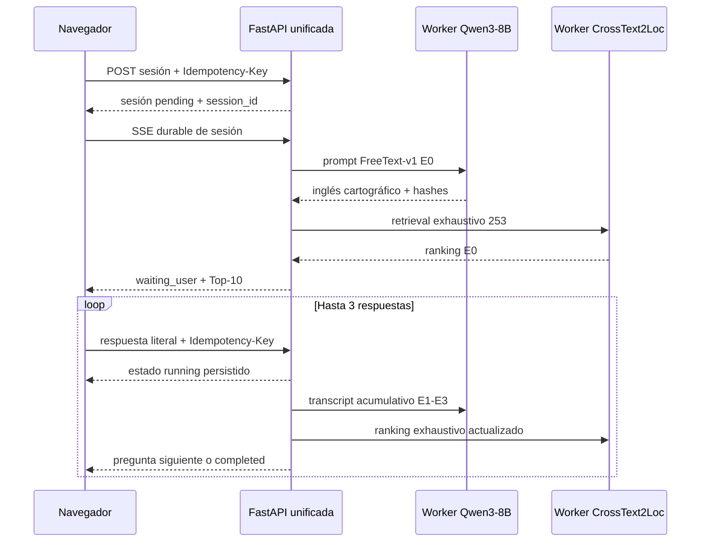

# Integración DialogueVPR en el MVP MapLibre

## Estado implementado

La rama MapLibre conserva mapa, PMTiles, 3D, resultados y SSE. Se añade una capa
mínima de sesiones DialogueVPR:

- selector de modo oficial o exploratorio;
- selector HXX y hash de la descripción congelada;
- imagen original hash-verificada;
- entrada manual de la descripción;
- pregunta actual y respuesta literal;
- persistencia atómica y reanudación por `session_id`;
- bloqueo de H26 ya completado;
- separación de consultas exploratorias mediante prefijo `X-`.

La API no devuelve rankings, scores, coordenadas o GT al formulario humano. El
documento interno persistido sí puede contener el estado científico completo
devuelto por el ejecutor: ES/EN, rankings completos, claims, tiempos, hashes,
configuración y motivo de parada.

## Persistencia

Cada sesión se escribe incrementalmente en:

```text
${ATLAS_DIALOGUE_SESSION_ROOT}/dialogue-<uuid>/session.json
```

La escritura es atómica y cada revisión incluye `session_sha256`. Un GET de la
sesión no repite inferencias. La raíz debe ser un volumen persistente y privado;
no debe servirse por Nginx.

Cada sesión oficial requiere un documento
`atlas-dialogue-session-authorization-v1` ligado a un único HXX. Autoriza como
máximo tres preguntas, tres cargas/llamadas Qwen y tres CT2L, cero retries,
`stable-swap-v2`, sin red, GT, referencias de evaluación, VLM o H38–H61. No se
reutiliza para otra sesión ni para consultas exploratorias.

Las autorizaciones oficiales se montan como directorio y siguen el nombre
`dialogue_<hxx>_session_authorization.request.json`. El backend selecciona por
`query_id`, comprueba todos los hashes en cada inicio y detecta consumo mediante
la sesión persistida. No hace falta reiniciar entre HXX ni después de editar un
documento dentro del bind mount. Una HXX con cualquier sesión oficial persistida
no puede volver a iniciarse.

El catálogo expone `pending`, `authorized`, `consumed`, `missing` o `invalid`,
además del texto oficial. El frontend no habilita Inicio si el estado no es
`authorized`. Una parada contractual terminal permite seleccionar la siguiente
HXX; un estado `failed` queda consumido y exige revisión técnica.

## Runtime secuencial integrado en PGX

El modo `dialogue-only` ejecuta una API ligera sin Qwen ni CT2L residentes. Cada
ronda lanza primero un proceso efímero Qwen3-8B y, después de su cierre, un
proceso efímero CT2L sobre los 253 candidatos. El supervisor aplica
`stable-swap-v2` antes de cada carga, no hace retries y conserva requests,
outputs, logs y gates dentro de la sesión.

`ATLAS_DIALOGUE_ENABLED=false` sigue siendo el valor predeterminado. Para una
campaña autorizada se requieren:

1. revisar una autorización por sesión que fije HXX, máximo tres turnos, una
    carga/llamada por modelo y ronda, `stable-swap-v2`, cero retries y outputs;
2. montar la cohorte congelada como `/dialogue-inputs/cohort.json`;
3. montar las imágenes originales como `/dialogue-images:ro`;
4. montar `/dialogue-sessions:rw` en almacenamiento persistente;
5. mantener H38–H61 fuera del catálogo.

La sesión y la autorización consumida se persisten antes de arrancar el primer
worker. Cada respuesta humana se persiste antes de continuar. Si un worker falla,
la sesión queda `failed` con `runtime_error_no_retry`: una recarga permite
inspeccionarla, pero no repite inferencia ni reanuda automáticamente.

## Assets MapLibre verificados en PGX

Los cinco archivos están presentes y fueron validados contra manifest y sidecar:

| Archivo | SHA-256 |
|---|---|
| `map-assets.json` | `3ee4d7622483941e0e9992fbc17162a889a9c095d50615a5bc74d8cbf5cdb76b` |
| `cells-25m.geojson` | `4ad0cfd9551e058fb963bf302075956ce95ca66159caef496d963bdf52de30ae` |
| `cells-50m.geojson` | `b720962e3a183c5acba98ff02a4a4b2198db53e0fc88dcf49c198e35022c8ed2` |
| `madrid.pmtiles` | `b267ebc4bb8de10e0ec0c7e6ba024793cb5ce0bc11dfb951cd6d9fe25541e093` |
| `madrid.pmtiles.provenance.json` | `e4c1c086e7493169bafcbebca03f1623770ae5868b24f5b8f27055d164046112` |

No regenerar estos assets si la copia original está disponible.

## Evaluación posterior

Al completar H26, H27, H28, H29, H31, H33, H36 y H37:

1. bloquear nuevas escrituras y congelar cada `session.json` por hash;
2. validar el denominador completo y los rankings de cada ronda;
3. abrir las referencias solo después del freeze;
4. ejecutar la comparación R/E y las métricas Recall@K, GeoRecall@K, distancias,
   rank y cambios entre rondas;
5. tratar rondas como medidas repetidas, no consultas independientes.

La evaluación no forma parte del endpoint interactivo y no usa GT durante
inferencia o selección de preguntas.

Los rankings completos permanecen únicamente en el documento interno persistido;
la respuesta pública del navegador contiene pregunta actual, estado y hashes, no
scores o coordenadas. Al congelar la cohorte se exportarán los estados internos a
un manifest de evaluación content-addressed y se aplicarán los evaluadores ya
existentes sin reabrir o editar sesiones.

## Política adaptativa experimental

`post-final-answer-retrieval-v1` es una política nueva y separada. No modifica ni
reinterpreta las sesiones oficiales. Sus componentes son:

- parser `deterministic-structured-answer-v1` para polaridad y observaciones
  adicionales;
- observaciones con entidad, polaridad, incertidumbre, nombre, dirección
  egocéntrica, distancia y evidencia literal;
- selector `deterministic-grounded-hybrid-v1`, que filtra intenciones usadas
  antes de ordenar alternativas;
- preguntas cerradas, abiertas espaciales y aclaraciones, siempre con grounding
  explícito y auditoría de descartes;
- recuperación opcional E3 después de A3 cuando existe información nueva y
  elegible;
- máximo tres preguntas humanas y cuatro llamadas Qwen/CT2L;
- cero retries, `stable-swap-v2`, sin GT, VLM o H38–H61.

Las relaciones izquierda/derecha/delante/detrás se conservan como relaciones
visuales egocéntricas; nunca se convierten en puntos cardinales sin orientación
fiable. F3 fundamenta presencia positiva por hipótesis, no visibilidad, ausencia
ni orientación del observador.

La política solo admite sesiones exploratorias y requiere
`atlas-dialogue-adaptive-authorization-v1`. La solicitud incluida permanece
`PENDING_OPERATOR_AUTHORIZATION`; por tanto, la UI la muestra pero no permite
iniciarla. El modo oficial continúa usando el contrato v1 y la parada previa a
EN3/E3.
# MVP operativo FreeText-v1

La política de producto `dialogue-vpr-freetext-v1-operational` acepta una
descripción española libre y no depende de cohortes, imágenes o respuestas
pregrabadas. Está separada de los pilotos históricos y de la candidata medium
provisional, que permanece deshabilitada.

## Flujo unificado



Qwen y CT2L se ejecutan secuencialmente mediante workers efímeros. En modo
FreeText operacional el lifespan no mantiene ambos modelos residentes. Los
rankings completos de 253 candidatos permanecen en la sesión; la API pública
expone Top-10 por etapa para MapLibre.

## Contratos operativos

- Política: `dialogue-vpr-freetext-v1-operational`, versión 1.0.0.
- Entrada: descripción española arbitraria, 3-2400 caracteres.
- Etapas: E0-E3; máximo tres preguntas.
- Preguntas: selector determinista FreeText-v1.
- Transcript: literal, cronológico y acumulativo.
- Retries: cero.
- GT, referencias, VLM y H38-H61: prohibidos.
- `Idempotency-Key`: obligatorio en creación y respuestas.
- Una reserva incierta no se reinfiere automáticamente.

## Progreso y recuperación

La sesión persiste eventos antes de publicarlos. Cada evento contiene
`session_id`, `event_id`, `stage`, `status`, `timestamp`, `message` y `error`.
Estados: `pending`, `running`, `waiting_user`, `completed`, `failed`, `unknown`.

Rutas:

- `GET /api/v1/dialogue-freetext/sessions/{id}/events`
- `GET /api/v1/dialogue-freetext/sessions/{id}/events/stream?follow=true`

SSE admite `Last-Event-ID`; ante desconexión, el frontend reconcilia con GET sin
repetir POST. Tras reinicio, una sesión `running` sin evidencia terminal pasa a
`unknown` y no se reintenta.
