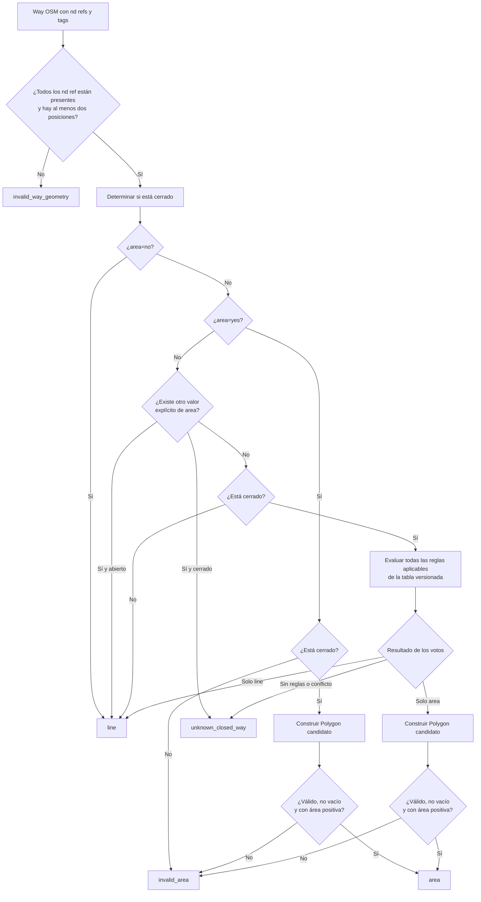

# Política de interpretación geométrica de OSM ways

## Estado

Este documento especifica la política `way_is_area-v1`, aceptada en D049, para
interpretar la geometría de los ways de OpenStreetMap durante la Fase 3. La
política está cerrada documentalmente, pero **Fase 3 todavía no está
implementada**.

El objetivo es evitar la inferencia incorrecta `closed way = Polygon`. Un way
cerrado puede representar un área, una línea cerrada o un caso cuya semántica no
puede determinarse con las reglas disponibles.

## Resultado de la clasificación

`way_is_area-v1` devolverá uno de estos estados:

| Estado | Significado |
|---|---|
| `line` | El way debe tratarse como geometría lineal. |
| `area` | Existe intención areal inequívoca y puede construirse un Polygon válido, no vacío y de área positiva. |
| `unknown_closed_way` | El way está cerrado, pero las reglas no permiten decidir de forma trazable entre línea y área. |
| `invalid_area` | Existe intención areal, pero no puede construirse un Polygon válido. |
| `invalid_way_geometry` | Faltan referencias o posiciones suficientes para construir la geometría del way. |

Una geometría inválida no constituye ambigüedad semántica. Por eso
`invalid_area` y `unknown_closed_way` se mantienen separados.

## Flujo de decisión



Un valor explícito de `area` distinto de `yes` o `no` nunca se tratará como
ausencia ni como `area=yes`. En un closed way producirá `unknown_closed_way`; en
un way abierto la geometría será `line` y se conservará el diagnóstico
`unrecognized_area_value`.

## Fuente de reglas congelada

La tabla aprobada en D049 es una copia exacta e inmutable de:

```text
repository: https://github.com/tyrasd/osm-polygon-features
release: v0.9.2
commit: 069a46416629ddbe84390c7a3ccc600fe73ee706
file: polygon-features.json
size: 2753 bytes
sha256: cf81018ba820557c59c2c27de7ea6b314009abed040cd11249e94ed1a3a10583
license: CC0-1.0
```

El recurso se conserva en
`third_party/osm-polygon-features/v0.9.2/`. F3 verificará su hash y lo consumirá
offline. No descargará reglas durante la generación.

### Semántica de la tabla

- `polygon=all`: un valor distinto de `no` produce voto `area`.
- `polygon=whitelist`: un valor incluido produce voto `area`; un valor no
  incluido y distinto de `no` produce voto `line`.
- `polygon=blacklist`: un valor excluido produce voto `line`; cualquier otro
  valor distinto de `no` produce voto `area`.
- Una clave ausente de la tabla no produce voto.
- Un valor `no` distinto de `area=no` no produce voto por sí mismo.

La ausencia de una clave en la tabla no demuestra semántica lineal. La política
solo devuelve `line` desde la tabla cuando existe una exclusión determinada por
una whitelist o blacklist y no coexiste un voto areal.

## Algoritmo `way_is_area-v1`

1. Validar que todos los `nd ref` estén presentes.
2. Si faltan referencias o hay menos de dos posiciones utilizables, devolver `invalid_way_geometry`.
3. Determinar `closed = first_ref == last_ref`.
4. Si `area=no`, devolver `line`, esté cerrado o no.
5. Si `area=yes` y el way no está cerrado, devolver `invalid_area`; no convertirlo silenciosamente en línea.
6. Si `area=yes` y está cerrado, construir el Polygon candidato.
7. Si ese Polygon es válido, no está vacío y tiene área positiva, devolver `area`.
8. Si el Polygon no es válido, devolver `invalid_area`; no aplicar `buffer(0)`, `make_valid` ni fallback a línea en v1.
9. Si no existe `area=*` y el way no está cerrado, devolver `line`.
10. Si existe otro valor explícito de `area`, por ejemplo un valor no reconocido, devolver `unknown_closed_way` cuando esté cerrado; no tratarlo como ausencia.
11. Si está cerrado y no tiene `area=*`, evaluar todas las reglas aplicables de la tabla versionada.
12. Aplicar la semántica `all`, `whitelist` y `blacklist` fijada en la sección anterior a todas las parejas clave-valor.
13. Si las reglas aplicables producen exclusivamente voto areal, construir y validar el Polygon.
14. Si el Polygon es válido, no está vacío y tiene área positiva, devolver `area`.
15. Si la intención es areal pero el Polygon falla, devolver `invalid_area`.
16. Si las reglas producen exclusivamente voto lineal, devolver `line`.
17. Si no hay reglas aplicables, devolver `unknown_closed_way`.
18. Si hay votos areal y lineal, devolver `unknown_closed_way` con conflicto explícito; el orden de los tags nunca lo resuelve.
19. Un `unknown_closed_way` puede conservar su secuencia y bbox para diagnóstico, pero no debe producir asociaciones base: tratarlo como área inventaría un interior y tratarlo como línea inventaría una semántica lineal.
20. No heredar tags ni semántica areal de una relation incompleta a sus member ways.

## Casos ambiguos

Los siguientes casos deben producir `unknown_closed_way`:

- closed way sin tags;
- tags no cubiertos por la tabla;
- valor de `area` distinto de `yes` o `no`;
- múltiples tags que generan votos incompatibles;
- tags que la tabla marque como dependientes del valor sin una regla para ese valor;
- tags de ciclo de vida como `disused:*` o `construction:*` no cubiertos explícitamente;
- member de multipolygon sin tags, porque F3 no reconstruye la relation;
- combinaciones de tags con votos areal y lineal simultáneos;
- combinación areal y `barrier=*` cuando distintas reglas discrepen;
- cualquier caso en que clasificar como área dependa de una interpretación local no respaldada.

Un `unknown_closed_way` no producirá asociaciones geométricas base. Permanecerá
en el inventario de objetos con estado explícito para permitir diagnóstico y una
regeneración posterior con otra versión de las reglas.

## Restricciones de la versión inicial

- No asumir `closed == polygon`.
- No inventar una lista local de tags areales o lineales sin trazabilidad.
- No reparar geometrías automáticamente.
- No degradar un área inválida a línea.
- No construir geometrías de relations incompletas.
- No consultar la red para completar objetos o aplicar las reglas.
- No utilizar la clasificación para scoring semántico.

## Relations y multipolygons

F2 conserva las relations como contexto sin clausura completa. F3 no construirá
su geometría ni consultará la red para completarlas. Tampoco heredará sus tags o
semántica a los member ways. Un member sin tags seguirá siendo
`unknown_closed_way` aunque tenga role `outer` o `inner`.

## Limitaciones

`osm-polygon-features` v0.9.2 es una heurística comunitaria histórica congelada.
No es una norma oficial de OpenStreetMap, una definición universal de áreas ni
una representación necesariamente actual de toda la semántica OSM.

La release es de 2016, su mantenimiento actual es limitado y la tabla se declara
incompleta. Algunas reglas, como `barrier=wall`, fueron cuestionadas
posteriormente en upstream. La política conserva los bytes originales y no
corrige silenciosamente esas reglas. La resolución conservadora de conflictos
es una adaptación propia del TFG. Una versión futura puede cambiar las
clasificaciones y asociaciones, por lo que exigirá otra versión del derivado.

## Diagnóstico del snapshot

La auditoría en memoria del snapshot F2 contabilizó 4.240 ways, de los cuales
3.287 estaban cerrados. La aplicación diagnóstica de `way_is_area-v1`, sin
generar F3, produjo:

| Resultado | Ways cerrados |
|---|---:|
| Área explícita por `area=yes` | 31 |
| Línea explícita por `area=no` | 0 |
| Área determinada por la tabla | 2.540 |
| Línea determinada por la tabla | 3 |
| `unknown_closed_way` sin regla | 710 |
| `unknown_closed_way` por conflicto | 3 |
| `invalid_area` detectado por comprobación local simple | 0 |

Los 710 casos sin regla incluyen 661 ways sin tags usados como members de
relations. La ausencia provisional de `invalid_area` no sustituye la futura
validación con la biblioteca geométrica fijada para F3.

## Condiciones de implementación

1. Verificar el SHA-256 de la tabla antes de procesar ways.
2. Registrar `way_is_area-v1`, la revisión de la tabla y las versiones de la
   biblioteca geométrica en provenance F3.
3. Validar la política con fixtures antes de generar el primer derivado F3.
4. Mantener el contrato global de F3 como una decisión posterior todavía sin
   identificador.
