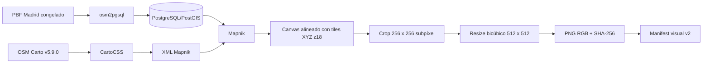

# F4: dataset visual y renderizado cartográfico de Madrid

## Alcance

F4.1a define contratos propios para relacionar candidatos F1, imágenes OSM,
futuros embeddings CrossText2Loc y resultados Top-K. No genera imágenes, no
carga checkpoints y no implementa recuperación.

Los artefactos F1, F2 y F3 permanecen inmutables. El dataset visual referencia
el manifest F1 mediante su identificador y SHA-256, y utiliza `candidate_id`
como clave primaria.

## Contratos

| Contrato | Schema | Propósito |
|---|---|---|
| Dataset visual | `schemas/f4_visual_manifest.schema.json` | Fuente, renderer, estilo, perfil, footprint, transformaciones e imágenes |
| Selección visual | `schemas/f4_visual_selection.schema.json` | Nueve candidatos fijos, roles espaciales y separación de evaluación |
| Fuente OSM | `schemas/f4_osm_source.schema.json` | Datos, provenance, cobertura, licencia y cierre |
| Renderer y estilo | `schemas/f4_renderer_provenance.schema.json` | Configuración, versión, estilo y manifests de assets/fuentes |
| Assets | `schemas/f4_assets_manifest.schema.json` | Hash, tamaño, origen y licencia de recursos cartográficos |
| Embeddings | `schemas/f4_embedding_manifest.schema.json` | Tensor `[N, 768]`, checkpoint, preprocesamiento y orden de filas |
| Recuperación | `schemas/f4_retrieval_result.schema.json` | Ranking exhaustivo texto-imagen sin ground truth |

Los validadores básicos se integran en `validate_document()`. Las invariantes
que requieren cruzar documentos o inspeccionar ficheros están en
`src/tfg_phase0/f4_validation.py`.

## Perfil experimental

El perfil corregido para F4.1b-A es:

```text
crosstext2loc-osm-z18-crop256-resize512-exp-v2
```

Su estado es `experimental_unconfirmed`. Registra un raster norte-arriba en
EPSG:3857, zoom 18, recorte de 256 x 256 píxeles nativos centrado con precisión
subpíxel en el candidato y salida PNG RGB 512 x 512 mediante interpolación
bicúbica. El preprocesamiento posterior previsto es el oficial de OpenAI CLIP
ViT-L/14@336.

El contrato distingue tres superficies:

- `request_bbox`: bbox real solicitada al renderer, ampliada hasta cubrir el
  crop completo de 256 píxeles z18;
- `source_mosaic_bbox`: extensión alineada con las teselas XYZ necesarias;
- `output_bbox`: footprint real del crop nativo de 256 píxeles a zoom 18.

`request_bbox` y `output_bbox` miden aproximadamente 152,874 m proyectados por
lado en esta versión. Los 67,2512 m calculados por el script upstream se
conservan en el perfil únicamente como evidencia de su procedimiento ambiguo;
no se usan para solicitar una fuente insuficiente.

Este perfil conserva explícitamente la limitación D007: el script upstream
calcula `img_crop`, pero guarda `img`. F4.1a no interpreta el perfil como una
reproducción confirmada de los raster de entrenamiento.

## Identidad e integridad

`visual_dataset_id` es content-addressed y se calcula sobre:

- versión del contrato y del generador;
- identidad y hash del manifest F1;
- perfil visual completo;
- fuente, renderer y estilo;
- registros ordenados de imágenes y sus hashes.

La serialización de identidad usa JSON UTF-8, claves lexicográficas, separadores
compactos y prohíbe NaN. Las rutas son lógicas y relativas. Los metadatos de una
imagen `generated` deben ser completos; los estados `failed` e
`insufficient_source` no pueden aparentar que existe un artefacto.

`embedding_dataset_id` aplica el mismo criterio content-addressed a la referencia
visual, modelo, checkpoint, preprocesamiento, matriz y orden de candidatos.

El manifest exige siempre los nueve registros de la selección, incluidos los
fallos o coberturas insuficientes con estado explícito. El primer render de
desarrollo actualizará solo su registro, sin publicar un manifest parcial.

`verify_visual_image_files()` comprueba localmente que cada imagen generada:

- permanece dentro de la raíz del dataset y no es un enlace simbólico;
- coincide con el SHA-256 declarado;
- tiene una estructura PNG completa, CRC válidos, `IDAT` descomprimible e
  `IEND` final sin bytes sobrantes;
- declara las dimensiones reales;
- usa RGB de 8 bits.

## Compatibilidad con F1

`load_verified_f1_50m()` reutiliza `load_verified_catalog()` y, por tanto,
comprueba schema, provenance, hash de configuración, cuadrícula regenerada,
orden, coordenadas y geometrías. F4.1a añade únicamente la condición provisional
de `spacing_m=50` y `cell_size_m=50`; no resuelve D003.

El validador visual exige que cada imagen corresponda a un candidato del F1
verificado y que latitud y longitud coincidan con su centro. No modifica ni
completa los campos `artifacts` del manifest original.

## Selección y cobertura

`config/madrid_f4_visual_fixture.json` fija nueve candidatos independientes de
texto y ground truth. El preflight de solo lectura se ejecuta con:

```bash
python scripts/preflight_f4_visual.py \
  --manifest data/processed/catalog/manifest-50m.json \
  --snapshot-dir data/raw/osm/snapshots/<osm_snapshot_id>
```

La cobertura se decide comprobando que `output_bbox` esté completamente
contenido en la bbox declarada por la fuente. Los nodos exteriores añadidos para
cerrar ways no amplían la cobertura válida.

La selección incluye cinco sondas interiores (`R0004_C0008`, `R0008_C0004`,
`R0008_C0008`, `R0008_C0012`, `R0013_C0008`) y cuatro de borde
(`R0001_C0001`, `R0004_C0016`, `R0008_C0001`, `R0016_C0008`). Con el snapshot
F2 actual, ocho están cubiertas y `R0004_C0016` necesita unos 43,329 m
proyectados adicionales al este.

Con F2, ocho candidatos están cubiertos y
`MADP_MADRID_PILOT_GRID_V1_GA467049559FD_S050_L050_R0004_C0016` requiere margen
adicional al este.

## Generación real F4.1b-B

### Por qué se necesitan imágenes OSM

F1 define las celdas candidatas y sus centros. F3 asocia geometrías y objetos
OSM a esas celdas, pero CrossText2Loc no consume directamente esas asociaciones:
su rama visual recibe imágenes cartográficas raster. Por ello F4 genera una
imagen OSM por `candidate_id` y mantiene separado este dataset derivado.

Las imágenes son la futura galería visual. F4.1c calculará sus embeddings una
sola vez y los almacenará asociados a `candidate_id`. En consulta, el encoder
textual producirá otro vector normalizado; el producto escalar entre vectores
normalizados —similitud coseno— permitirá ordenar exhaustivamente los candidatos
y devolver un Top-K con las coordenadas resueltas desde F1. F4.1b-B no calcula
embeddings, no ejecuta retrieval y no proporciona métricas de recuperación.

### Renderer utilizado

La ejecución real utiliza:

| Componente | Versión efectiva | Función |
|---|---|---|
| Mapnik | 3.1.0 | Convierte consultas geográficas y reglas de estilo en raster |
| OpenStreetMap Carto | v5.9.0, commit `491bd4a4675a94f3950ff45843d0c4696d8ae420` | Apariencia de calles, edificios, parques, etiquetas y símbolos |
| osm2pgsql | 1.11.0 | Importa el PBF OSM en el schema `pgsql` esperado por el estilo |
| PostgreSQL | 16.15 | Almacena las tablas de renderizado |
| PostGIS | 3.4.2 | Proporciona geometrías y consultas espaciales |
| CartoCSS | 1.2.0 | Compila `project.mml` a XML de Mapnik |
| Pillow | 10.2.0 | Crop subpíxel, resize bicúbico y PNG RGB |
| Contenedor | `sha256:70e20b64458b562342c9c9534151e7a6bf7dceffba23326bbda87cbc42f4d5b7` | Entorno Ubuntu 24.04 ARM64 aislado |

El Compose no publica puertos, no usa GPU y mantiene PostgreSQL en `tmpfs`.
El proyecto se monta en solo lectura; únicamente el clon OSM Carto, los
metadatos del renderer y la salida visual se montan con escritura.
No se despliega un servidor de tiles permanente. OSM Carto v5.9.0 fue la última
release identificada anterior al script CVG-Text publicado en julio de 2025.
Esta proximidad temporal no demuestra que sea el estilo exacto de entrenamiento.

La descarga histórica de las faces monocromas `Noto Emoji Regular/Bold` ya no
funciona. Se aplica el parche versionado
`docker/f4-osm-carto-arm64/osm-carto-v5.9.0-emoji-fallback.patch`, autorizado
para sustituir únicamente esas faces por `Noto Sans Symbols2 Regular` y
`Noto Sans Symbols Bold`. Es una desviación explícita del estilo upstream.

### Fuente cartográfica

La fuente independiente de F4 es el extracto Geofabrik Madrid resuelto como
`madrid-261014.osm.pbf`, fechado internamente el 14 de octubre de 2026:

```text
size: 85.306.514 bytes
sha256: 9ef85f5c728a26995712a835a68f0cb30e01a32af6d2a7facd6744f3a3840db8
bbox header: -4.589539,39.881157,-3.050423,41.168640
```

El extracto cubre holgadamente los nueve footprints, incluido el caso oriental
que F2 no cubría. F2 no se modifica ni se usa como base de render: su adquisición
estaba limitada a D004 y sus relations son parciales. La provenance completa de
la fuente F4 se materializa desde `config/madrid_f4_osm_source_provenance.json`.

Los datos OSM y los water/ice polygons están bajo ODbL 1.0; el dataset Natural
Earth usado por el estilo es dominio público; OSM Carto declara CC0 1.0. La
atribución OSM se conserva en el manifest. Las imágenes permanecen fuera de Git
y su eventual publicación requerirá revisar el paquete concreto.

### Pipeline ejecutado



Parámetros efectivos:

- coordenadas de candidato en WGS84;
- render y footprints en EPSG:3857;
- orientación norte arriba;
- zoom 18 y tile de 256 píxeles;
- resolución nativa `0,5971642834779395` m proyectados/píxel;
- footprint de salida `152,87405657035252` m proyectados por lado;
- crop nativo 256 x 256 centrado con offsets subpíxel;
- resize bicúbico a 512 x 512;
- salida PNG RGB.

La celda F1 mide 50 x 50 m, pero el raster representa un contexto mayor. La
celda define la unidad candidata; no define el footprint visual.

Mapnik renderiza un canvas continuo cuya bbox coincide con la unión de tiles
XYZ necesaria. No se descargan ni concatenan tiles HTTP individuales. Esta
elección conserva escala, orientación y alineación z18, pero la colocación de
etiquetas puede diferir del pipeline `contextily` y de los metatiles del servidor
OSM original.

### Resultado real

Se generaron nueve imágenes, una por candidato de la selección fija. Todas son
PNG RGB de 512 x 512, se decodifican completamente y contienen variación de
color no nula. El bundle local es:

```text
data/processed/visual/
  f4-madrid-visual-sha256-40ed367c74e29ab271308f1f2df0349b1fc423d8e64ba7dc19da60d7d40be915/
```

El candidato central se validó primero y obtuvo SHA-256:

```text
3043d9982aa62a80cc9aae99006b61d8693843f88eb26fd7a03c884196034667
```

Una segunda ejecución completa produjo el mismo `visual_dataset_id` y el
publicador comprobó igualdad byte a byte del árbol completo.

### Comandos reproducibles

La adquisición requiere red y solo debe repetirse tras revisar las políticas y
autorizarla explícitamente:

```bash
bash scripts/acquire_f4_render_inputs.sh
```

Construcción del entorno ARM64:

```bash
docker build --platform linux/arm64 \
  -f docker/f4-osm-carto-arm64/Dockerfile \
  -t tfg-f4-osm-carto-arm64:ubuntu24.04 .
```

Render de los nueve candidatos, sin red:

```bash
bash scripts/run_f4_osm_render.sh
```

Validación independiente:

```bash
./.venv-geo/bin/python scripts/validate_f4_visual_bundle.py \
  --bundle data/processed/visual/f4-madrid-visual-sha256-40ed367c74e29ab271308f1f2df0349b1fc423d8e64ba7dc19da60d7d40be915
```

El wrapper resuelve el ID de la imagen local y ordena a Compose ejecutar ese ID
exacto; el manifest no acepta un digest introducido independientemente del
runtime. Repetir el comando de render comprueba reproducibilidad: si el mismo ID ya
existe, el script compara cada fichero por SHA-256 y falla ante cualquier
diferencia.

El Dockerfile fija la base por digest y CartoCSS por versión, pero APT resuelve
los paquetes disponibles al construir. Por ello una reconstrucción futura puede
producir otro ID y debe considerarse otro entorno hasta validar de nuevo sus
versiones y raster.

## Límites para F4.1c

La ampliación de esta fixture o su distribución requiere conservar una fuente
con margen y los recursos del renderer y estilo con versiones, hashes y
condiciones de uso verificadas. D007, D013 y D016 permanecen abiertas; el
contrato y las imágenes no demuestran compatibilidad visual exacta,
transferencia zero-shot ni permiso de redistribución.

La fuente y el renderer ya se han materializado para este piloto, pero D007
permanece abierta: ni OSM Carto v5.9.0 ni el fallback tipográfico prueban
equivalencia exacta con las imágenes de entrenamiento. F4.1c deberá tratar la
galería como experimental, cargar el checkpoint solo tras las comprobaciones
previstas y separar sus resultados del protocolo oficial de Nueva York.

## Embeddings y recuperación F4.1c

F4.1c reutiliza las nueve imágenes sin ejecutar de nuevo Mapnik. El trabajo se
divide en dos recorridos:

```text
offline: bundle visual validado -> encoder de imagen -> matriz (9, 768)
online:  descripción -> encoder de texto -> similitud coseno -> Top-K
```

Ambos encoders pertenecen al mismo checkpoint CrossText2Loc provisional de
Nueva York. Se carga OpenAI CLIP `ViT-L/14@336px`, se amplía el contexto textual
a 300 posiciones como hace el código original y se exige que el checkpoint no
produzca claves ausentes ni inesperadas. Los PNG almacenados a 512 x 512 se
abren en RGB y pasan por el preprocesamiento oficial de CLIP, que produce la
entrada real del encoder de 336 x 336. No se aplica un resize manual alternativo.

### Artefacto offline

El bundle observado es:

```text
data/embeddings/
  f4-madrid-embeddings-sha256-9d721b9893e004b39a238c1b1e40ece8f865964e4555c82d2732ba9b066709eb/
    manifest.json
    embeddings/image_embeddings.npy
    embeddings/candidate_ids.jsonl
```

La matriz tiene forma `(9, 768)`, dtype `float32`, orden C, valores finitos y
filas normalizadas L2. `candidate_ids.jsonl` fija la correspondencia exacta de
cada fila con el orden del manifest visual. El manifest registra hashes de la
matriz, filas, checkpoint, pesos base CLIP, commits, preprocesamiento y entorno.

Checkpoint utilizado:

```text
long_model_NewYork-mixed_1e-05_128_osm_epoch30_59.08.pth
sha256: d0c2f684ec838fa22dc7e607f0f1dc790468aef6df050cf472720756c26da47d
```

Pesos base OpenAI CLIP:

```text
ViT-L-14-336px.pt
sha256: 3035c92b350959924f9f00213499208652fc7ea050643e8b385c2dac08641f02
```

### Recuperación online

La consulta se tokeniza mediante:

```python
clip.tokenize(text, context_length=300, truncate=True)
```

Después se normaliza el embedding textual y se calculan los nueve scores de una
vez:

```text
scores = image_embeddings @ text_embedding
```

Como ambas modalidades están normalizadas L2, el producto escalar equivale a
similitud coseno. Se ordena por score descendente y, en empate, por
`candidate_id` ascendente. La coordenada WGS84 se obtiene del manifest F1. El
score no se interpreta como probabilidad.

No se llama a `evaluate.py` ni a `cal_score()`: no se usa la coordenada real de
la consulta, no se seleccionan 100 vecinos geográficos y se evalúan siempre las
nueve filas de la galería antes de recortar Top-K.

### Comandos reales

Generación offline:

```bash
bash scripts/run_f4_crosstext2loc.sh embed \
  --visual-bundle /workspace/project/data/processed/visual/f4-madrid-visual-sha256-40ed367c74e29ab271308f1f2df0349b1fc423d8e64ba7dc19da60d7d40be915 \
  --catalog-manifest /workspace/project/data/processed/catalog/manifest-50m.json \
  --selection /workspace/project/config/madrid_f4_visual_fixture.json \
  --region-config /workspace/project/config/madrid.yaml \
  --checkpoint /workspace/project/checkpoints/CrossText2Loc/long_model_NewYork-mixed_1e-05_128_osm_epoch30_59.08.pth \
  --clip-weights /root/.cache/clip/ViT-L-14-336px.pt \
  --cvg-text-root /workspace/project/external/CVG-Text \
  --device cuda --output-root /artifacts
```

Consulta reutilizando la matriz:

```bash
bash scripts/run_f4_crosstext2loc.sh rank \
  --visual-bundle /workspace/project/data/processed/visual/f4-madrid-visual-sha256-40ed367c74e29ab271308f1f2df0349b1fc423d8e64ba7dc19da60d7d40be915 \
  --catalog-manifest /workspace/project/data/processed/catalog/manifest-50m.json \
  --selection /workspace/project/config/madrid_f4_visual_fixture.json \
  --region-config /workspace/project/config/madrid.yaml \
  --checkpoint /workspace/project/checkpoints/CrossText2Loc/long_model_NewYork-mixed_1e-05_128_osm_epoch30_59.08.pth \
  --clip-weights /root/.cache/clip/ViT-L-14-336px.pt \
  --cvg-text-root /workspace/project/external/CVG-Text \
  --device cuda \
  --embedding-bundle /artifacts/f4-madrid-embeddings-sha256-9d721b9893e004b39a238c1b1e40ece8f865964e4555c82d2732ba9b066709eb \
  --query-id ejemplo --text "Una plaza urbana" --language es --k 5
```

Las consultas de desarrollo realizadas no constituyen evaluación: no hay
ground truth independiente ni se calcula Recall@K. Una consulta repetida produjo
los mismos candidatos y scores; los tiempos se conservan como telemetría
operacional y pueden variar.
