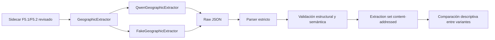

# F5.3: extracción geográfica estructurada

## Estado y alcance

F5.3 implementa y valida técnicamente un extractor desacoplado que transforma
variantes F5.1/F5.2 en JSON geográfico con evidencia textual. Se ejecutó
Qwen3-8B real en la GB10.

Resultado de cierre:

| Componente | Estado |
|---|---|
| Interfaz `GeographicExtractor` | Implementada |
| JSON Schema F5.3 | Implementado y validado |
| Parser JSON sin reparaciones silenciosas | Implementado |
| Validación estructural/semántica | Implementada |
| Provenance e identidad content-addressed | Implementadas |
| Comparación descriptiva entre variantes | Implementada |
| Smoke fake de 10 casos | 10/10 válidos |
| Inferencia Qwen real | Ejecutada |
| Cumplimiento contractual Qwen | Insuficiente: máximo 1/10 válido |
| Uso automático de extracciones | **No validado / bloqueado** |
| Accuracy geográfica | No disponible |

F5.3 no implementa preselección OSM, filtrado, reranking, fusión, diálogo, VLM,
Street View, TOLoc ni fine-tuning. No modifica el MVP.

Validación observada: 14 tests específicos F5.3, smoke fake 10/10, 335 tests
Python totales, 8 tests Node, build Vite, schemas F5.3 y readiness del MVP.

## Arquitectura



La interfaz es:

```python
extract(
    text: str,
    language: str,
    protected_toponyms: list[str],
    config: ExtractionConfig,
) -> ExtractionResult
```

Implementaciones:

- `QwenGeographicExtractor`, que reutiliza una instancia
  `QwenTransformersAdapter` ya cargada;
- `FakeGeographicExtractor`, exclusivo de tests y smoke técnico.

No se carga CrossText2Loc durante la extracción.

## Contratos

| Artefacto | Schema |
|---|---|
| Conjunto de extracciones | `schemas/f5_geographic_extraction_set.schema.json` |
| Comparación entre variantes | `schemas/f5_geographic_extraction_comparison.schema.json` |

El conjunto referencia el sidecar por `dataset_id`, SHA-256 y ruta lógica. Cada
record conserva `source_query_id`, `derivation_group_id`, partición, variante,
idioma, texto exacto, topónimos protegidos, raw outputs, prompt, duración,
extracción, validación y provenance Qwen.

Los artefactos se publican bajo:

```text
results/generated/f5/f53/<extraction_set_id>/extractions.json
results/generated/f5/f53/<comparison_id>/comparison.json
```

Permanecen fuera de Git.

## Entidades y atributos

Tipos iniciales:

```text
street, road, intersection, square, park, building, church,
station, bridge, river, monument, other, unknown
```

Cada entidad contiene ID local, tipo, nombre opcional, negación, atributos y
evidencia. Cada atributo tiene su propio ID para poder referenciar una negación.

No se añaden coordenadas, OSM IDs, distancias numéricas ni candidate IDs.

## Relaciones

Predicados:

```text
near, next_to, inside, between, in_front_of, behind,
left_of_observer, right_of_observer,
north_of, south_of, east_of, west_of, intersects, unknown
```

Las referencias usan `observer` o IDs de entidades existentes. `between` exige
dos objetos; si el texto menciona más, debe registrarse una ambigüedad. Las
relaciones egocéntricas usan frame `egocentric` y no se convierten a cardinales.

## Negaciones

Una negación se representa dos veces de forma coherente:

1. `negated: true` en entidad, relación o atributo;
2. una entrada en `negations` con `target_kind` y `target_id`.

El validador exige igualdad exacta entre ambos conjuntos. Por ejemplo, «No hay
ningún parque» no se convierte en evidencia positiva de parque.

## Orientación

`observer_orientation` distingue:

- `unknown`;
- `reported` por el usuario;
- `verified` en el contrato, pero prohibido para el modelo textual durante
  validación semántica.

Una relación `north_of` entre dos entidades no implica que el observador mire al
norte. Izquierda/derecha permanecen egocéntricas.

## Evidencia textual

Cada entidad, atributo, relación y negación debe incluir:

```json
{
  "text": "Plaza Mayor",
  "span": {"start": 15, "end": 27},
  "support": "explicit"
}
```

Los offsets se calculan sobre el texto exacto de la variante; `start` es
inclusivo y `end` exclusivo. El validador comprueba literalmente:

```text
input_text[start:end] == evidence.text
```

No se asume que los offsets de una traducción correspondan al español original.

## Ambigüedad

Se registran:

- referente ambiguo;
- relación incompleta;
- tipo de entidad incierto;
- información insuficiente;
- otros casos documentados.

No se fuerza una interpretación única. Una descripción sin contenido geográfico
debe producir una ambigüedad `insufficient_information`, no inventar objetos.

## Prompt e inferencia

Versión:

```text
f53-geographic-extraction-v1
```

Configuración:

```text
Qwen/Qwen3-8B
revision: b968826d9c46dd6066d109eabc6255188de91218
do_sample: false
temperature: 0
seed: 0
enable_thinking: false
max_new_tokens: 512 en el smoke real
max_attempts: 1 o 2 explícitos
```

El prompt no contiene ground truth, candidatos, coordenadas ni OSM. Solicita solo
JSON. Si falla, se conserva el raw output. El reintento incluye códigos de error
y está limitado a un intento adicional. No se corrigen spans ni semántica de
forma silenciosa.

## Validación

### Estructural

- JSON válido y raíz objeto;
- campos cerrados y tipos permitidos;
- IDs únicos;
- referencias existentes;
- aridad de relaciones;
- spans bien formados;
- negaciones y ambigüedades con forma válida;
- hashes de raw outputs e identidad content-addressed.

### Semántica

- evidencia literal y span exacto;
- topónimos protegidos presentes;
- índice de negaciones coherente;
- orientación no inventada;
- frame cardinal/egocéntrico correcto;
- ausencia de coordenadas/distancias numéricas no permitidas;
- aviso cuando no hay información geográfica.

Las heurísticas no garantizan corrección semántica y toda extracción exige
revisión humana.

## Comparación entre variantes

Los IDs locales pueden cambiar entre variantes. Por ello, las comparaciones usan
firmas semánticas:

- entidad: tipo, nombre normalizado y negación;
- relación: firma de sujeto, predicado, objetos, negación y frame;
- negación: clase de objetivo y firma del objetivo.

Se registran entidades/relaciones comunes, omitidas y añadidas, Jaccard,
topónimos conservados, negaciones, cambio de orientación, contradicciones
potenciales, advertencias y latencias.

Estas métricas miden consistencia entre extracciones, no exactitud sin anotaciones
de referencia.

## Smoke fake

```bash
.venv-geo/bin/python scripts/smoke_f53_fake.py
```

Resultado:

```text
casos: 10
válidos: 10
technical_fake_only: true
accuracy_available: false
```

Incluye plaza/topónimo, parque/avenida, intersección, negación, cardinal,
izquierda, orientación desconocida, topónimo ambiguo, tres entidades y texto sin
geografía. El smoke no valida Qwen.

## Smoke real Qwen3-8B

Se realizaron tres campañas sobre diez sondas técnicas development sin ground
truth:

| Campaña | Configuración | Válidas | Rechazadas | Resultado principal |
|---|---|---:|---:|---|
| Inicial | 1 intento | 1 | 9 | Spans y referencias incorrectos |
| Reintento | hasta 2 intentos | 0 | 10 | El reintento no corrigió offsets/contrato |
| Prompt con mapa índice-caracter | 1 intento | 0 | 10 | Persistieron spans/formato; 2 JSON inválidos |

Errores observados:

- `evidence_span_mismatch`;
- `invalid_negation` y `negation_index_mismatch`;
- `unknown_relation_reference`;
- `invalid_relation` y `cardinal_frame_mismatch`;
- `between_requires_two_objects`;
- `invalid_ambiguity`;
- `invalid_json`.

La primera campaña cargó Qwen en 87,42 s, alcanzó un pico CUDA asignado de
16.542.131.200 B y generó cada extracción en 15,88 s de media. Tras cerrar, la
memoria asignada quedó en 8.519.680 B y reservada en 20.971.520 B.

La muestra «El ambiente es agradable.» se ejecutó dos veces con el prompt final.
El raw JSON y su SHA-256 fueron idénticos, pero ambas salidas quedaron rechazadas
por usar campos de ambigüedad incompatibles (`id/type` en lugar de los campos
contractuales). Esto demuestra reproducibilidad de esa salida, no calidad.

## Interpretación del resultado

Qwen3-8B puede generar JSON plausible, pero no siguió de forma fiable el contrato
estricto con spans Unicode. La infraestructura F5.3 y la inferencia real están
validadas técnicamente; la calidad de extracción queda **insuficiente para uso
automático**. No se debe conectar este output a preselección, diálogo, VLM o
ranking hasta resolverlo y evaluarlo con anotaciones humanas.

No se relajaron spans, referencias o negaciones para aumentar artificialmente la
tasa de éxito, ni se repararon outputs silenciosamente.

## Ejecución

```bash
python scripts/extract_f5_geographic_structure.py \
  --sidecar <sidecar-revisado.json> \
  --extractor qwen \
  --model-path "$HOME/models/hf/Qwen3-8B-b968826d9c46" \
  --model-id Qwen/Qwen3-8B \
  --model-revision b968826d9c46dd6066d109eabc6255188de91218 \
  --max-new-tokens 512 \
  --max-attempts 1 \
  --output-root results/generated/f5/f53
```

Comparación:

```bash
python scripts/compare_f5_geographic_extractions.py \
  --extraction-set <extractions.json> \
  --output-root results/generated/f5/f53
```

## Posibles reutilizaciones futuras

- DialogueChat: usar ambigüedades para formular preguntas, tras validar calidad.
- VLM: contrastar entidades/relaciones visibles con fotografías autorizadas.
- OSM: compilar entidades a consultas o preselección solo tras decisión del
  tutor y evaluación independiente.

Ninguna de estas integraciones se implementa en F5.3.

## F5.3b: generación estructurada y evidencias literales

F5.3b mantiene D064: las extracciones no se conectan a OSM, diálogo, API, VLM ni
ranking. El objetivo fue comparar mejoras acotadas sin relajar el contrato final.
Los artefactos históricos no se modificaron.

### Diagnóstico reproducible

`scripts/diagnose_f53_extraction_errors.py` clasifica los issues persistidos como
estructurales o semánticos y conserva sus códigos originales. Sobre las tres
campañas F5.3 (30 records) registró 16 incidencias estructurales y 42 semánticas;
39 de estas últimas fueron `evidence_span_mismatch`. También aparecieron dos JSON
inválidos, seis ambigüedades mal formadas, tres referencias inexistentes, dos
negaciones inválidas, dos aridades `between`, un frame cardinal incorrecto y
otros errores aislados. Un record puede aportar varios issues, por lo que estas
cifras no son porcentajes de casos.

```bash
.venv-geo/bin/python scripts/diagnose_f53_extraction_errors.py \
  --extraction-set <campaña-inicial>/extractions.json \
  --extraction-set <campaña-retry>/extractions.json \
  --extraction-set <campaña-indexed>/extractions.json \
  --output results/generated/f5/f53/f53b-historical-diagnostics.json
```

El informe queda fuera de Git y es content-addressed mediante
`diagnostic_id`. La sintaxis JSON, la validez estructural y la validez semántica
se cuentan por separado.

### Estrategias comparadas

Se mantuvo un intento y `max_new_tokens=512` para las tres estrategias, con el
mismo snapshot, seed, non-thinking y validadores:

| Estrategia | Versión | Implementación |
|---|---|---|
| Baseline | `f53-geographic-extraction-v1` | Prompt F5.3 con spans generados por Qwen |
| Evidencia literal | `f53b-literal-evidence-v1` | Qwen genera `evidence.text` literal sin offset; código determinista resuelve solo coincidencias únicas |
| Schema guiado + evidencia literal | `f53b-literal-evidence-v1` y estrategia registrada | LM Format Enforcer 0.11.3 restringe nombres, tipos, enums y estructura; después se resuelven offsets únicos |

`resolve_literal_evidence_spans()` no repara una evidencia incorrecta. Cero
coincidencias produce `evidence_not_literal`; más de una produce
`evidence_not_unique`. Solo una coincidencia añade `span`, tras lo que se ejecutan
sin cambios `validate_extraction_structure()` y
`validate_extraction_semantics()`. La igualdad
`input_text[start:end] == evidence.text` continúa siendo obligatoria.

LM Format Enforcer se fija en `requirements-f53b-guided.txt`. Su instalación
aislada observada ocupó aproximadamente 30 MB sin Transformers y no requiere una
extensión CUDA. La integración 0.11.3 necesita un shim local porque Transformers
5.9 exporta `PreTrainedTokenizerBase` desde una ruta nueva. Además, su parser no
acepta enums mixtos string/null; el schema de generación los expresa como
`anyOf` equivalente. Ninguna adaptación cambia el schema persistido.

### Campaña real comparativa

Resultados sobre las mismas diez sondas técnicas development, sin ground truth:

| Estrategia | JSON sintáctico | Estructuralmente válidas | Contrato final válido | Latencia media |
|---|---:|---:|---:|---:|
| Baseline histórico | 10/10 | 6/10 | 1/10 | 15.881,92 ms |
| Evidencia literal | 10/10 | 5/10 | 4/10 | 11.575,19 ms |
| Schema guiado + evidencia literal | 8/10 | 6/10 | 5/10 | 18.493,57 ms |

Los dos JSON inválidos guiados fueron salidas truncadas al alcanzar el presupuesto
de tokens; una restricción de prefijo no garantiza que el objeto termine dentro
del límite. Persistieron referencias inexistentes, aridad, negación y topónimos.
El guiado mejora cumplimiento contractual en esta muestra, pero no garantiza
fidelidad semántica y puede forzar decisiones improbables.

Telemetría real:

| Estrategia | Carga | Pico CUDA asignado |
|---|---:|---:|
| Evidencia literal | 89.283,94 ms | 16.506.925.056 B |
| Guiada | 89.424,47 ms | 16.523.023.360 B |

Tras cada cierre quedaron 8.519.680 B asignados y 20.971.520 B reservados. La
capa temporal de dependencias ocupó 133 MB porque incluía Transformers y sus
dependencias directas, pero no duplicó Torch ni los 16 GB de pesos.

### Cinco variantes textuales

El contrato textual v2 añade `en_cartographic` sin reinterpretar v1. La campaña
guiada sobre seis observaciones y cinco variantes produjo 15/30 records válidos,
exactamente 3/6 por variante. En inglés persistió
`egocentric_frame_mismatch`; en todas las variantes persistieron referencias,
negación, aridad y casos sin contenido geográfico. No se observó superioridad de
`en_cartographic` para extracción.

No se creó una anotación de referencia independiente después de observar estas
salidas: las sondas ya se usaron para desarrollar prompts. La validez contractual
no se presenta como exactitud semántica. Una evaluación posterior deberá congelar
anotaciones humanas y separar desarrollo de comprobación.

### Estado de cierre

F5.3b queda completada como experimento técnico, pero **no es apta para
integración automática**. La mejor estrategia alcanzó 5/10 en sondas de
desarrollo y sigue requiriendo revisión humana. Aumentar el límite de tokens,
relajar referencias o corregir outputs a posteriori no se usó para mejorar
artificialmente el resultado.
