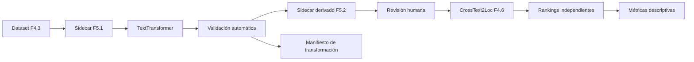

# F5.2: transformación textual local y rankings independientes

## Estado

F5.2 implementa la infraestructura para transformar textos F5.1 y comparar sus
rankings CrossText2Loc sin alterar el MVP, las galerías o el recuperador.

Estado de validación:

| Componente | Estado |
|---|---|
| Interfaz `TextTransformer` | Implementada |
| Prompts y modo no-thinking | Implementados |
| Protección/restauración de topónimos | Implementada y probada |
| Validación heurística | Implementada; siempre requiere revisión humana |
| Artefacto derivado content-addressed | Implementado |
| Rankings F4.6 independientes | Implementados mediante inyección del recuperador |
| Métricas descriptivas | Implementadas |
| Smoke fake determinista | PASS |
| Inferencia real `Qwen/Qwen3-8B` | **Bloqueada: snapshot exacto no disponible localmente** |
| Ranking real de variantes Qwen | No ejecutado |
| Precisión geográfica | No disponible; no hay ground truth F5.1 |

Validación observada: 11 tests F5.2 y 319 tests Python totales, además de 8 tests
Node, build Vite, schemas F5 y readiness del MVP.

No se descargaron pesos ni se instalaron dependencias. La caché local contiene
otros modelos (`Qwen3.8-27B`, Qwen2.5-7B-AWQ y un artefacto Ollama `qwen3.8`),
pero no el candidato exacto `Qwen/Qwen3-8B`; no se sustituyeron silenciosamente.

## Modelo candidato

La ficha pública observada identifica:

| Campo | Valor |
|---|---|
| Modelo | `Qwen/Qwen3-8B` |
| Revisión pública observada | `b968826d9c46dd6066d109eabc6255188de91218` |
| Tipo | LLM causal textual, no VLM |
| Parámetros | 8,2B |
| Licencia declarada | Apache-2.0 |
| Modo | Thinking y non-thinking |
| Requisito documentado | Transformers ≥ 4.51 para Qwen3 |

Fuente: <https://huggingface.co/Qwen/Qwen3-8B>. Antes de usar pesos locales hay
que revisar de nuevo licencia, revisión y hashes del snapshot efectivo.

El adaptador exige `--model-path` local y `--model-revision`; usa
`local_files_only=True`, `trust_remote_code=False` y no descarga. Calcula un
manifest hash de todos los ficheros del snapshot. El tokenizer y la revisión se
registran en el manifiesto de ejecución.

## Arquitectura



El LLM y CrossText2Loc se ejecutan en procesos separados. El modelo lingüístico
se carga una vez por ejecución y genera todas las variantes pendientes. El
runner de ranking carga CrossText2Loc una vez después de cerrar/liberar el LLM.

## Interfaz

```python
TextTransformer.transform(
    original_text,
    task,
    protected_toponyms,
    config,
)
```

Tareas:

- `cartographic_rewrite_es`;
- `translate_en_conventional`;
- `translate_en_preserve_toponyms`.

Implementaciones:

- `QwenTransformersAdapter`: modelo real local-only;
- `FakeTransformer`: doble determinista exclusivo de tests/smoke técnico.

No se implementa servidor público del LLM ni integración en FastAPI/frontend.

## Prompts y generación

Versión: `f52-text-transform-v1`.

La configuración fijada es:

```text
do_sample: false
temperature: 0
seed: 0 por defecto
enable_thinking: false
max_new_tokens: 256 por defecto
```

El adaptador llama a `apply_chat_template(..., enable_thinking=False)` cuando la
versión del tokenizer lo soporta. Se solicita únicamente el texto transformado,
sin explicación. La ejecución registra prompt por SHA-256, parámetros, entorno,
duración y salida original. La generación GPU no se declara bit a bit idéntica
hasta comprobarlo con el snapshot real.

## Protección de topónimos

La protección se apoya en los topónimos F5.1 revisados:

```text
Plaza Mayor → __TOPONYM_000__
Gran Vía     → __TOPONYM_001__
```

El prompt obliga a conservar placeholders. Tras generar, la restauración exige:

- todos los placeholders esperados;
- exactamente una aparición de cada uno;
- ningún placeholder inventado;
- ausencia de placeholders residuales.

Después se restauran las menciones originales literalmente. Una pérdida,
duplicación o alteración rechaza la variante. La traducción convencional no usa
placeholders, para poder estudiar cambios de topónimo.

## Validación automática y revisión

Las heurísticas detectan:

- salida vacía o demasiado larga;
- idioma incompatible de forma heurística;
- cambio de números o distancias;
- pérdida/cambio de negación explícita;
- pérdida de orientación cardinal o egocéntrica detectable;
- topónimos protegidos omitidos/modificados;
- placeholders perdidos, duplicados o inventados;
- posibles elementos geográficos nuevos detectables por vocabulario controlado.

También registra elementos detectados como conservados, eliminados o modificados.
Estas reglas no garantizan equivalencia semántica. Toda salida lleva
`human_review_required: true`; una variante generada queda `review_status:
pending` y el runner real no la compara hasta que sea revisada. El flag técnico
para comparar variantes no revisadas solo se admite con un manifiesto fake.

## Artefactos

Schemas:

- `schemas/f5_transformation_run.schema.json`;
- `schemas/f5_variant_ranking_report.schema.json`.

Código:

- `src/tfg_phase0/f5_text_transform.py`;
- `src/tfg_phase0/f5_variant_ranking.py`.

Los resultados se publican de forma content-addressed fuera de Git:

```text
results/generated/f5/f52/<run_id>/
├── derived-sidecar.json
└── run.json

results/generated/f5/f52/<report_id>/
└── report.json
```

El sidecar F5.1 original nunca se sobrescribe.

## Ejecución Qwen real

Solo después de disponer de un snapshot local autorizado:

```bash
python scripts/generate_f5_textual_variants.py \
  --sidecar <sidecar-f51-con-observaciones.json> \
  --source-query-dataset <dataset-f43.json> \
  --manifest data/processed/catalog/manifest-50m.json \
  --transformer qwen \
  --model-path <snapshot-local-Qwen3-8B> \
  --model-id Qwen/Qwen3-8B \
  --model-revision b968826d9c46dd6066d109eabc6255188de91218 \
  --output-root results/generated/f5/f52
```

El entorno Qwen debe estar separado del entorno CrossText2Loc. Las dependencias
esperadas se registran en `requirements-f52-qwen.txt`, pero no se instalaron
automáticamente. Se detectó fuera de este repositorio un entorno con versiones
compatibles de Torch/Transformers, aunque no constituye por sí solo un entorno
F5.2 aprobado o congelado.

## Rankings CrossText2Loc

Tras revisión humana del sidecar derivado y con el LLM cerrado:

```bash
python scripts/rank_f5_textual_variants.py \
  --sidecar <derived-sidecar-revisado.json> \
  --source-query-dataset <dataset-f43.json> \
  --transformation-run <run.json> \
  --cvg-utils-sha256 <sha256-utils.py> \
  --clip-weights "$HOME/.cache/clip/ViT-L-14-336px.pt" \
  --gallery madrid-50m \
  --gallery madrid-25m \
  --top-k 10 \
  --output-root results/generated/f5/f52
```

Cada variante produce un ranking independiente. Se conserva ranking exhaustivo,
desempate, checkpoint, embeddings, candidate IDs y ausencia de ground truth en
inferencia. No se suman scores, no se usa RRF, no se promedian coordenadas y no
se selecciona una predicción por consenso.

## Métricas descriptivas

Por variante:

- score margin Top-1/Top-2;
- dispersión espacial como distancia media al medoide Top-K;
- latencia de transformación, retrieval y total.

Frente a `es_original`:

- coincidencia Top-1;
- solapamiento y Jaccard Top-K;
- distancia Haversine entre Top-1;
- desplazamiento medio de rango compartido;
- cambio de margen y dispersión.

Entre 25 m y 50 m:

- distancia entre Top-1;
- distancia mínima entre candidatos Top-K.

Nunca se comparan IDs 25 m/50 m como iguales. El informe declara
`geographic_accuracy_available: false` mientras no haya ground truth. Margen,
dispersión y acuerdo no son confianza calibrada ni mejora de precisión.

## Smoke técnico fake

```bash
.venv-geo/bin/python scripts/smoke_f52_fake.py
```

Resultado observado:

```text
status: pass
technical_fake_only: true
real_qwen_inference: false
rankings: 8
comparisons: 6
geographic_accuracy_available: false
```

Este smoke valida contratos y flujo de software. No valida Qwen, no usa
CrossText2Loc real y no pertenece al dataset de evaluación.

## Limitaciones y continuación

- El sidecar F5.1 actual tiene cero observaciones elegibles.
- No se ejecutó ni validó Qwen3-8B real.
- No se ejecutaron rankings CrossText2Loc con variantes Qwen.
- No hay métricas de precisión sin ground truth.
- F5.2 no realiza extracción estructurada automática; eso pertenece a F5.3.
- Qwen3-8B es textual, no Qwen3-VL ni un VLM.
- Qwen3-VL, DialogueChat, Street View, TOLoc y fine-tuning no están implementados.
- La preselección/reranking OSM permanece en stand-by.
