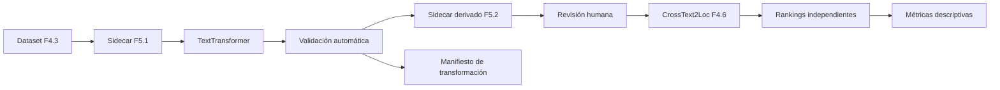

# F5.2: transformación textual local y rankings independientes

Guía práctica del modelo y su uso:
[QWEN.md](QWEN.md). Este documento conserva el protocolo y la evidencia
experimental de F5.2.

## Estado

F5.2 implementa la infraestructura para transformar textos F5.1 y comparar sus
rankings CrossText2Loc sin alterar el MVP, las galerías o el recuperador.

Estado de validación:

| Componente | Estado |
|---|---|
| Interfaz `TextTransformer` | Implementada |
| Prompts y modo no-thinking | Implementados |
| Protección/restauración de topónimos | Implementada y probada |
| Validación heurística | Implementada; siempre requiere revisión humana |
| Artefacto derivado content-addressed | Implementado |
| Rankings F4.6 independientes | Implementados mediante inyección del recuperador |
| Métricas descriptivas | Implementadas |
| Smoke fake determinista | PASS |
| Inferencia real `Qwen/Qwen3-8B` | PASS en NVIDIA GB10 |
| Ranking real de variantes Qwen | PASS sobre 25 m y 50 m tras revisión humana |
| Precisión geográfica | No disponible; no hay ground truth F5.1 |

Validación observada: 13 tests F5.2/F5.2b y 321 tests Python totales, además de 8 tests
Node, build Vite, schemas F5 y readiness del MVP.

El snapshot exacto se descargó fuera de Git tras autorización expresa. No se
instalaron paquetes globalmente ni se sustituyó por otros modelos locales.

## Modelo candidato

La ficha pública observada identifica:

| Campo | Valor |
|---|---|
| Modelo | `Qwen/Qwen3-8B` |
| Revisión pública observada | `b968826d9c46dd6066d109eabc6255188de91218` |
| Tipo | LLM causal textual, no VLM |
| Parámetros | 8,2B |
| Licencia declarada | Apache-2.0 |
| Modo | Thinking y non-thinking |
| Requisito documentado | Transformers ≥ 4.51 para Qwen3 |

Fuente: <https://huggingface.co/Qwen/Qwen3-8B>. Antes de usar pesos locales hay
que revisar de nuevo licencia, revisión y hashes del snapshot efectivo.

El adaptador exige `--model-path` local y `--model-revision`; usa
`local_files_only=True`, `trust_remote_code=False` y no descarga. Calcula un
manifest hash de todos los ficheros del snapshot. El tokenizer y la revisión se
registran en el manifiesto de ejecución.

Snapshot validado:

```text
ubicación local observada: $HOME/models/hf/Qwen3-8B-b968826d9c46
revisión: b968826d9c46dd6066d109eabc6255188de91218
pesos: 16.381.470.720 bytes, BF16, 399 tensores, 5 shards
manifest SHA-256 F5.2: d95b2ee5a666c88adcb53094740c1002718f28e0dcabad56a508a9c66dce1570
```

Los SHA-256 de los cinco shards coinciden con los OIDs publicados:

```text
31d6a825ae35f11fb85b195b4c42c146c051e446433125a215336abdf95cbf5f
5991236cea6fe21f3d43cab0f0e84448734fbbe0789816202989f2ddc9d18282
c5185c4794be2d8a9784d5753c9922db38df478ce11f9ed0b415b7304d896836
b5ee7de71fbf17db3d5704e0c8f2bc7d005ca9e1d7ca2aeb19827b0cfcaa917a
20c2d6366ab85c90786ccdd829cd2b9e7d30ef3b2ebbb998280e7e4014b542ff
```

## Arquitectura



El LLM y CrossText2Loc se ejecutan en procesos separados. El modelo lingüístico
se carga una vez por ejecución y genera todas las variantes pendientes. El
runner de ranking carga CrossText2Loc una vez después de cerrar/liberar el LLM.

## Interfaz

```python
TextTransformer.transform(
    original_text,
    task,
    protected_toponyms,
    config,
)
```

Tareas:

- `cartographic_rewrite_es`;
- `translate_en_conventional`;
- `translate_en_preserve_toponyms`.

Implementaciones:

- `QwenTransformersAdapter`: modelo real local-only;
- `FakeTransformer`: doble determinista exclusivo de tests/smoke técnico.

No se implementa servidor público del LLM ni integración en FastAPI/frontend.

## Prompts y generación

Versión: `f52-text-transform-v1`.

La configuración fijada es:

```text
do_sample: false
temperature: 0
seed: 0 por defecto
enable_thinking: false
max_new_tokens: 256 por defecto
```

El adaptador llama a `apply_chat_template(..., enable_thinking=False)` cuando la
versión del tokenizer lo soporta. Se solicita únicamente el texto transformado,
sin explicación. La ejecución registra prompt por SHA-256, parámetros, entorno,
duración y salida original. La generación GPU no se declara bit a bit idéntica
hasta comprobarlo con el snapshot real.

## Protección de topónimos

La protección se apoya en los topónimos F5.1 revisados:

```text
Plaza Mayor → __TOPONYM_000__
Gran Vía     → __TOPONYM_001__
```

El prompt obliga a conservar placeholders. Tras generar, la restauración exige:

- todos los placeholders esperados;
- exactamente una aparición de cada uno;
- ningún placeholder inventado;
- ausencia de placeholders residuales.

Después se restauran las menciones originales literalmente. Una pérdida,
duplicación o alteración rechaza la variante. La traducción convencional no usa
placeholders, para poder estudiar cambios de topónimo.

## Validación automática y revisión

Las heurísticas detectan:

- salida vacía o demasiado larga;
- idioma incompatible de forma heurística;
- cambio de números o distancias;
- pérdida/cambio de negación explícita;
- pérdida de orientación cardinal o egocéntrica detectable;
- topónimos protegidos omitidos/modificados;
- placeholders perdidos, duplicados o inventados;
- posibles elementos geográficos nuevos detectables por vocabulario controlado.

También registra elementos detectados como conservados, eliminados o modificados.
Estas reglas no garantizan equivalencia semántica. Toda salida lleva
`human_review_required: true`; una variante generada queda `review_status:
pending` y el runner real no la compara hasta que sea revisada. El flag técnico
para comparar variantes no revisadas solo se admite con un manifiesto fake.

## Artefactos

Schemas:

- `schemas/f5_transformation_run.schema.json`;
- `schemas/f5_variant_ranking_report.schema.json`.

Código:

- `src/tfg_phase0/f5_text_transform.py`;
- `src/tfg_phase0/f5_variant_ranking.py`.

Los resultados se publican de forma content-addressed fuera de Git:

```text
results/generated/f5/f52/<run_id>/
├── derived-sidecar.json
└── run.json

results/generated/f5/f52/<report_id>/
└── report.json
```

El sidecar F5.1 original nunca se sobrescribe.

La fixture técnica se crea fuera de Git con
`scripts/create_f52_technical_fixture.py`. Las decisiones humanas se aplican con
`scripts/review_f5_textual_variants.py`, que exige cubrir exactamente todas las
variantes generadas y nunca autoaprueba.

## Ejecución Qwen real

Comando validado con el snapshot local autorizado:

```bash
python scripts/generate_f5_textual_variants.py \
  --sidecar <sidecar-f51-con-observaciones.json> \
  --source-query-dataset <dataset-f43.json> \
  --manifest data/processed/catalog/manifest-50m.json \
  --transformer qwen \
  --model-path <snapshot-local-Qwen3-8B> \
  --model-id Qwen/Qwen3-8B \
  --model-revision b968826d9c46dd6066d109eabc6255188de91218 \
  --output-root results/generated/f5/f52
```

El entorno Qwen debe estar separado del entorno CrossText2Loc. Las dependencias
esperadas se registran en `requirements-f52-qwen.txt`, pero no se instalaron
automáticamente. Se detectó fuera de este repositorio un entorno con versiones
compatibles de Torch/Transformers, aunque no constituye por sí solo un entorno
F5.2 aprobado o congelado.

Entorno utilizado:

```text
arquitectura: ARM64
GPU: NVIDIA GB10
Python: 3.12.3
PyTorch: 2.11.0+cu130
CUDA PyTorch: 13.0
Transformers: 5.9.0
Accelerate: 1.13.0
Hugging Face Hub: 1.15.0
```

### Telemetría real y reproducibilidad

| Medición | Ejecución 1 | Ejecución 2 |
|---|---:|---:|
| Carga del modelo | 82.035,84 ms | 89.282,41 ms |
| CUDA asignada tras carga | 16.381.490.176 B | 16.381.490.176 B |
| Pico CUDA asignado | 16.425.854.976 B | 16.425.854.976 B |
| Generación total, 18 variantes | 22.782,86 ms | 22.863,73 ms |
| Generación media | 1.265,71 ms | 1.270,21 ms |
| Generación mediana | 1.221,37 ms | 1.225,52 ms |
| CUDA asignada tras cierre | 8.519.680 B | 8.519.680 B |
| CUDA reservada tras cierre | 20.971.520 B | 20.971.520 B |

La inferencia mínima generó `I am near Plaza Mayor, next to a narrow street.`
en 2.414,39 ms, sin bloques `<think>` y restaurando el placeholder. Las dos
ejecuciones completas produjeron 18/18 textos y hashes idénticos. Los `run_id`
difieren porque incluyen latencias y telemetría. Esto no garantiza identidad en
otro driver, hardware o versión.

Ejemplos reales:

| Original | Variante generada |
|---|---|
| `Estoy cerca de la Plaza Mayor, junto a una calle estrecha.` | `I am near the Plaza Mayor, next to a narrow street.` |
| `No hay ningún parque cerca de esta intersección.` | `There is no park near this intersection.` |
| `La estación está al norte de la plaza.` | `The station is to the north of the square.` |
| `Veo una iglesia a mi izquierda y una calle a la derecha.` | `I see a church on my left and a street on the right.` |

Los topónimos protegidos `Plaza Mayor` y `Gran Vía`, las negaciones y las
relaciones cardinales/egocéntricas se conservaron según revisión humana.

### Revisión humana

Las 18 variantes quedaron primero `pending`. Un manifiesto local de decisiones
cubrió exactamente las 18; tras revisar original, salida, topónimos, negación y
orientación se aprobaron 18 y se rechazaron 0. El sidecar sigue siendo una
fixture development sin ground truth:

```text
observaciones: 6
variantes revisadas: 18
ground truth validado: 0
precision_metrics_available: false
```

## Rankings CrossText2Loc

Tras revisión humana del sidecar derivado y con el LLM cerrado:

```bash
python scripts/rank_f5_textual_variants.py \
  --sidecar <derived-sidecar-revisado.json> \
  --source-query-dataset <dataset-f43.json> \
  --transformation-run <run.json> \
  --cvg-utils-sha256 <sha256-utils.py> \
  --clip-weights "$HOME/.cache/clip/ViT-L-14-336px.pt" \
  --gallery madrid-50m \
  --gallery madrid-25m \
  --top-k 10 \
  --output-root results/generated/f5/f52
```

Cada variante produce un ranking independiente. Se conserva ranking exhaustivo,
desempate, checkpoint, embeddings, candidate IDs y ausencia de ground truth en
inferencia. No se suman scores, no se usa RRF, no se promedian coordenadas y no
se selecciona una predicción por consenso.

### Resultado real exploratorio

CrossText2Loc produjo 48 rankings Top-10: 6 sondas × 4 variantes × 2 galerías,
con 36 comparaciones frente a `es_original` y 24 comparaciones entre galerías.

| Galería | Acuerdo Top-1 | Jaccard@10 medio | Distancia Top-1 media | Mediana |
|---|---:|---:|---:|---:|
| 50 m | 0,333 | 0,359 | 244,6 m | 161,9 m |
| 25 m | 0,278 | 0,324 | 281,6 m | 236,9 m |

| Variante | Acuerdo Top-1 | Jaccard@10 medio | Distancia Top-1 media |
|---|---:|---:|---:|
| `es_cartographic` | 0,917 | 0,857 | 31,7 m |
| `en_conventional` | 0,000 | 0,095 | 351,4 m |
| `en_toponym_preserved` | 0,000 | 0,072 | 406,3 m |

La distancia Top-1 media entre galerías fue 136,4 m. La latencia interna media
de retrieval fue 6,75 ms y la transformación media 1.265,71 ms, sin contar la
carga del LLM. Son métricas de estabilidad sobre sondas técnicas, no accuracy.

## Métricas descriptivas

Por variante:

- score margin Top-1/Top-2;
- dispersión espacial como distancia media al medoide Top-K;
- latencia de transformación, retrieval y total.

Frente a `es_original`:

- coincidencia Top-1;
- solapamiento y Jaccard Top-K;
- distancia Haversine entre Top-1;
- desplazamiento medio de rango compartido;
- cambio de margen y dispersión.

Entre 25 m y 50 m:

- distancia entre Top-1;
- distancia mínima entre candidatos Top-K.

Nunca se comparan IDs 25 m/50 m como iguales. El informe declara
`geographic_accuracy_available: false` mientras no haya ground truth. Margen,
dispersión y acuerdo no son confianza calibrada ni mejora de precisión.

## Smoke técnico fake

```bash
.venv-geo/bin/python scripts/smoke_f52_fake.py
```

Resultado observado:

```text
status: pass
technical_fake_only: true
real_qwen_inference: false
rankings: 8
comparisons: 6
geographic_accuracy_available: false
```

Este smoke valida contratos y flujo de software. No valida Qwen, no usa
CrossText2Loc real y no pertenece al dataset de evaluación.

## Limitaciones y continuación

- Las seis observaciones ejecutadas son sondas técnicas development sin ground
  truth y no pertenecen a evaluación.
- No hay métricas de precisión sin ground truth.
- F5.2 no realiza extracción estructurada automática; eso pertenece a F5.3.
- Qwen3-8B es textual, no Qwen3-VL ni un VLM.
- Qwen3-VL, DialogueChat, Street View, TOLoc y fine-tuning no están implementados.
- La preselección/reranking OSM permanece en stand-by.

## F5.3b: variante `en_cartographic`

El contrato `f5-textual-variant-dataset-v2` añade un quinto slot sin modificar el
contrato v1 ni sus artefactos históricos:

```text
en_cartographic
```

La tarea `translate_en_cartographic` traduce al inglés, conserva topónimos con
placeholders, relaciones, negaciones, números, distancias y orientación, y elimina
solo detalles visuales sin representación cartográfica evidente. Su prompt se
versiona como `f53b-text-transform-v2`. La plantilla v2 está en
`config/madrid_f53b_textual_variants_template.json`; la plantilla F5.1 v1 continúa
con cuatro variantes.

Se generaron y revisaron seis salidas reales: 6 aprobadas y 0 rechazadas. Los
ejemplos incluyen:

```text
Estoy cerca de la Plaza Mayor, junto a una calle estrecha.
→ I am near the Plaza Mayor, adjacent to a narrow street.

No hay ningún parque cerca de esta intersección.
→ There is no park near this intersection.
```

La campaña v2 completa generó 24 variantes derivadas, todas revisadas, y 60
rankings Top-10 sobre 6 sondas × 5 variantes × 2 galerías. Frente al original,
`en_cartographic` obtuvo:

| Métrica de estabilidad | Total | 25 m | 50 m |
|---|---:|---:|---:|
| Acuerdo Top-1 | 0,000 | 0,000 | 0,000 |
| Jaccard@10 medio | 0,079 | 0,055 | 0,103 |
| Distancia Top-1 media | 328,2 m | 391,4 m | 264,9 m |

La transformación media fue 1.284,26 ms y el retrieval medio 7,15 ms. No hay
ground truth: estos valores no demuestran mejora o empeoramiento geográfico.

En extracción estructurada guiada, las cinco variantes obtuvieron 3/6 records
contractualmente válidos cada una. No existe evidencia de superioridad de
`en_cartographic` para Qwen. La comparación y sus límites se documentan en
[PHASE5_GEOGRAPHIC_EXTRACTION.md](PHASE5_GEOGRAPHIC_EXTRACTION.md#f53b-generación-estructurada-y-evidencias-literales).
