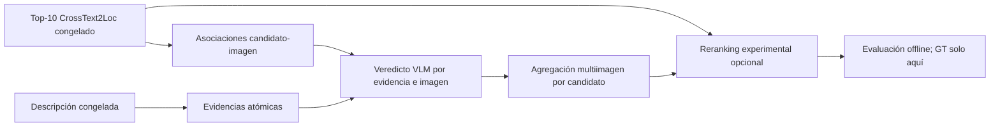

# Implementación experimental de verificación multiimagen y reranking

## Estado y alcance

Esta fase prepara un pipeline offline separado del MVP:



No se integra todavía en backend o frontend. CrossText2Loc, sus scores, IDs,
coordenadas y rankings permanecen inmutables. El reranking está desactivado por
defecto y genera un artefacto separado.

## Reutilización de componentes

- Ranking base: `f4_retrieval.exhaustive_rank`; el score es coseno entre vectores
  L2, mayor es mejor y no es una probabilidad.
- Candidatos: celdas F1 en EPSG:25830 publicadas por su centro WGS84.
- Inventario y cobertura: `mapillary_coverage.py`, 5.337 metadatos congelados.
- Geometría y diversidad: `bearing_degrees`, `angular_difference` y secuencias.
- Adquisición y atribución: `acquire_mapillary_pilot_images.py`.
- Protección frente a fuga: `reject_ground_truth` y separación de evaluadores.
- VLM local: Qwen3-VL-2B en revisión y hash ya fijados.
- Evaluación: asignación por celda, Haversine y métricas @K existentes; solo el
  evaluador posterior puede abrir referencias.

## Asociación candidato-imagen

La implementación nueva conserva por separado:

- assets únicos por `image_id`, descargables una sola vez;
- asociaciones many-to-many `(candidate_id, image_id)` con distancia, rumbo,
  diferencia angular, secuencia y tipo de cámara.

La política v1 usa radio máximo 100 m y hasta tres vistas por candidato. Para
cámaras perspectiva prioriza diferencia angular ≤45°, después ≤90° y por último
el resto. Las panorámicas tienen prioridad propia porque su contenido no queda
representado por un único rumbo. Se diversifica primero por secuencia. La
proximidad no demuestra visibilidad y no se inventa FOV.

El plan offline para los 88 candidatos únicos Top-10 `en_cartographic` de 50 m
produce:

| Medida | Valor |
|---|---:|
| Candidatos | 88 |
| Con cobertura ≤100 m | 86 |
| Asociaciones | 258 |
| Assets únicos | 208 |
| Assets compartidos | 38 |
| Panorámicas/cilíndricas | 87 |
| Perspectivas ≤45° | 145 |
| Perspectivas 45–90° | 17 |
| Perspectivas >90° | 9 |

De los 208 assets, 14 ya están descargados y 194 serían nuevos. La media real
del piloto estima 21.487.909 B adicionales; el máximo contractual de 8 MB por
asset sería 1.552.000.000 B. Quedan aproximadamente 9,29 GB libres, pero este
plan **no autoriza descargas**. La confirmación anterior cubría solo 24 imágenes.

## Evidencias atómicas

`visual_reranking.compile_atomic_claims` extrae literalmente objetos, atributos,
texto visible y relaciones egocéntricas. No usa un LLM adicional. Los IDs se
derivan de contenido canónico, spans y SHA-256 del texto. La salida actual suma
146 claims para H11–H25:

| Tipo | Claims |
|---|---:|
| Objetos | 83 |
| Atributos | 23 |
| Relaciones egocéntricas | 33 |
| Texto/OCR | 7 |

Es un compilador conservador de desarrollo, no una comprensión lingüística
completa. Cada claim requiere revisión humana antes de usarlo con el VLM. No se
reutilizan automáticamente las extracciones F5.3 porque su calidad contractual
quedó bloqueada.

## Veredicto visual

El contrato `visual_atomic_verdict.schema.json` procesa exactamente una evidencia
y una imagen:

```text
supported | contradicted | unverifiable
```

Un soporte o contradicción exige una observación breve. No se aceptan fences,
campos adicionales, JSON parcial ni reparación silenciosa. Una contradicción con
vista parcial, fuera de campo, oclusión, distancia o baja resolución es inválida.
Un topónimo requiere OCR literal. Una relación egocéntrica sin orientación
comparable debe ser `unverifiable`. Los fallos de generación son neutrales.

Este contrato pequeño responde a los truncamientos y listas degenerativas de la
evaluación anterior. Todavía falta implementar un adaptador VLM por claim y una
fixture humana claim-imagen antes de ejecutar inferencia masiva.

## Agregación multiimagen

La agregación deduplica confirmaciones por `sequence_id`; varios frames de una
misma secuencia no multiplican evidencia. Claims genéricos pesan 0,5 y
distintivos 1,0. `unverifiable`, fallos y conflictos son neutrales. Una
contradicción solo resta si el veredicto atómico pasó todas las validaciones.
Cada agregado conserva imágenes de soporte/contradicción y secuencias usadas.

Los pesos son unidades ordinales de evidencia, no probabilidades calibradas.

## Reranking aislado

La implementación normaliza el coseno dentro del Top-K mediante min-max y ofrece:

```text
score_experimental = score_base_normalizado
                    + lambda_pos * evidencia_positiva
                    - lambda_neg * evidencia_negativa
```

No se ha elegido ningún `lambda`. Ambos pesos son cero y `enabled=false` por
defecto. Si se habilita en desarrollo, conserva exactamente los mismos IDs y usa
rango base e ID como desempate. Candidatos sin cobertura, fallos y abstenciones
mantienen el score base. El ranking original nunca se sobrescribe.

## Presupuesto experimental mínimo

Verificar 146 claims contra 258 asociaciones produciría miles de decisiones y no
es un primer experimento razonable. El siguiente lote debe limitarse a 3–5
consultas de desarrollo, 3–5 claims humanos por consulta y hasta tres vistas por
candidato. Antes de red debe publicarse el número de assets nuevos y bytes. Antes
de GPU deben congelarse claims, asociaciones, prompt y hashes.

Se ha preparado una fixture inicial con H12, H14, H16 y H19, veinte claims y doce
imágenes ya descargadas. Contiene 60 pares claim-imagen pendientes de anotación
humana. H16 se conserva deliberadamente como control interior frente a vistas
exteriores. No debe ejecutarse el VLM sobre la fixture hasta completar esa
anotación; así se evita adaptar etiquetas después de observar el modelo.

No se usará H11–H25 como test independiente: ya se inspeccionó y se empleó para
diseñar prompts y reglas. Hace falta otro conjunto congelado para evaluación.

## Criterios de aceptación

Antes de permitir reranking experimental con outputs reales:

1. 100 % JSON atómico válido; cualquier fallo es neutral.
2. Cero contradicciones basadas únicamente en ausencia o vista parcial.
3. Cero soportes de comercios/topónimos sin OCR literal.
4. Cero relaciones egocéntricas decididas sin orientación comparable.
5. Cobertura exacta de pares claim-imagen y sin duplicados.
6. Estabilidad medida en ejecuciones repetidas con el mismo entorno.
7. Anotación humana claim-imagen completa para development.
8. Parámetros de agregación y lambdas congelados antes del test.
9. Conjunto test independiente y no usado para seleccionar vistas o pesos.
10. Top-10 y Recall@10 invariantes; cualquier cambio del conjunto es un bug.

Para una futura integración del MVP se exigirá además mejora descriptiva de
GeoRecall@1/Recall@1 y distancia Top-1 sin regresiones inaceptables, pero no se
inventa ahora un umbral numérico de éxito.

## Riesgos y dependencias

- La orientación Mapillary no equivale a orientación corporal del observador.
- H16 es interior y no tiene cobertura exterior comparable.
- Las 24 anotaciones actuales son por imagen, no por claim.
- H11–H25 tiene referencias de enlace con incertidumbre desconocida.
- Los documentos H11–H25 y algunos resúmenes Mapillary muestran deriva respecto
  a los artefactos generados actuales; deben reconciliarse antes de publicar una
  comparación final.
- Ampliar imágenes requiere nueva aprobación de términos y alcance.
- El 2B sigue siendo exploratorio; no se presupone que 4B resuelva los fallos.

## Artefactos preparados

- Código: `src/tfg_phase0/visual_reranking.py`.
- Tests: `tests/test_visual_reranking.py`.
- Esquemas: `schemas/visual_atomic_claims.schema.json` y
  `schemas/visual_atomic_verdict.schema.json`.
- Plan offline:
  `results/generated/mapillary/visual-reranking-development-v1/multiview-plan.json`.
- Claims:
  `results/generated/mapillary/visual-reranking-development-v1/atomic-claims.json`.
- Fixture claim-imagen y plantilla de anotación:
  `results/generated/mapillary/visual-reranking-development-v1/atomic-development-fixture.json`.
- Preparación reproducible: `scripts/prepare_visual_reranking_fixture.py`.

## Resultado de validación atómica

La fixture humana de 60 pares ya fue completada. Qwen3-VL-2B se ejecutó con un
contrato compacto y generación guiada. Solo 24/60 resultados fueron utilizables,
todos `unverifiable`; 36 outputs se rechazaron. No hubo ningún soporte o
contradicción aceptada. El resultado no satisface los criterios de aceptación y
bloquea reranking y descarte. Véase
[PHASE_VISUAL_ATOMIC_VALIDATION_RESULTS.md](PHASE_VISUAL_ATOMIC_VALIDATION_RESULTS.md).

No se ejecutó un reranking real ni se modificó el MVP.
