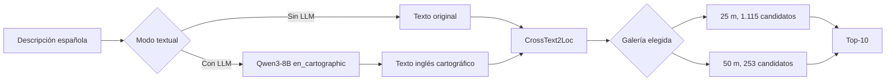
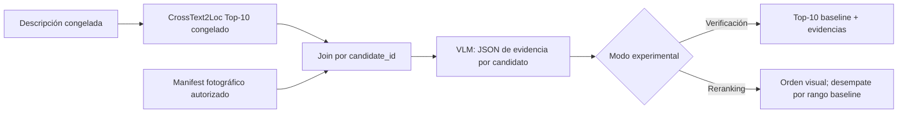

# Plan de verificación visual y reranking Top-10 mediante VLM

## Estado y recomendación

Este documento planifica una extensión posterior a F5.11. No implementa ni
autoriza todavía adquisición fotográfica, descarga de checkpoints, ejecución de
un VLM, reranking o cambios del MVP.

**Recomendación propuesta:** desarrollar primero una prueba offline de
verificación visual sobre el Top-10 congelado de CrossText2Loc. La extracción
geográfica estructurada F5.3 no es requisito para esta prueba y permanece
bloqueada para integración automática por D064 y D065.

El primer incremento debe usar fotografías propias o expresamente autorizadas,
un contrato de evidencia independiente de F4 y un VLM local pequeño. Google
Street View y Mapillary no se activarán hasta resolver sus condiciones para
adquisición, almacenamiento, procesamiento con IA y evaluación.

## Hechos verificados del sistema actual

### Pipeline F5.11



La API exige una galería y un modo. Devuelve un Top-10 con:

- `candidate_id` estable;
- rango baseline;
- centro WGS84 de la celda;
- similitud coseno, que no es probabilidad;
- identidad del catálogo visual y de embeddings.

Componentes reutilizables:

| Componente | Ruta o símbolo |
|---|---|
| Runtime residente y Top-10 | `src/tfg_phase0/crosstext2loc_runtime.py`, `CrossText2LocRetriever` |
| Ranking determinista | `src/tfg_phase0/f4_retrieval.py`, `exhaustive_rank()` |
| Identidad y geometría de candidato | `src/tfg_phase0/f3_inputs.py`, `CandidateInput` |
| Distancias y asignación | `src/tfg_phase0/f4_evaluation.py`, `haversine_m()`, `assign_reference()` |
| Integridad de artefactos | `src/tfg_phase0/f4_validation.py` y `f56_evidence_common.py` |
| Lifespan y capabilities | `backend/atlas_api/lifespan.py`, `routes/health.py` |
| Evaluación con candidatas | `src/tfg_phase0/h11_h25_independent.py` |

Los manifests F4 son específicos de mapas raster OSM y de CrossText2Loc. Sirven
como patrón de integridad, pero no deben reutilizarse sin versionar para
fotografías a nivel de calle.

### Recursos GB10

Entorno observado: ARM64, NVIDIA GB10, CUDA 13.x y PyTorch 2.11. F5.11 midió:

| Estado | CUDA asignada |
|---|---:|
| CrossText2Loc residente | 1.712.462.336 B |
| CrossText2Loc + Qwen3-8B | 18.093.952.512 B |
| Pico transformación + Top-10 | 18.141.917.696 B |

No existe medición de un VLM. No se presupone que un tercer modelo quepa junto a
Qwen3-8B y CrossText2Loc. La prueba VLM deberá medir primero ejecución aislada y
después coexistencia con CrossText2Loc. La opción conservadora es cerrar el Qwen
textual antes de cargar el VLM o ejecutar la fase visual en un proceso offline
separado.

### Resultados humanos disponibles

H11–H25 recomienda provisionalmente `en_cartographic` con galería 50 m:
GeoRecall@10 a 50 m de 8/15. H16 interior se comporta como un dominio distinto.
Las referencias tienen incertidumbre desconocida y no constituyen GT F5.4.

Un reranker puro que conserva exactamente las diez candidatas **no puede mejorar
GeoRecall@10**. Puede mejorar GeoRecall@1, Recall@1 o error Top-1. Para mejorar
GeoRecall@10 tendría que cambiar el conjunto, por ejemplo verificando un Top-N
mayor antes de recortar a diez; eso sería otro protocolo y no se propone para la
primera prueba.

## Responsabilidades de Qwen y del VLM

### A. Qwen3-8B como preprocesador

Ya implementado: transforma español a `en_cartographic`. Continúa siendo una
opción textual, no un modelo visual.

### B. Qwen3-8B como extractor geográfico

F5.3/F5.3b produjo como máximo 5/10 salidas contractualmente válidas en sondas de
desarrollo y mantiene integración bloqueada. Añadirlo antes del VLM introduciría
un nuevo punto de fallo, aproximadamente 12–18 s de extracción y unos 16 GB de
pesos sin beneficio visual demostrado.

### C. VLM como verificador

El VLM puede recibir directamente la descripción original o `en_cartographic` y
una o varias fotografías del candidato. Debe producir un JSON pequeño específico
de verificación, no el contrato F5.3 completo:

```json
{
  "candidate_id": "...",
  "coverage": "available",
  "grade": "partial_match",
  "matches": ["plaza", "torre"],
  "contradictions": [],
  "unverifiable": ["a mi derecha"],
  "view_ids": ["..."]
}
```

**Conclusión:** B no es requisito real para C. Se recomienda C primero y B solo
como ablación futura si se necesita puntuación por pistas atómicas o prefiltrado.

## Fuentes de evidencia visual

### Fotografías propias o controladas

**Recomendación para la primera fase.** Permiten fijar consentimiento, posición
de cámara, rumbo, FOV, fecha, retención y licencia del experimento. El coste es la
recogida manual y una cobertura inicialmente pequeña; por ello sirven para una
fixture de viabilidad, no para cubrir automáticamente cualquier Top-10 de D004.

Cada fotografía debe asociarse a candidatos sin usar la consulta ni su GT. La
asociación se calcula desde la cámara al catálogo mediante una política congelada.

### Wikimedia Commons

Viable solo archivo por archivo. Commons exige comprobar la licencia de cada
imagen, atribuir autor/licencia y revisar restricciones no relacionadas con
copyright, como personas identificables. La vista puede no coincidir con el
centro, orientación o fecha del candidato. Es fuente complementaria, no galería
uniforme.

Fuente oficial consultada:
<https://commons.wikimedia.org/wiki/Commons:Reusing_content_outside_Wikimedia>.

### Mapillary

Mapillary es la candidata principal escalable y permanece **CONDICIONADA**. Las
imágenes se declaran CC BY-SA 4.0 y la API v4 requiere cuenta, aplicación
registrada y `client access token`. La licencia permite reproducción y material
adaptado con atribución y ShareAlike cuando se comparte; todavía deben revisarse
los términos concretos aceptados al registrar la aplicación para confirmar el
flujo automatizado, la retención y el procesamiento con Qwen3-VL.

Ya existe una implementación metadata-only para medir cobertura sin descargar
imágenes ni usar GT. Cubre 1.115 candidatos de 25 m, 253 de 50 m y los 88
candidatos únicos de los Top-10 H11-H25 `en_cartographic` + `madrid-50m`. El
cliente no realiza solicitudes sin `MAPILLARY_ACCESS_TOKEN`; no se ha configurado
un token ni ejecutado la adquisición. Procedimiento y artefactos:
[MAPILLARY_COVERAGE.md](MAPILLARY_COVERAGE.md).

Antes de considerarla viable se requiere:

1. obtener acceso API autorizado;
2. congelar una consulta de cobertura D004;
3. revisar términos vigentes y atribución;
4. confirmar retención de imágenes y derivados;
5. autorizar y ejecutar primero una adquisición de metadatos D004, nunca una
   descarga masiva de imágenes;
6. medir cobertura a 10, 25, 50 y 100 m y separar proximidad de utilidad visual.

Fuente oficial consultada:
<https://help.mapillary.com/hc/en-us/articles/360010234680-Accessing-imagery-and-data-through-the-Mapillary-API>.

La primera puerta técnica es exclusivamente de cobertura. No cambia rankings ni
métricas H11-H25 y no autoriza todavía el smoke VLM.

La auditoría posterior confirmó truncamiento en bordes y, además, que una
consulta monolítica de la bbox no era un inventario completo estable. Se adoptó
una bbox con buffer proyectado de 100 m y cuatro consultas 2×2, unidas por
`image_id`. El inventario resultante contiene 5.337 imágenes y cubre espacialmente
86/88 candidatos Top-10 a 100 m. Esto no acredita utilidad visual. El piloto
offline selecciona diez candidatos `3+3+2+2` y planifica 24 imágenes; la descarga
permanece pendiente de revisión de términos. Detalles y comandos en
[MAPILLARY_COVERAGE.md](MAPILLARY_COVERAGE.md).

### Google Street View Static API

No se recomienda para la primera implementación. La política oficial indica que
el prefetch, indexación, almacenamiento o caché de contenido están generalmente
prohibidos; el `pano_id` sí está exceptuado. También exige atribución visible y
términos/privacidad de la aplicación. El proyecto no dispone de confirmación para
descargar vistas candidatas, procesarlas con un VLM y usar sus resultados en una
evaluación académica. Borrar la imagen tras inferencia no concede permiso.

Fuentes oficiales consultadas:

- <https://developers.google.com/maps/documentation/streetview/policies>
- <https://cloud.google.com/maps-platform/terms/maps-service-terms>

### Imágenes OSM existentes

Están disponibles y autorizadas bajo las condiciones ya documentadas, pero son
mapas cenitales, no fotografías. Pueden servir como smoke de contrato VLM o como
control negativo, pero no verifican fachadas, materiales, relojes, letreros o
visibilidad desde calle. No deben presentarse como Street View.

### Decisión propuesta de fuente

1. **Principal de viabilidad:** fotografías propias/controladas.
2. **Complementaria:** Commons tras revisión individual.
3. **Candidata principal escalable:** Mapillary, condicionada a términos y
   cobertura real D004.
4. **Bloqueada:** Google Street View hasta aclaración contractual expresa.

## Selección propuesta de VLM

No se descargó ni ejecutó ningún checkpoint. Las características siguientes
proceden de las fichas oficiales y deben medirse localmente.

| Modelo | Hechos publicados | Ventajas esperadas | Riesgos pendientes |
|---|---|---|---|
| **Qwen3-VL-4B-Instruct** | 4B, BF16, Apache-2.0, imagen-texto, OCR multilingüe, percepción espacial, Transformers | Equilibrio entre capacidad urbana/OCR y tamaño; misma familia y stack reciente | Memoria/latencia GB10 no medidas; español y JSON del verificador requieren prueba; revisión exacta por fijar |
| Qwen3-VL-2B-Instruct | 2B, BF16, Apache-2.0, mismas interfaces multimodales | Alternativa ligera para fixture y comparación de recursos | Menor capacidad publicada; calidad en escenas urbanas no medida |
| Qwen3-VL-8B-Instruct | 9B reportados en la ficha, BF16, Apache-2.0 | Mayor capacidad publicada | Probable coste de memoria incompatible con residencia triple; no justificado para primer smoke |
| Qwen2.5-VL-3B-Instruct | 3B nominal, Apache-2.0, localización visual y JSON publicados | Alternativa madura y ligera | Generación anterior; dependencias específicas; no conviene ampliar candidatos sin medir Qwen3-VL primero |

Modelo principal propuesto: **Qwen3-VL-4B-Instruct**. Alternativa ligera:
**Qwen3-VL-2B-Instruct**. El 4B se probaría primero aislado, con resolución y
tokens visuales acotados. Si excede memoria/latencia o falla en ARM64, se prueba
el 2B. No se propone el 8B inicialmente.

Fuentes oficiales consultadas:

- <https://huggingface.co/Qwen/Qwen3-VL-4B-Instruct>
- <https://huggingface.co/Qwen/Qwen3-VL-2B-Instruct>
- <https://huggingface.co/Qwen/Qwen3-VL-8B-Instruct>
- <https://github.com/QwenLM/Qwen3-VL>

Las fichas declaran Apache-2.0 y Transformers. La compatibilidad efectiva con
PyTorch/CUDA/ARM64 GB10 sigue siendo hipótesis hasta un smoke. Las afirmaciones
de percepción espacial son de los autores y no resultados del TFG.

## Contratos nuevos mínimos

No se modifica F1 ni el manifest OSM. Se añaden sidecars content-addressed.

### Manifest fotográfico de candidatos

Por vista:

```text
candidate_id, view_id, provider, provider_asset_id,
camera_latitude, camera_longitude, camera_accuracy_m,
distance_to_candidate_center_m, heading, pitch, field_of_view,
captured_at, logical_path_or_ephemeral_policy, sha256_if_allowed,
license, attribution, retention_policy, coverage_status, selection_policy
```

Estados de cobertura propuestos:

```text
available, no_coverage, too_far, orientation_unavailable,
license_blocked, acquisition_failed, rejected_quality
```

### Resultado de verificación

Debe conservar:

```text
candidate_id, baseline_rank, baseline_cosine_similarity,
view_ids_examined, coverage_status, matches, contradictions,
unverifiable, grade, visual_score_optional, reranked_rank,
model_revision, prompt_version, latency, limitations
```

La ausencia de evidencia se marca `unverifiable`, no contradicción. El baseline
nunca se sobrescribe.

## Selección de vistas

Política inicial propuesta, congelada antes de evaluar:

1. solo vistas asociadas al `candidate_id` por el manifest;
2. distancia máxima cámara-centro fijada en desarrollo, nunca desde el GT;
3. hasta cuatro orientaciones por candidato si existen;
4. evitar múltiples frames casi idénticos del mismo panorama;
5. conservar rumbo, FOV y distancia;
6. si no hay orientación, verificar presencia de objetos, no relaciones
   izquierda/derecha;
7. compartir panorama entre candidatos próximos está permitido, pero se registra
   y no se interpreta como evidencia independiente.

Para relaciones egocéntricas, el VLM solo puede evaluarlas cuando la orientación
de la vista y el marco de la descripción son comparables. «Detrás» normalmente
requiere otra vista. Si no existe, queda no verificable.

## Diseño de verificación y reranking



### Opción 1: verificación sin reordenación

Primer objetivo científico. Añade evidencias, cobertura, contradicciones y
latencia, pero conserva el ranking. Permite revisar calidad del VLM sin riesgo de
regresiones de orden.

### Opción 2: reranking exclusivamente visual

Regla mínima recomendada para la primera ablación:

1. ordenar por grado ordinal predefinido (`strong_match`, `partial_match`,
   `insufficient`, `contradiction`);
2. dentro del mismo grado, conservar `baseline_rank`;
3. candidatos sin cobertura usan `insufficient`, no se eliminan;
4. empate final por `candidate_id` solo si también empata rango baseline.

No se mezclan numéricamente coseno CrossText2Loc y un score VLM no calibrado.

### Opción 3: reranking híbrido

No recomendado inicialmente. Una suma ponderada requiere calibración y selección
de pesos con development separado. Se estudia solo después de que el reranking
visual sea reproducible.

### Fallos y casos especiales

- **Sin cobertura:** conservar candidato y baseline; grado `insufficient`.
- **VLM fallido:** no sustituir por una inferencia inventada; registrar error y
  conservar baseline.
- **Nombre comercial:** exigir evidencia OCR visible; un nombre OSM no cuenta
  como evidencia fotográfica.
- **Varias vistas:** agregar por regla congelada, por ejemplo mejor grado solo si
  no existe contradicción fuerte; conservar resultados por vista.
- **Panorama compartido:** registrar `provider_asset_id`; no duplicar coste y no
  contar vistas como independientes.
- **Cámara lejana:** conservar distancia y marcar `too_far`; no ocultarla.
- **Interior H16:** protocolo separado; no comparar con galería fotográfica
  exterior sin vistas interiores autorizadas.

## Prevención de fuga de información

Controles obligatorios:

1. El manifest candidato-vista se construye desde `candidate_id` y coordenadas de
   candidato antes de abrir referencias H11–H25.
2. La adquisición recibe solo candidato, radio y política de orientación. Nunca
   recibe `query_id`, GT, distancia al GT o etiqueta de acierto.
3. Las fotografías originales que generaron una consulta no pueden usarse como
   vista candidata de esa consulta.
4. Las coordenadas H11–H25 se cargan únicamente en el evaluador posterior.
5. Prompt VLM: descripción, `candidate_id` opaco y vistas; sin GT, rango correcto,
   nombres de consulta ni asignación de acierto.
6. Los ficheros de desarrollo y evaluación usan raíces y permisos separados.
7. Se congela SHA-256 de Top-10, manifest visual, prompt y outputs antes de medir.
8. Un test negativo introduce un GT centinela y exige que no aparezca en request,
   logs o artefactos de verificación.
9. La selección de vistas no puede consultar rankings de otras variantes ni
   escoger retrospectivamente el mejor encuadre.
10. La revisión humana de evidencias desconoce la etiqueta de acierto cuando sea
    posible.

## Protocolo de evaluación

Comparaciones separadas:

| Configuración | Qué cambia |
|---|---|
| A. Baseline | CrossText2Loc sin VLM |
| B. Verificador | Mismo ranking y Top-10, añade evidencia |
| C. Reranker visual | Mismos diez candidatos, nuevo orden |

Métricas por galería y subconjunto exterior/interior:

- GeoRecall@1 a 50 y 100 m;
- Recall@1 exacto;
- distancia Top-1 media/mediana y distribución;
- GeoRecall@10 a 50 y 100 m como comprobación de invariancia del conjunto;
- Recall@10 exacto;
- rango de la candidata relevante o MRR cuando exista celda asignable;
- transiciones pareadas mejora/regresión/empate;
- cobertura fotográfica por candidato y consulta;
- fallos/abstenciones del VLM;
- latencia de adquisición, VLM y total;
- memoria CUDA y coste de proveedor.

Si C conserva exactamente el Top-10, GeoRecall@10 y Recall@10 deben permanecer
idénticos al baseline. Cualquier cambio indicaría un bug o que se alteró el
conjunto. La métrica principal de reranking pasa a GeoRecall@1 a 50 m.

Casos cuyo Top-10 no contiene candidatos a 50/100 m son imposibles de rescatar
mediante reranking puro y se informan como `unrecoverable_by_reranking`.

No se ajustan prompt, grados, radio, vistas o modelo sobre el conjunto presentado
después como test. Se necesita development para diseño y otro conjunto congelado
para evaluación. H11–H25 ya fue inspeccionado y no es test ciego de este futuro
reranker.

## Orden VLM frente a prefiltrado Qwen

| Estrategia | Dependencias | Riesgo | Capacidad de evaluación |
|---|---|---|---|
| Prefiltrado primero | F5.3 fiable, compilador OSM, umbrales y fallback | Alto; F5.3 está bloqueado y puede eliminar el candidato correcto | Requiere medir cobertura antes de retrieval |
| **VLM primero** | Fotografías autorizadas, manifest, VLM y Top-10 actual | Fuente visual y GPU | Ablación directa y pareada sobre baseline congelado |
| Ambos simultáneos | Todas las anteriores | Muy alto; causas de mejora confundidas | Mala atribución y mayor alcance |

**Recomendación única:** VLM primero, como verificador offline del Top-10. El
prefiltrado permanece en stand-by. No desarrollar ambos simultáneamente.

## Plan incremental

### Fase 1. Viabilidad de evidencia visual

- **Objetivo:** demostrar que pueden asociarse vistas autorizadas a candidatos.
- **Entrada:** 5–10 candidatos de desarrollo, no seleccionados por GT.
- **Salida:** manifest fotográfico con cobertura, pose, licencia y hashes.
- **Reutiliza:** F1 `candidate_id`, `assign_reference`, patrones F4/F5.6.
- **Nuevo:** schema y validador del sidecar; importador de fotografías propias.
- **Tests:** rutas seguras, hashes, distancia cámara-centro, duplicados, licencia,
  prohibición de GT.
- **Aceptación:** al menos tres candidatos con vistas válidas y trazables.
- **Parada:** permisos insuficientes, pose desconocida o cobertura inutilizable.

### Fase 2. Smoke aislado del VLM

- **Objetivo:** validar Qwen3-VL-4B-Instruct local con una imagen autorizada.
- **Entrada:** descripción española, una fotografía y JSON de salida pequeño.
- **Salida:** matches/contradictions/unverifiable, latencia y memoria.
- **Nuevo:** `VisualVerifier` y adaptador local-only; sin servidor.
- **Tests:** modelo/revisión, JSON estricto, determinismo configurado, cierre GPU.
- **Aceptación:** 100 % outputs contractuales en una fixture manual mínima y
  revisión humana razonable.
- **Parada:** incompatibilidad ARM64/CUDA, memoria excesiva o calidad insuficiente;
  probar entonces el modelo 2B.

#### Resultado del smoke autorizado con el modelo 2B

El 23 de octubre de 2026 se autorizó y ejecutó únicamente
`Qwen/Qwen3-VL-2B-Instruct`, revisión
`89644892e4d85e24eaac8bacfd4f463576704203`. Se eligió la alternativa 2B por el
espacio disponible y no se descargó el 4B. La muestra fijada antes de inferencia
incluyó una imagen humana `useful`, una `partially_useful` y una `not_useful`.

- 3/3 respuestas fueron JSON contractuales;
- carga del modelo: 26,57 s; total: 34,83 s;
- inferencia por imagen: 3,99 s, 2,63 s y 1,51 s;
- pico CUDA asignado/reservado: 4.479.027.712 / 4.513.071.104 B;
- pico RSS: 5.357.838.336 B;
- acuerdo del grado VLM con la equivalencia de utilidad humana: 1/3.

La calidad no supera el criterio de aceptación para avanzar automáticamente. En
la imagen `useful`, el modelo afirmó ver una inmobiliaria y una tienda que la
anotación humana dejó como no verificables. En la imagen `not_useful`, elevó una
coincidencia genérica de plaza a `partial_match`. Esto evidencia riesgo de
sobreafirmación. El resultado valida ejecución local y contrato, pero mantiene
bloqueadas Fase 3, reranking e integración del MVP hasta revisar el prompt y
evaluar fidelidad sobre una fixture de desarrollo específica.

La evaluación ampliada de desarrollo confirmó el bloqueo: 19/24 JSON válidos,
14/24 acuerdos con el proxy ordinal estricto, 11/24 sobreafirmaciones y 11/24
contradicciones injustificadas. El modelo queda como apoyo exploratorio con
revisión humana obligatoria. Véase
[PHASE_QWEN3_VL_2B_CONSERVATIVE_EVALUATION.md](PHASE_QWEN3_VL_2B_CONSERVATIVE_EVALUATION.md).

### Fase 3. Verificación de un candidato

- **Objetivo:** unir candidato, vistas y texto sin fuga.
- **Entrada:** una fila Top-10 congelada y su manifest fotográfico.
- **Salida:** resultado por vista y agregado, sin cambiar rango.
- **Tests:** `candidate_id` coherente, no GT, orientación no inventada, sin
  cobertura y fallo VLM.
- **Aceptación:** evidencia explicable y reproducible para coincidencia,
  contradicción e insuficiencia.

### Fase 4. Top-10 y reranking offline

- **Objetivo:** verificar diez candidatos y aplicar el orden visual discreto.
- **Entrada:** respuesta F5.11 congelada y vistas autorizadas.
- **Salida:** baseline, evidencias y Top-10 reordenado.
- **Tests:** mismos diez IDs, unicidad, tie-break, GeoRecall@10 invariante,
  telemetría y candidatos sin cobertura.
- **Aceptación:** pipeline completo en una fixture de development, sin fusión de
  scores y con regresiones contabilizadas.

### Fase 5. Integración mínima backend

- **Objetivo:** exponer verificación solo tras superar la ablación offline.
- **Entrada/salida:** contrato Atlas v3 con baseline y evidencias visuales.
- **Reutiliza:** lifespan, lock, capabilities y errores FastAPI.
- **Nuevo:** modo explícito `visual_verify` o endpoint experimental separado;
  nunca activación silenciosa.
- **Tests:** no fallback, timeout, una sola configuración, errores saneados.
- **Aceptación:** smoke real en GB10 y recursos medidos.
- **Parada:** coexistencia inviable; mantener ejecución offline/secuencial.

### Fase 6. Evaluación reproducible

- **Objetivo:** comparar A/B/C en conjunto congelado independiente.
- **Salida:** métricas pareadas, cobertura, errores, latencia y manifest final.
- **Tests:** identidades/hashes, separación development/test, invariancia Top-10.
- **Aceptación:** mejora GeoRecall@1 sin degradación excesiva y evidencia humana
  correcta; no se fija umbral antes de observar development.

### Fase 7. Frontend opcional

- **Objetivo:** mostrar rango baseline/final y evidencias.
- **Nuevo:** tarjetas de matches, contradicciones, no verificable y atribución.
- **Tests:** accesibilidad, fuentes, ausencia de imágenes cuando licencia lo
  prohíba y resultados obsoletos.
- **Aceptación:** la UI distingue evidencia de certeza y nunca presenta score VLM
  como probabilidad.

## Decisiones pendientes

Antes de implementar deben aprobarse explícitamente:

1. fuente visual y permiso concreto;
2. política candidato-vista, radio y orientaciones;
3. Qwen3-VL-4B o alternativa 2B y revisión exacta;
4. output estructurado y política de evidencia desconocida;
5. verificación sin orden frente a reranking visual;
6. presupuesto Top-N y número de vistas;
7. ciclo de vida GPU y convivencia con Qwen textual;
8. retención, atribución y publicación;
9. conjunto development/test independiente;
10. integración offline o API.

## Recomendación final

El siguiente paso debe ser **Fase 1: una fixture de evidencia visual propia y
autorizada**, no descargar un VLM ni activar un proveedor. Una vez trazadas 3–5
localizaciones candidatas con pose/orientación y licencia, se ejecutaría un smoke
aislado de Qwen3-VL-4B-Instruct. Solo tras demostrar calidad contractual, memoria
y latencia se diseñaría el reranking Top-10.
