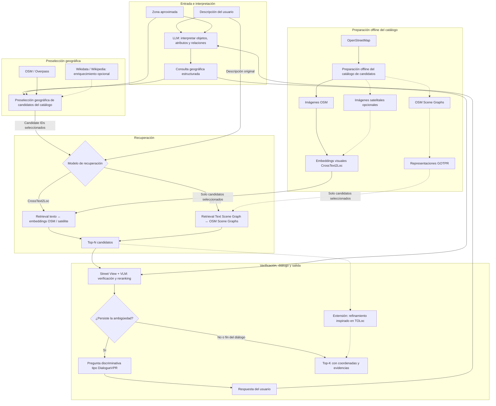

# TFG: geolocalización a partir de descripciones y diálogo

## 1. Fuente y estado del documento

Este documento define una propuesta de Trabajo de Fin de Grado cuyo contexto de investigación procede de [BASELINE.md](../BASELINE.md), fechado el 24 de septiembre de 2026. Las prioridades de desarrollo incorporan las decisiones de alcance acordadas posteriormente con el autor del proyecto. No describe un sistema ya implementado ni presenta resultados experimentales propios.

Se distinguen tres niveles: **estado del arte**, que recoge los trabajos descritos en la fuente; **arquitectura propuesta**, que organiza sus ideas para el TFG; y **posibles extensiones**, cuya incorporación no está decidida. Las cifras experimentales se atribuyen a BASELINE.md y requieren contraste bibliográfico. Este documento es la referencia de alcance; [TFG_COMPONENTS.md](../TFG_COMPONENTS.md) resume su implementación y [LICENSES_AND_PERMISSIONS.md](LICENSES_AND_PERMISSIONS.md) registra las condiciones de reutilización.

## 2. Problema que se quiere resolver

Una persona puede conocer aproximadamente la zona en la que se encuentra y describir lo que ve, pero desconocer su ubicación concreta. Por ejemplo:

> Estoy en el centro de Madrid. A mi derecha veo un edificio con reloj, estoy en una plaza y veo una torre alta de ladrillo.

El problema consiste en transformar esa descripción en un conjunto reducido de ubicaciones geográficas compatibles. La dificultad no se limita a reconocer palabras como «plaza» o «torre»: es necesario interpretar atributos, relaciones espaciales y visibilidad desde el punto de observación.

Las descripciones humanas pueden ser incompletas o ambiguas. Además, OpenStreetMap (OSM) no siempre recoge detalles visuales, como materiales, colores o relojes en fachadas. Varias ubicaciones pueden compartir los mismos elementos, y una relación como «a mi derecha» depende de hacia dónde mira la persona; no equivale por sí sola a una dirección cardinal.

El contexto de partida no presenta una solución general capaz de localizar con fiabilidad cualquier descripción en cualquier ciudad. Sí considera razonable una prueba de concepto —PoC— con una región aproximada conocida, como el centro de Madrid.

## 3. Objetivo y alcance

El objetivo es definir y, en una fase posterior, construir y evaluar un sistema híbrido que reciba una descripción en lenguaje natural y una zona aproximada, recupere candidatos geográficos, contraste sus evidencias y utilice preguntas de aclaración cuando persista la ambigüedad.

La salida prevista es un **Top-K de candidatos**: una lista ordenada de K ubicaciones, con coordenadas asociadas y una explicación de las coincidencias y discrepancias con la descripción. Recuperar un lugar o una zona compatible no equivale a estimar con precisión la posición de la persona dentro de esa zona.

Madrid es el escenario objetivo. La bbox del piloto está fijada en D004; la extensión definitiva de Madrid y el conjunto de evaluación siguen pendientes. El ámbito puede ser una parte de la ciudad declarada previamente, pero no se recortará alrededor de la respuesta correcta de cada consulta. La zona aproximada aportada por el usuario y las pistas de su descripción sí podrán restringir la búsqueda. Se reutilizarán modelos preentrenados con pesos fijos, sin entrenamiento desde cero ni fine-tuning, y sin pedir a un LLM que adivine coordenadas. La preparación de imágenes, grafos o índices locales no modifica los pesos y forma parte del procesamiento de datos.

El objetivo incluye comparar CrossText2Loc y GOTPR como dos variantes de recuperación con pesos fijos sobre consultas y un ámbito de Madrid comunes. No se establece una cascada obligatoria ni una fusión de puntuaciones. El primer prototipo podrá ejecutar una sola variante, pero no sustituye la comparación prevista.

El objetivo final es implementar y evaluar el recorrido principal del grafo de la sección 5: interpretación, generación geográfica, preselección sobre el catálogo offline, recuperación, verificación visual, diálogo y salida Top-K. El primer hito será un núcleo evaluable con LLM y un recuperador; la verificación y el diálogo son prioridades para alcanzar el sistema final, no requisitos para ejecutar ese primer hito. Wikidata/Wikipedia, las imágenes satelitales y el refinamiento con TOLoc quedan como extensiones condicionadas a su utilidad y al tiempo disponible. La sección 9 establece el orden de implementación y sus criterios de evaluación.

La definición del sistema se acompaña de un [prototipo frontend interactivo: Atlas](../frontend/README.md), con búsqueda, candidatos, comparación, diálogo e historial simulados. Este prototipo permite revisar la interfaz; no ejecuta modelos, no integra el backend y no aporta resultados experimentales. La organización prevista del catálogo y la evaluación se resume en [MADRID_DATASET.md](MADRID_DATASET.md). La localización global y la precisión comparable a un GPS no constituyen compromisos del TFG.

## 4. Estado del arte de referencia

La revisión desarrollada, con una comparación global y una síntesis de las cuestiones abiertas, se encuentra en [STATE_OF_THE_ART.md](STATE_OF_THE_ART.md). Este apartado conserva el resumen de referencia para la definición del proyecto.

### 4.1. SPOT: del lenguaje a consultas sobre OSM

Según BASELINE.md, SPOT es una herramienta de código abierto de Deutsche Welle, presentada en ACL 2025 y disponible como SPOT v2.0. Interpreta descripciones mediante modelos como Mistral/Llama, utiliza un sistema semántico de etiquetas de OSM y transforma el texto en consultas geoespaciales que devuelven candidatos en un mapa.

Es una referencia para la primera capa del sistema: pasar de lenguaje natural a búsqueda geográfica. Su limitación principal para este caso es la dependencia de la cobertura y consistencia de las etiquetas de OSM. No puede darse por hecho que atributos como «fachada de ladrillo» o «edificio con reloj» estén registrados.

### 4.2. CrossText2Loc y CVG-Text

El trabajo *Where am I? Cross-View Geo-localization with Natural Language Descriptions*, presentado en ICCV 2025 según la fuente, plantea recuperar una ubicación a partir de una descripción de lo que observa una persona, utilizando OSM o imágenes satelitales. CrossText2Loc está diseñado para descripciones largas y contempla reducir el espacio de búsqueda mediante una región aproximada conocida.

Su dataset, **CVG-Text**, reúne más de 30.000 posiciones en Nueva York, Brisbane y Tokio, con Street View, imágenes satelitales, OSM y una descripción textual asociada. BASELINE.md indica que hay código y checkpoints publicados y que el trabajo mejora en más de diez puntos el Top-1 Recall respecto a los métodos comparados. Este resultado pertenece a sus experimentos y no constituye una previsión de rendimiento en Madrid.

Una limitación relevante es el origen de las descripciones: no proceden principalmente de personas escribiendo espontáneamente, sino que se generan a partir de Street View mediante GPT-4o, OCR —reconocimiento de texto en imágenes— y segmentación de mundo abierto, con control de calidad posterior. Por tanto, el comportamiento con descripciones humanas libres es una cuestión que el TFG tendría que evaluar.

En la arquitectura propuesta, CrossText2Loc sería una opción para la recuperación semántica de tiles —porciones del mapa o de la imagen satelital— compatibles con la descripción.

### 4.3. GOTPR y los grafos de escena

*General Outdoor Text-Based Place Recognition Using Scene Graph Retrieval with OpenStreetMap* (GOTPR) se presenta en BASELINE.md como un trabajo de IEEE Robotics and Automation Letters de 2025, con implementación bajo licencia MIT.

Su idea central es representar la descripción mediante un **grafo de escena**: los objetos o entidades se relacionan mediante conexiones que expresan su disposición espacial. En el ejemplo del proyecto, podrían representarse la persona, una plaza, un edificio y una torre, junto con relaciones como «delante», «a la derecha» o «detrás» y atributos como la presencia de un reloj. Este ejemplo es conceptual, no una especificación del formato interno del modelo.

El método GOTPR compara grafos derivados de OSM con grafos textuales. Esto no garantiza que el repositorio publique un conversor completo desde Overpass ni desde lenguaje libre a sus entradas: deben comprobarse y adaptar las herramientas de preparación. La fuente indica que sus autores realizaron experimentos con descripciones de usuarios y utilizaron un LLM para convertir el lenguaje libre al formato requerido, pero esa conversión completa no forma parte del repositorio auditado.

Su interés para el TFG es contrastar la disposición de los elementos, además de su presencia. No obstante, representar un atributo en la descripción no garantiza que exista información equivalente en OSM, y las relaciones relativas al observador requieren tratar la orientación.

### 4.4. Diferencias y posible complementariedad

| Aspecto | CrossText2Loc | GOTPR |
| --- | --- | --- |
| Énfasis descrito en la fuente | Recuperación a partir de descripciones largas | Recuperación mediante grafos de escena |
| Información geográfica | OSM o imágenes satelitales | OSM y grafos derivados |
| Resultado descrito | Tile o localización candidata | Lugar candidato |
| Aportación posible al TFG | Encontrar zonas semánticamente compatibles | Contrastar relaciones espaciales entre elementos |
| Cautela para la evaluación | Textos de CVG-Text principalmente generados | Cobertura de OSM e interpretación de relaciones |

Una hipótesis de integración sería utilizar ambos sobre los mismos `candidate_id` preseleccionados y comparar sus rankings. CrossText2Loc contrastaría el texto con representaciones de imágenes OSM o satelitales; GOTPR contrastaría un Text Scene Graph con OSM Scene Graphs. También podrían compararse como alternativas antes de combinarlos. BASELINE.md respalda su interés conjunto, pero no define una interfaz común, una fusión de puntuaciones ni un orden obligatorio entre ambos. Su complementariedad es una hipótesis que se debe comprobar, no una mejora demostrada para este TFG.

### 4.5. TOL/TOLoc: de recuperar una zona a estimar una posición

Según BASELINE.md, *TOL: Textual Localization with OpenStreetMap* es una referencia de IEEE RA-L 2026. Su modelo, TOLoc, aborda la localización 2D sin una posición GNSS inicial en dos etapas: recuperar la zona de OSM más probable y alinear texto y mapa para estimar una posición dentro de ella.

La fuente describe aproximadamente 121.000 consultas textuales y 316 km de trayectorias en Boston, Karlsruhe y Singapur, con código, datos y modelos publicados desde julio de 2026. Las consultas se generan automáticamente desde OSM con reglas y plantillas; no equivalen a conversaciones humanas.

Los checkpoints citados en BASELINE.md alcanzan aproximadamente un 3,5–4,4 % de éxito a 5 m y un 15,8–26,4 % a 25 m, dependiendo del modelo y en su configuración publicada. Estas cifras ilustran la dificultad de la estimación métrica; no son directamente comparables con recuperar correctamente un tile.

TOLoc sirve como referencia para una **posible extensión de refinamiento de posición**. Su incorporación no está decidida y no es necesaria para describir una primera salida de candidatos con coordenadas asociadas.

### 4.6. DialogueVPR y referencias multimodales

**DialogueVPR**, presentado como un trabajo de CVPR 2026, aborda las descripciones incompletas mediante diálogo. Entrena un componente llamado DQ-pilot para elegir preguntas que permitan distinguir candidatos. El TFG propone inspirarse en este paradigma; no presupone adoptar ni entrenar ese componente.

BASELINE.md recoge además dos referencias para posibles alternativas o extensiones multimodales:

- **Turning Generators into Retrievers**, identificado en el texto como CVPR Findings 2026 y relacionado con «MLLM Retriever» en la tabla inicial. Adapta modelos multimodales de gran tamaño para recuperar imágenes satelitales desde texto. La fuente atribuye una mejora de 12,2 puntos en Recall@1 sobre GeoText-1652 y resultados punteros en varias subtareas de CVG-Text.
- **GeoBridge**, presentado en CVPR 2026, crea un espacio contrastivo común
  para texto, Street View, satélite y *drone*. La auditoría del código confirma
  encoders específicos por vista, normalización L2 y ranking por producto
  matricial; también confirma que el release público de GeoLoc contiene solo el
  subconjunto *drone*. No soporta imágenes OSM en su versión original:
  mapas estáticos y hechos OSM pertenecen a GeoBridge++, sin implementación o
  checkpoint diferenciado en el repositorio auditado. Véase
  [requisitos auditados de GeoBridge](DATASET_MODEL_REQUIREMENTS.md#7-geobridge-como-extensión-opcional).

### 4.7. Estado de GeoBridge en este proyecto

GeoBridge queda aceptado únicamente como **extensión opcional/experimental**
(D036), no como requisito del MVP. Su posición inicial recomendada (D037,
todavía propuesta) es después de la preselección: como retriever alternativo
texto→imagen o como reranker de un Top-N. Una fusión con CrossText2Loc, GOTPR o
un VLM sería metodología propia y necesitaría calibración y ablaciones.

El uso en Madrid está condicionado por las licencias ausentes del código y del
checkpoint, por los permisos de la fuente visual y por una validación zero-shot.
En particular, la disponibilidad pública de imágenes de Google no autoriza su
descarga, almacenamiento ni conversión en embeddings. Estas condiciones están
registradas en D038 y D039.

## 5. Arquitectura híbrida propuesta

La propuesta combina **LLM + OSM/Wikidata + catálogo offline + CrossText2Loc/GOTPR + Street View/VLM + diálogo tipo DialogueVPR**. Cada bloque aporta una función distinta; los modelos concretos, las interfaces y la combinación de resultados siguen abiertos.

El diagrama expresa el sistema final deseado. El catálogo de candidatos y sus representaciones se preparan offline a partir de OSM; durante la consulta, la preselección limita los identificadores que se entregan al modelo de recuperación. CrossText2Loc y GOTPR se implementarán como variantes comparables, empezando por una para validar el recorrido. Google Street View es la fuente prevista de fotografías reales para el VLM, condicionada a confirmar las condiciones del uso concreto; no se considera descartada ni autorizada automáticamente. Diálogo y verificación visual forman parte del objetivo final. Wikidata/Wikipedia y las imágenes satelitales son enriquecimientos opcionales, mientras que TOLoc es una extensión de refinamiento. El primer hito puede devolver Top-K antes de incorporar verificación y diálogo.

La flecha desde la consulta estructurada al recuperador representa una interfaz conceptual. En CrossText2Loc se conservará una descripción textual junto a las imágenes OSM; el JSON de restricciones sirve para la búsqueda geográfica y no sustituye por sí solo al texto de entrada. Para GOTPR, habrá que adaptar la descripción y los datos OSM a sus grafos. Estas conversiones deberán respetar el formato del checkpoint seleccionado.

| Componente | Función prevista |
| --- | --- |
| LLM, modelo de lenguaje | Interpretar la descripción y las respuestas; extraer zona, objetos, atributos, relaciones y texto visible |
| OSM y enfoque tipo SPOT | Buscar lugares compatibles con las restricciones geográficas disponibles |
| Wikidata/Wikipedia | Aportar, si se incorpora, información complementaria sobre lugares |
| CrossText2Loc | Recuperar zonas de OSM o satélite compatibles con el texto |
| GOTPR | Contrastar descripciones y candidatos mediante grafos de escena |
| Street View | Proporcionar panoramas cercanos a los candidatos para examinar su apariencia |
| VLM, modelo de visión y lenguaje | Comparar la descripción con imágenes y aportar evidencias para reordenar candidatos |
| GeoBridge | Extensión opcional para recuperar o reordenar candidatos mediante similitud texto–imagen de calle, satélite o *drone*; no usa OSM raster en la versión auditada |
| Diálogo tipo DialogueVPR | Obtener información que permita distinguir las alternativas restantes |
| Salida Top-K | Comunicar ubicaciones posibles, coordenadas y motivos de su selección |

## 6. Pipeline completo: de la descripción libre al Top-K

La siguiente secuencia desarrolla el funcionamiento propuesto del sistema final. Los pasos 1–7 constituyen el núcleo inicial; los pasos 8–12 incorporan verificación visual y diálogo, y el paso 13 es una extensión opcional. El paso 14 describe la salida común, que también puede producirse directamente desde el núcleo. Se trata de un diseño pendiente de implementación y evaluación.

1. **El usuario introduce una descripción libre en lenguaje natural.** Describe lo que ve desde su posición: objetos, edificios, colores, carteles y relaciones como «delante» o «a mi derecha». Puede aportar una zona aproximada. Si no lo hace, el sistema utiliza el ámbito definido para el proyecto, por ejemplo Madrid, sin inferir un recorte a partir de la respuesta correcta.

2. **Un LLM interpreta la descripción y genera información estructurada.** Extrae la zona mencionada, objetos, atributos, relaciones espaciales, texto visible y ambigüedades. Conserva también la descripción original. «A mi derecha» no se convierte en una dirección cardinal sin conocer la orientación del usuario. Se contempla utilizar un modelo preentrenado desplegado en Azure, sin crearlo ni entrenarlo desde cero; el proveedor y el modelo concretos siguen abiertos.

3. **El sistema transforma las restricciones utilizables en consultas geográficas, siguiendo un enfoque inspirado en SPOT.** El LLM ayuda a interpretar qué buscar y las herramientas ejecutan las consultas sobre OSM. Por ejemplo, pueden buscar plazas con iglesias próximas dentro del ámbito indicado. Los detalles que OSM no pueda representar se conservan para etapas posteriores. La reutilización directa de SPOT o la implementación de una capa inspirada en él sigue pendiente.

4. **Las consultas sobre OSM generan ubicaciones candidatas.** Se obtienen objetos, geometrías, etiquetas y coordenadas. La selección se basa exclusivamente en el ámbito declarado y las pistas disponibles, sin utilizar la ubicación real reservada para evaluar. La ausencia de una etiqueta en OSM no demuestra que el elemento no exista; habrá que evitar filtros excesivamente restrictivos y medir cuántos candidatos correctos se pierden en esta etapa.

5. **El catálogo se prepara offline y la consulta selecciona sus candidatos.** La preparación obtiene de OSM las geometrías y etiquetas, genera las representaciones compatibles y calcula o almacena los embeddings que corresponda. Durante la consulta, la zona y la consulta estructurada se utilizan para preseleccionar `candidate_id` del catálogo; esa preselección puede consultar OSM/Overpass y, si se incorpora, Wikidata/Wikipedia. Overpass aporta datos vectoriales, geometrías y etiquetas; no genera por sí mismo las imágenes OSM. Para **CrossText2Loc**, la recuperación compara el texto original con los embeddings de las imágenes OSM o satelitales de los candidatos seleccionados. Para **GOTPR**, un adaptador debe construir el Text Scene Graph y compararlo con los OSM Scene Graphs compatibles de los candidatos seleccionados; el repositorio oficial no ofrece por sí solo todo el conversor desde texto libre y OSM crudo. Sus categorías, relaciones y codificación numérica deben ajustarse al modelo preentrenado; no basta con proporcionarle imágenes OSM y texto libre. Son dos alternativas de recuperación, no dos pasos consecutivos obligatorios. Se implementan y evalúan por separado bajo condiciones comparables.

6. **CrossText2Loc o GOTPR compara la consulta con los candidatos.** Se ejecuta el modelo con sus pesos preentrenados, sin entrenamiento ni fine-tuning. Produce puntuaciones que permiten ordenar las ubicaciones candidatas. Estas puntuaciones no se interpretan automáticamente como probabilidades de acierto. Se registrará el checkpoint utilizado, es decir, la copia de los pesos aprendidos que se carga para inferencia.

7. **El sistema selecciona una lista de candidatos para continuar.** Cada candidato conserva su identificador, coordenadas, puntuación y evidencia disponible. Hasta aquí llega el núcleo inicial, que ya puede devolver un Top-K mediante el paso 14 y evaluarse. El número de candidatos que pasan a verificación y el K de salida son parámetros diferentes, todavía por definir; BASELINE.md sugiere verificar unos 20–50 candidatos como orientación experimental, no como requisito.

8. **Como ampliación visual, el sistema obtiene imágenes de Street View cercanas a los candidatos seleccionados.** Las herramientas consultan el proveedor de imágenes y registran su posición y orientación cuando estén disponibles. Puede haber candidatos sin cobertura o sin una vista adecuada. El acceso, las condiciones de uso y el proveedor deberán comprobarse antes de incorporar esta etapa.

9. **Un VLM contrasta la descripción con las imágenes de Street View.** Busca evidencias como un reloj, una fachada roja o una torre y distingue coincidencias, contradicciones y detalles no verificables. Sus resultados se utilizan para reordenar los candidatos. Puede emplearse un modelo visual adicional o un modelo multimodal que también desempeñe el papel del LLM inicial, si se comprueba que cumple ambas funciones.

10. **El sistema comprueba si quedan candidatos ambiguos o información insuficiente.** Aplica criterios que habrá que definir y evaluar: diferencias entre candidatos, evidencias contradictorias o falta de orientación, por ejemplo. Si no hay evidencia suficiente, no debe presentar una ubicación como segura. Esta decisión también puede aplicarse sobre los resultados del núcleo cuando la verificación visual aún no esté implementada.

11. **Si hace falta, el LLM formula una pregunta discriminativa, inspirada en DialogueVPR.** Por ejemplo: «¿Ves una fuente en el centro de la plaza?», siempre que esa diferencia esté respaldada por los datos de los candidatos. Se puede reutilizar el mismo LLM; no se requiere incorporar un modelo de diálogo independiente ni se presupone reproducir DQ-pilot.

12. **El usuario responde y el sistema actualiza la búsqueda.** El LLM incorpora la nueva información a la descripción y a las restricciones. Después se repiten las etapas necesarias: generación, recuperación o verificación. La búsqueda puede ampliarse dentro del ámbito permitido si las nuevas pistas contradicen la selección anterior; la política de actualización deberá definirse y evaluarse.

13. **Opcionalmente, se explora un refinamiento de posición inspirado en TOLoc.** Es una extensión independiente, con sus propias entradas y evaluación. Su objetivo sería estimar una posición más precisa. No se presupone que pueda conectarse directamente al resultado de CrossText2Loc o GOTPR; será necesario estudiar la compatibilidad de sus representaciones y mantener la restricción de pesos fijos.

14. **El sistema devuelve el Top-K final con coordenadas y evidencias.** Presenta las ubicaciones más compatibles, las coincidencias y las dudas pendientes, distinguiendo datos cartográficos de comprobaciones visuales. Finaliza cuando se cumple el criterio de parada, el usuario decide terminar o se alcanza el límite de interacciones. Si no hay candidatos suficientes, lo comunica sin inventarlos. Las coordenadas representan los candidatos recuperados; solo se presentarían como una estimación refinada del observador si esa etapa se ha implementado y evaluado.

Durante la evaluación del TFG, la ubicación real se utiliza únicamente para medir el acierto del proceso, nunca para ayudar a seleccionar candidatos. Los pasos anteriores describen el orden de ejecución del sistema completo; el orden de desarrollo y las alternativas de alcance se establecen en la sección 9.

### Obtención automática de datos y papel del LLM

El LLM interpretará la descripción y podrá coordinar herramientas de consulta y preparación de datos siguiendo un enfoque inspirado en SPOT. Las herramientas ejecutarán las consultas, obtendrán geometrías y etiquetas, y generarán u obtendrán las imágenes necesarias. No se exige descargar ni seleccionar imágenes manualmente. La base de datos OSM y las imágenes de mapa que utiliza el recuperador son representaciones distintas; se debe comprobar la compatibilidad del renderizado, escala, orientación y resolución con el modelo elegido.

El catálogo de referencia se construirá offline para la zona piloto y se reutilizará entre consultas; no se descargarán imágenes ni se recalcularán embeddings para cada petición. Durante la inferencia, la preselección podrá utilizar la zona, la consulta estructurada, OSM/Overpass y el enriquecimiento opcional disponible para devolver un subconjunto de `candidate_id`. En ambos casos se registrarán la cobertura, los puntos candidatos, las fuentes y las transformaciones. La selección se basará en el ámbito declarado y en información disponible en la consulta, nunca en la respuesta de evaluación. Si el filtro geográfico excluye el lugar correcto, ese caso contará como fallo del sistema completo.

### Verificación con Street View y VLM

Esta etapa busca cubrir detalles que OSM puede omitir: el material de una torre, un reloj o la apariencia de una fachada. También intenta comprobar si la combinación descrita es visible desde las proximidades de un candidato.

La verificación depende del panorama y de su orientación. No identificar un reloj en una imagen no equivale necesariamente a demostrar que no existe. Para explicar el resultado se distinguirán coincidencias observadas, contradicciones y atributos no verificables. Google Street View es la fuente prevista; quedan pendientes confirmar el uso permitido, la cobertura y el VLM concreto.

### Diálogo y orientación

Las preguntas deberían estar motivadas por las diferencias entre candidatos. Siguiendo el ejemplo de BASELINE.md, podría preguntarse si la torre termina en una aguja o en una parte superior rectangular, o si una calle amplia sale de la plaza.

Para interpretar «a mi derecha» sería necesario conocer hacia dónde mira la persona, considerar orientaciones posibles o reformular la relación entre objetos: «¿La torre queda al otro lado de la plaza respecto al edificio del reloj?». No se decide todavía cuál de estas estrategias utilizar. El beneficio esperado del diálogo es reducir la ambigüedad, y deberá comprobarse frente al uso de una sola descripción.

### Mapas OSM y fotografías de calle

Una imagen OSM para CrossText2Loc es un mapa renderizado con información cartográfica. Una fotografía de Street View muestra el entorno real. El VLM puede buscar ladrillo visible o un reloj en una fotografía con encuadre y resolución adecuados; no puede comprobar su apariencia desde un contorno de edificio en un mapa. Consultar una etiqueta OSM sobre material es evidencia cartográfica, no verificación fotográfica.

La verificación visual permite revisar la selección y el orden de los candidatos. No implica automáticamente refinar la posición dentro de una tesela. La posición de la cámara de Street View tampoco se identifica sin más con la posición del usuario. El refinamiento métrico con TOLoc permanece opcional.

Las condiciones de Google y del proveedor del VLM deben revisarse para el flujo concreto, incluida la transferencia de imágenes y su retención. Inferencia con pesos fijos y evaluación de modelos son actividades distintas; no se afirma una prohibición universal de cualquier inferencia. Véase [LICENSES_AND_PERMISSIONS.md](LICENSES_AND_PERMISSIONS.md).

## 7. Resultado esperado

Cada candidato de la lista final debería permitir entender:

- Qué lugar o zona se propone y cuáles son sus coordenadas asociadas.
- Qué partes de la descripción coinciden con la información geográfica o visual.
- Qué discrepancias persisten y qué atributos no se han podido comprobar.
- Qué evidencia justifica su posición relativa en la lista.

Las coordenadas de un lugar, tile o panorama candidato no deben confundirse con una estimación precisa de la posición del observador. La representación espacial del candidato y el significado exacto de sus coordenadas son decisiones pendientes.

BASELINE.md muestra porcentajes de confianza únicamente como ejemplos de salida. No son resultados del proyecto ni justifican asignar probabilidades concretas. El método de puntuación y, si se usan probabilidades, su calibración tendrían que definirse y evaluarse.

## 8. Posible evaluación

Las siguientes métricas son **propuestas para evaluar el TFG**, coherentes con los objetivos y las referencias de BASELINE.md. No constituyen un protocolo cerrado ni objetivos numéricos de rendimiento.

| Dimensión | Métrica posible | Qué permitiría comprobar |
| --- | --- | --- |
| Recuperación | Recall@K, incluido Recall@1 | Proporción de consultas cuya ubicación correcta aparece entre los K primeros candidatos |
| Localización | Error geográfico en metros | Distancia entre la coordenada estimada y la posición real, si la salida permite esa comparación |
| Precisión espacial | Porcentaje de éxito bajo umbrales de distancia | Frecuencia con la que se alcanza una tolerancia espacial definida |
| Verificación visual | Cambio de Recall@K antes y después del reranking | Si Street View + VLM mejora la selección y ordenación |
| Diálogo | Cambio del acierto y número de turnos necesarios | Si las preguntas resuelven ambigüedades con un esfuerzo razonable |
| Evidencias | Proporción de coincidencias y discrepancias correctamente justificadas | Si las explicaciones se apoyan en información comprobable |
| Generación de candidatos | Cobertura del lugar correcto antes del recuperador | Cuántos fallos introduce el filtrado geográfico previo |
| Recursos | Latencia, consumo de memoria y coste por consulta | Viabilidad del procesamiento bajo demanda, la caché y las ampliaciones |

Los umbrales de 5 m y 25 m aparecen en la referencia a TOLoc y podrían servir para estudiar precisión métrica, pero no se adoptan como requisitos del TFG. Para Recall@K habría que definir qué cuenta como candidato correcto: un lugar, un tile o una posición dentro de una tolerancia. Una evaluación por tiles no debe presentarse como precisión métrica.

Sería útil comparar progresivamente la búsqueda sobre OSM, los enfoques de recuperación, la incorporación de verificación visual y el diálogo. Así se podría estudiar la contribución de cada bloque. El conjunto debería permitir analizar descripciones humanas, dada la diferencia con los textos generados de CVG-Text y TOL.

BASELINE.md menciona como ejemplo una prueba con 100 ubicaciones reales; el tamaño, la selección de ubicaciones, las anotaciones y las condiciones de comparación siguen abiertos. No se atribuye a Madrid el rendimiento publicado en otras ciudades y configuraciones.

### Condiciones de una evaluación válida en Madrid

El ámbito geográfico se fijará antes de evaluar. Una restricción adicional solo podrá proceder de la descripción, del diálogo o del procesamiento del sistema a partir de esos datos. No se utilizará la ubicación real para centrar un recorte, insertar el candidato correcto ni corregir retrospectivamente la selección. Un experimento limitado a un distrito se presentará como tal, no como búsqueda en toda la ciudad.

Se separarán los ejemplos de desarrollo, usados para ajustar instrucciones, filtros y parámetros, de las consultas de prueba final. Se registrarán el checkpoint, el idioma y las posibles traducciones del texto, las versiones de datos y los candidatos examinados. Las coordenadas reales solo servirán para evaluar. Se informará del resultado de extremo a extremo, además de las métricas por etapa; los casos sin candidatos o sin imágenes no se omitirán del resultado global.

Las comparaciones propuestas son: búsqueda geográfica sola; recuperación con texto original frente a texto preparado por el LLM sobre la misma galería; sistema con y sin filtrado geográfico; incorporación de verificación visual; incorporación de diálogo. Se controlarán cobertura y presupuesto de búsqueda para no atribuir al modelo mejoras causadas por facilitarle los candidatos. Una reproducción en una ciudad de CVG-Text puede servir como comprobación técnica, pero no sustituye la evaluación objetivo en Madrid.

## 9. Prioridades de desarrollo y criterios de avance

El orden de desarrollo no impone un orden entre los dos recuperadores durante la inferencia. Se conserva el objetivo de comparar ambos y construir el sistema con verificación visual y diálogo. Las fases 4, 5 y 6 del roadmap pueden avanzar parcialmente en paralelo: la infraestructura del LLM, la preselección y la evaluación no deben esperar a D007, D013 y D016, pero la evaluación CrossText2Loc no se cerrará hasta resolverlos.

| Prioridad | Trabajo | Criterio de avance |
| --- | --- | --- |
| P0 — Viabilidad, datos y evaluación | Fijar región, unidad candidata, criterio de acierto, presupuesto y muestras de desarrollo; comprobar permisos, pesos y formatos | Una inferencia reproducible con entradas compatibles y condiciones de uso aclaradas |
| P1 — Primer recorrido | LLM, herramientas OSM, preparación de entradas y un recuperador con Top-K | Recorrido evaluable en Madrid con coordenadas trazables y registro de errores |
| P2 — Comparación de recuperadores | Incorporar el segundo recuperador y comparar CrossText2Loc y GOTPR con pesos fijos | Mismas consultas, ámbito y criterio de acierto; cobertura y presupuesto de candidatos documentados |
| P3 — Verificación visual | Fotografías de Google Street View y VLM, una vez confirmado el uso permitido | Comparación antes/después, incluyendo falta de cobertura, evidencias no verificables, coste y latencia |
| P4 — Diálogo e integración | Preguntas inspiradas en DialogueVPR y actualización de la búsqueda | Comparación consulta única/diálogo, límites de turnos y salida ante ambigüedad persistente |
| P5 — Extensiones opcionales | TOLoc, Wikidata/Wikipedia, satélite o GeoBridge si se justifican y están autorizados | Evaluación separada del beneficio y del coste añadido |

CrossText2Loc es la primera opción de prueba heredada del diseño inicial; si sus permisos o formatos bloquean el arranque, se puede comenzar con GOTPR documentando el motivo. Esto no implica que un método sea superior en Madrid. No se entrenan ni ajustan los pesos de ninguno.

El diálogo puede desarrollarse en paralelo a la verificación visual con evidencias OSM mientras se aclara el acceso a fotografías. No se presupone adoptar DQ-pilot. Tampoco se presupone que el LLM y el VLM deban ser modelos distintos.

Si la verificación visual queda bloqueada, el núcleo y la comparación pueden seguir avanzando. Se documentará esa etapa como pendiente o se acordará una fuente alternativa de fotografías con permisos adecuados. Un mapa renderizado no sustituye esa evidencia fotográfica.

### 9.1. Preparación y búsqueda de candidatos

El catálogo de referencia de Madrid y el dataset de evaluación son recursos distintos. El catálogo contiene ubicaciones de búsqueda y representaciones asociadas; el dataset contiene consultas y posiciones reales reservadas para medir resultados. La separación se detalla en [MADRID_DATASET.md](MADRID_DATASET.md). No basta con incluir únicamente los lugares de las consultas.

La preparación cartográfica se realizará offline para la zona piloto y se reutilizará entre consultas. Overpass devuelve objetos, etiquetas y geometrías, no fotografías ni entradas de modelo completas. El backend debe consultar y normalizar esos datos durante la preparación; las teselas o imágenes OSM se obtendrán mediante el mecanismo de renderizado compatible con CrossText2Loc. En inferencia, Overpass puede aportar información para la preselección, pero no sustituye al catálogo offline. El LLM puede coordinar estas herramientas, pero no las sustituye.

CrossText2Loc recupera imágenes de mapa; GOTPR recupera grafos y puede reducir la búsqueda mediante su mecanismo de extracción de candidatos. Un filtro geográfico previo inspirado en SPOT es una etapa distinta y deberá compararse con la búsqueda sin ese filtro. No es obligatorio ejecutar SPOT ni Milvus en todas las configuraciones. El filtro externo no debe confundirse con la candidate extraction interna de GOTPR.

Se mantendrá un identificador común y una correspondencia entre candidato, coordenadas, imagen y grafo cuando proceda. Se registrarán diferencias de cobertura o de soporte espacial: compartir identificador no basta para garantizar una comparación justa. Las coordenadas se resuelven desde los metadatos del candidato recuperado; estos recuperadores no deben presentarse como regresores de una coordenada continua nueva.

### 9.2. Contratos mínimos y decisiones pendientes

Antes de ampliar la galería se fijarán los formatos de descripción estructurada, candidato y salida de cada recuperador. La descripción conservará texto original, idioma, orientación conocida o desconocida y relaciones sin inventar información. Las entradas específicas incluirán el preprocesamiento de imagen o las características de nodos y aristas exigidas por el checkpoint.

Siguen pendientes el límite exacto de Madrid, el muestreo de candidatos, el tamaño y origen del dataset, K, tolerancias métricas, hardware, presupuesto, LLM/VLM y política de preguntas. Estas decisiones no quedan resueltas por los ejemplos del documento.

## 10. Riesgos, limitaciones y decisiones abiertas

| Riesgo o limitación derivado del contexto | Consecuencia para el proyecto |
| --- | --- |
| Etiquetas de OSM incompletas o inconsistentes | Pueden faltar candidatos o atributos necesarios para distinguirlos |
| Descripciones humanas ruidosas o incompletas | Una única consulta puede no aportar información suficiente |
| Orientación del observador desconocida | Las relaciones egocéntricas no se pueden convertir directamente en direcciones cardinales |
| Diferencia entre textos generados y espontáneos | Los resultados publicados pueden no trasladarse a usuarios reales |
| Aplicación en una ciudad distinta de las evaluadas | El rendimiento en Madrid debe comprobarse experimentalmente |
| Dependencia de panoramas adecuados | La comprobación visual puede ser parcial o inconcluyente |
| Dificultad de la estimación métrica | Un lugar recuperado correctamente no garantiza una posición exacta |
| Combinación de métodos no evaluada en este TFG | La arquitectura híbrida propuesta no implica una mejora demostrada |
| Código/pesos GeoBridge sin licencia y galería visual condicionada por proveedor | La extensión no debe implementarse hasta resolver D038; no afecta al MVP |

Se priorizan Madrid, pesos fijos, la comparación CrossText2Loc–GOTPR, verificación mediante fotografías reales y diálogo. Las decisiones pendientes se enumeran en la sección 9.2. La combinación en cascada o fusión de puntuaciones sigue siendo una hipótesis, no un requisito.

La estimación de posición con TOLoc y la adopción de MLLM Retriever o GeoBridge
se mantienen como posibles extensiones. La disponibilidad pública de código o
pesos no resuelve por sí sola permisos, reproducibilidad, transferencia a
Madrid ni acceso a imágenes. Para GeoBridge se aplican D036–D039.

## 11. Referencias conservadas de BASELINE.md

El archivo fuente contiene títulos, nombres de proyectos, atribuciones y rótulos de enlaces, pero **no contiene URL explícitas ni destinos de hipervínculos recuperables**. Se conservan a continuación esas referencias tal como permiten identificarlas los datos disponibles. No se han inventado enlaces ni completado citas mediante fuentes externas.

| Trabajo o recurso | Identificación y atribución en BASELINE.md | Rótulos de recursos conservados |
| --- | --- | --- |
| SPOT / FindThatSpot | Deutsche Welle; ACL 2025; SPOT v2.0; ACL Anthology | «Probar SPOT / FindThatSpot»; «Código de SPOT» |
| CrossText2Loc / CVG-Text | *Where am I? Cross-View Geo-localization with Natural Language Descriptions*; ICCV 2025; Open Access CVF; Junyan Ye | «CrossText2Loc / CVG-Text en GitHub» |
| GOTPR | *General Outdoor Text-Based Place Recognition Using Scene Graph Retrieval with OpenStreetMap*; IEEE RA-L 2025; Seoul National University | «Proyecto GOTPR» |
| TOL / TOLoc | *TOL: Textual Localization with OpenStreetMap*; IEEE RA-L 2026; arXiv; GitHub | «TOL / TOLoc en GitHub» |
| DialogueVPR | CVPR 2026; Open Access CVF; componente DQ-pilot | No se incluye un rótulo de repositorio específico |
| MLLM Retriever | *Turning Generators into Retrievers*; CVPR Findings 2026 en el texto y CVPR 2026 en la tabla inicial; arXiv; evaluación mencionada en GeoText-1652 y CVG-Text | No se incluye un rótulo de repositorio específico |
| GeoBridge | CVPR 2026; Open Access CVF; recursos de código, modelo y dataset mencionados | No se incluye un rótulo de repositorio específico |

OSM, Wikidata/Wikipedia y Street View se conservan como fuentes geográficas, de conocimiento y de imágenes propuestas en el contexto. Los enlaces incorporados posteriormente se conservan en [TFG_COMPONENTS.md](../TFG_COMPONENTS.md#7-referencias-conservadas). La verificación de las publicaciones y la normalización bibliográfica siguen pendientes.
