# Qwen3-8B: integración técnica en F5

## 1. Introducción

Qwen3-8B es el modelo de lenguaje causal textual empleado localmente en la Fase
5. No recibe imágenes ni calcula una posición: transforma descripciones y, en el
experimento F5.3, intenta extraer de ellas una estructura geográfica con evidencia
literal. En este TFG se carga con pesos preentrenados congelados, exclusivamente
para inferencia, sin entrenamiento ni *fine-tuning*.

Su papel es distinto del de los otros modelos del proyecto:

| Componente | Entrada | Responsabilidad actual | Salida |
|---|---|---|---|
| **Qwen3-8B** | Texto | Reescritura cartográfica, traducción y extracción F5.3 experimental | Texto transformado o JSON geográfico |
| **CrossText2Loc** | Texto y galería visual preparada | Recuperación exhaustiva de candidatos geográficos | Ranking Top-K con `candidate_id` y coordenadas del catálogo |
| **Qwen3-VL** | Texto e imágenes | Posible verificación visual futura | No está integrado ni debe confundirse con Qwen3-8B |

Qwen se usa junto a CrossText2Loc para estudiar si una representación textual
alternativa cambia el ranking del recuperador. Qwen **no** consulta OSM, no conoce
la galería, no puntúa candidatos y no produce coordenadas. CrossText2Loc recibe
cada variante revisada como una consulta independiente y resuelve las coordenadas
desde los metadatos de los candidatos recuperados.

Estado real:

| Fase | Estado | Papel de Qwen |
|---|---|---|
| F5.1 | Implementada | Ninguno: define el sidecar, topónimos, orientación y slots de variantes |
| F5.2/F5.2b | Implementada y ejecutada en GB10 | Genera tres variantes por descripción; después se validan y revisan |
| F5.3 | Infraestructura implementada e inferencia real ejecutada | Extrae JSON geográfico, pero su cumplimiento contractual fue insuficiente y su integración automática está bloqueada |
| DialogueChat | Futuro | Podría reformular descripciones o preguntas, pero no está implementado |
| Verificación visual | Futuro y condicionada | Requeriría un VLM y una fuente fotográfica autorizada; no corresponde a Qwen3-8B |

La metodología completa está en
[F5.1](PHASE5_TEXTUAL_VARIANTS.md),
[F5.2](PHASE5_TEXT_TRANSFORMATION.md) y
[F5.3](PHASE5_GEOGRAPHIC_EXTRACTION.md). Las decisiones D059-D064 se registran
en [DECISIONS.md](DECISIONS.md).

## 2. Modelo utilizado

### 2.1. Identidad y artefactos

Los siguientes datos proceden del snapshot y de los registros F5.2b; no se
extrapolan a otros modelos de la familia Qwen.

| Campo | Valor validado |
|---|---|
| Identificador | `Qwen/Qwen3-8B` |
| Revisión | `b968826d9c46dd6066d109eabc6255188de91218` |
| Parámetros | Aproximadamente 8,2 mil millones |
| Arquitectura | `Qwen3ForCausalLM`, Transformer decoder-only causal: 36 capas, dimensión oculta 4096, 32 cabezas de atención y 8 cabezas key/value |
| Checkpoint | Snapshot Hugging Face de la revisión anterior |
| Formato de pesos | Safetensors BF16 |
| Precisión almacenada/cargada observada | BF16; el adaptador solicita `torch_dtype="auto"` |
| Peso total de shards | 16.381.470.720 bytes |
| Tensores | 399 |
| Shards | 5 |
| Tokenizer | `Qwen2Tokenizer`, vocabulario de 151.936 tokens y chat template del snapshot; se carga mediante `AutoTokenizer` |
| Licencia declarada | Apache-2.0 en la ficha y snapshot revisados |
| Snapshot local | `$HOME/models/hf/Qwen3-8B-b968826d9c46` |
| Manifest SHA-256 F5.2 | `d95b2ee5a666c88adcb53094740c1002718f28e0dcabad56a508a9c66dce1570` |
| Ajuste del TFG | Ninguno; pesos congelados |
| Modo | *Non-thinking* |

Fuente del modelo: <https://huggingface.co/Qwen/Qwen3-8B>. Su uso local y las
condiciones de redistribución se resumen en
[LICENSES_AND_PERMISSIONS.md](LICENSES_AND_PERMISSIONS.md).

La arquitectura anterior se contrasta con el `config.json` del snapshot local:
`model_type: qwen3`, contexto configurado de 40.960 posiciones, activación SiLU,
normalización RMS y atención agrupada por consultas, reflejada por las 32 cabezas
de atención y 8 cabezas key/value. Es un modelo *decoder-only*: predice el
siguiente token condicionado por los anteriores. Los tokens especiales y el
formato conversacional proceden de `tokenizer_config.json`; el código no los
redefine.

SHA-256 de los cinco shards, en el orden registrado:

```text
31d6a825ae35f11fb85b195b4c42c146c051e446433125a215336abdf95cbf5f
5991236cea6fe21f3d43cab0f0e84448734fbbe0789816202989f2ddc9d18282
c5185c4794be2d8a9784d5753c9922db38df478ce11f9ed0b415b7304d896836
b5ee7de71fbf17db3d5704e0c8f2bc7d005ca9e1d7ca2aeb19827b0cfcaa917a
20c2d6366ab85c90786ccdd829cd2b9e7d30ef3b2ebbb998280e7e4014b542ff
```

`hash_tree_manifest()` no concatena los ficheros: calcula SHA-256 y tamaño de
cada archivo del snapshot, excluye componentes dentro de `.cache`, serializa la
lista ordenada de forma canónica y vuelve a calcular SHA-256. Así, el manifest
identifica el árbol completo, mientras los hashes anteriores identifican cada
shard de pesos.

### 2.2. Conceptos mínimos

- Un **parámetro** es un valor numérico aprendido por el modelo.
- Los **pesos** son el conjunto persistido de esos parámetros.
- Un **shard** es una parte de los pesos; dividirlos en cinco archivos facilita su almacenamiento y carga, pero no crea cinco modelos.
- Un **checkpoint** es la versión completa recuperable del modelo: configuración, pesos y archivos auxiliares necesarios para inferencia.

No debe sustituirse silenciosamente este checkpoint por `Qwen3.8`, Qwen2.5,
una cuantización o una revisión distinta. Ese cambio define otro experimento.

## 3. Arquitectura de integración

```mermaid
flowchart LR
    O[Descripción original] --> F43[Dataset F4.3]
    F43 -->|dataset_id, SHA-256 y query_id| F51[Sidecar F5.1]
    F51 --> M[materialize_variants]
    M --> A[QwenTransformersAdapter]
    A --> P[prepare_prompt]
    P --> B[build_prompt]
    B --> I[Inferencia Qwen3-8B]
    I --> R[Restauración de topónimos]
    R --> V[validate_transformation]
    V --> D[Sidecar derivado F5.2 y run.json]
    D --> H[Revisión humana]
    H --> S[Sidecar revisado]
    S --> C[CrossText2LocRetriever]
    C --> K[Rankings Top-K independientes]
    K --> E[report.json y métricas descriptivas]

    S -- proceso F5.3 separado --> G[QwenGeographicExtractor]
    G --> J[JSON geográfico y validación estricta]
    J --> X[Extracciones experimentales no conectadas al ranking]
```



El orden relevante es `materialize_variants()` →
`QwenTransformersAdapter.transform()` → `prepare_prompt()` → `build_prompt()` →
chat template/tokenización → `model.generate()` → decodificación/restauración →
`validate_transformation()`. El prompt se construye dentro del adaptador; el
pipeline calcula además su hash antes de invocarlo para dejar provenance.

La generación, la revisión y el ranking son procesos distintos:

1. `generate_f5_textual_variants.py` carga Qwen una vez, procesa el lote, cierra el adaptador y materializa F5.2.
2. `review_f5_textual_variants.py` aplica decisiones humanas sin cargar ningún modelo.
3. `rank_f5_textual_variants.py` carga CrossText2Loc, consulta las galerías y lo cierra.
4. `extract_f5_geographic_structure.py` es otra ejecución de Qwen para F5.3; no forma parte del camino hacia los rankings F5.2.

Por ello Qwen y CrossText2Loc no necesitan residir simultáneamente en GPU. Los
artefactos JSON constituyen la frontera entre procesos, lo que reduce memoria,
evita mezclar dependencias y permite revisar las salidas antes de recuperarlas.

## 4. Mapa de archivos

### 4.1. Implementación, scripts y contratos

| Archivo | Responsabilidad | Funciones o clases principales | Relación con Qwen |
|---|---|---|---|
| [`src/tfg_phase0/f5_text_transform.py`](../src/tfg_phase0/f5_text_transform.py) | Núcleo F5.2: configuración, prompts, adaptadores, protección, validación, provenance y materialización | `GenerationConfig`, `TextTransformer`, `FakeTransformer`, `QwenTransformersAdapter`, `build_prompt()`, `prepare_prompt()`, `materialize_variants()` | Implementación principal de inferencia textual |
| [`src/tfg_phase0/f5_textual_variants.py`](../src/tfg_phase0/f5_textual_variants.py) | Identidad y validación del sidecar F5.1/F5.2 | `validate_textual_variant_dataset()`, `textual_variant_dataset_id()`, `paired_variant_plan()` | Proporciona textos, topónimos revisados, estados y contrato que Qwen consume |
| [`src/tfg_phase0/f5_variant_ranking.py`](../src/tfg_phase0/f5_variant_ranking.py) | Ejecuta y compara rankings independientes | `VariantRetriever`, `run_variant_rankings()`, `paired_comparisons()`, `compare_two_rankings()` | Consume variantes generadas por Qwen, pero no carga Qwen |
| [`src/tfg_phase0/f5_geographic_extraction.py`](../src/tfg_phase0/f5_geographic_extraction.py) | Núcleo F5.3: prompt JSON, extracción, validación y comparación | `ExtractionConfig`, `QwenGeographicExtractor`, `FakeGeographicExtractor`, `build_extraction_prompt()`, `parse_and_validate_extraction()`, `materialize_extractions()` | Reutiliza `QwenTransformersAdapter`; integración automática bloqueada |
| [`src/tfg_phase0/crosstext2loc_runtime.py`](../src/tfg_phase0/crosstext2loc_runtime.py) | Runtime residente de CrossText2Loc F4.6 | `CrossText2LocRetriever.load()`, `retrieve_many()`, `close()` | Recuperador posterior e independiente; no es código Qwen |
| [`src/tfg_phase0/validation.py`](../src/tfg_phase0/validation.py) | Validadores Python de contratos JSON | `_validate_f5_transformation_run()`, `_validate_f5_variant_ranking_report()`, `_validate_f5_geographic_extraction_set()` | Revalida artefactos, hashes, IDs y restricciones de generación |
| [`scripts/generate_f5_textual_variants.py`](../scripts/generate_f5_textual_variants.py) | CLI de generación F5.2 y publicación atómica | `main()` | Construye `QwenTransformersAdapter`, ejecuta el lote y lo cierra |
| [`scripts/review_f5_textual_variants.py`](../scripts/review_f5_textual_variants.py) | Aplica revisión humana explícita | `main()` | Convierte salidas `generated` en `reviewed` o `rejected` |
| [`scripts/rank_f5_textual_variants.py`](../scripts/rank_f5_textual_variants.py) | CLI de rankings reales F4.6 | `main()` | Verifica que el texto revisado coincide con el output Qwen y carga CrossText2Loc |
| [`scripts/validate_f5_textual_variants.py`](../scripts/validate_f5_textual_variants.py) | CLI de validación F5.1/F5.2 | `main()` | Comprueba el sidecar antes y después de generar |
| [`scripts/create_f52_technical_fixture.py`](../scripts/create_f52_technical_fixture.py) | Crea seis sondas técnicas F4.3/F5.1 | `CASES`, `main()` | Prepara el lote usado para F5.2b; no ejecuta Qwen |
| [`scripts/smoke_f52_fake.py`](../scripts/smoke_f52_fake.py) | Smoke del flujo con dobles | `SmokeRetriever`, `main()` | Usa `FakeTransformer`; no prueba inferencia ni calidad Qwen |
| [`scripts/extract_f5_geographic_structure.py`](../scripts/extract_f5_geographic_structure.py) | CLI de extracción F5.3 | `main()` | Carga el adaptador Qwen y lo envuelve en `QwenGeographicExtractor` |
| [`scripts/compare_f5_geographic_extractions.py`](../scripts/compare_f5_geographic_extractions.py) | Compara extracciones F5.3 válidas | `main()` | Opera sobre JSON persistido, sin modelo cargado |
| [`scripts/create_f53_technical_fixture.py`](../scripts/create_f53_technical_fixture.py) | Crea diez sondas F5.3 sin ground truth | `CASES`, `main()` | Prepara inputs, no demuestra calidad |
| [`scripts/smoke_f53_fake.py`](../scripts/smoke_f53_fake.py) | Smoke F5.3 de diez casos | `main()` y constructores de fixtures | Usa `FakeGeographicExtractor`, no Qwen real |
| [`schemas/f5_textual_variant_dataset.schema.json`](../schemas/f5_textual_variant_dataset.schema.json) | Contrato de sidecar F5.1/F5.2 | Slots, topónimos, orientación, estados | Define qué entradas y salidas textuales son válidas |
| [`schemas/f5_transformation_run.schema.json`](../schemas/f5_transformation_run.schema.json) | Contrato de `run.json` | Modelo, generación, entorno, recursos y records | Fija `do_sample=false`, `temperature=0` y `enable_thinking=false` |
| [`schemas/f5_variant_ranking_report.schema.json`](../schemas/f5_variant_ranking_report.schema.json) | Contrato de `report.json` | Rankings y comparaciones sin fusión | Traza los efectos posteriores de cada variante |
| [`schemas/f5_geographic_extraction_set.schema.json`](../schemas/f5_geographic_extraction_set.schema.json) | Contrato de extracciones F5.3 | Entidades, relaciones, evidencias y provenance | Valida la salida estructurada de Qwen |
| [`schemas/f5_geographic_extraction_comparison.schema.json`](../schemas/f5_geographic_extraction_comparison.schema.json) | Contrato de comparación F5.3 | Comparaciones descriptivas | No contiene accuracy ni conecta con rankings |
| [`config/madrid_f51_textual_variants_template.json`](../config/madrid_f51_textual_variants_template.json) | Plantilla F5.1 | Protocolo y slots vacíos | Declara preselección OSM en stand-by y fusión desactivada |
| [`config/madrid_f43_query_dataset_draft.json`](../config/madrid_f43_query_dataset_draft.json) | Borrador de dataset fuente F4.3 | Consultas, particiones, provenance y referencias | La plantilla F5.1 lo referencia; no contiene el lote técnico F5.2b |
| [`config/madrid_f46_retriever.json`](../config/madrid_f46_retriever.json) | Configuración del runtime y galerías F4.6 | Modelo, galerías 25 m/50 m y artefactos locales | La consume el script de ranking después de cerrar Qwen |
| [`requirements-f52-qwen.txt`](../requirements-f52-qwen.txt) | Dependencias específicas del entorno Qwen | `transformers`, `accelerate`, `huggingface_hub` | No incluye ni instala PyTorch automáticamente |

### 4.2. Tests, documentación y artefactos

| Archivo o ruta | Responsabilidad | Cuándo interviene |
|---|---|---|
| [`tests/test_phase5_text_transform.py`](../tests/test_phase5_text_transform.py) | Prueba prompts, configuración, placeholders, heurísticas, materialización, adaptador local-only y rankings fake | Desarrollo y regresión F5.2 |
| [`tests/test_phase5_textual_variants.py`](../tests/test_phase5_textual_variants.py) | Prueba vínculo F4.3, spans, topónimos, orientación, estados, particiones y stand-by OSM | Validación F5.1/F5.2 |
| [`tests/test_review_f5_textual_variants.py`](../tests/test_review_f5_textual_variants.py) | Prueba cobertura exacta y decisiones `approve`/`reject` | Revisión humana |
| [`tests/test_phase5_geographic_extraction.py`](../tests/test_phase5_geographic_extraction.py) | Prueba reintentos, JSON, spans, referencias, negación, orientación y comparaciones | Desarrollo y regresión F5.3 |
| [`docs/PHASE5_TEXT_TRANSFORMATION.md`](PHASE5_TEXT_TRANSFORMATION.md) | Protocolo y evidencia experimental F5.2b | Referencia metodológica |
| [`docs/PHASE5_GEOGRAPHIC_EXTRACTION.md`](PHASE5_GEOGRAPHIC_EXTRACTION.md) | Contrato y resultado negativo de integración F5.3 | Referencia metodológica |
| [`docs/EXPERIMENTS.md`](EXPERIMENTS.md) | Registro resumido de las ejecuciones | Respaldo de resultados y entorno |
| [`docs/DECISIONS.md`](DECISIONS.md) | D059-D064: alcance, revisión, checkpoint e integración | Justificación de decisiones aceptadas |
| `results/generated/f5/f52/<run_id>/derived-sidecar.json` | Sidecar derivado con textos Qwen | Salida de generación, fuera de Git |
| `results/generated/f5/f52/<run_id>/run.json` | Manifest de generación, hashes, latencias y recursos | Auditoría F5.2, fuera de Git |
| `results/generated/f5/f52/<report_id>/report.json` | Rankings y métricas descriptivas | Salida CrossText2Loc, fuera de Git |
| `results/generated/f5/f53/<extraction_set_id>/extractions.json` | Raw outputs, validación y extracciones F5.3 | Auditoría F5.3, fuera de Git |
| `$HOME/models/hf/Qwen3-8B-b968826d9c46/` | Snapshot del checkpoint | Entrada pesada local; nunca se versiona |

## 5. Funciones y clases importantes

Las firmas siguientes son las firmas reales del código. `Mapping` y `Sequence`
se usan para no acoplar la lógica a una implementación concreta de diccionario o
lista.

### 5.1. Configuración y resultados

```python
GenerationConfig(
    max_new_tokens: int = 256,
    seed: int = 0,
    do_sample: bool = False,
    temperature: float = 0.0,
    enable_thinking: bool = False,
    max_output_characters: int = 2400,
    max_length_ratio: float = 2.5,
)
```

Definida en `f5_text_transform.py`. `__post_init__()` rechaza límites menores que
uno y cualquier configuración con muestreo, temperatura distinta de cero o modo
thinking. Un error produce `ValueError("configuración de generación fuera de
rango")` o `ValueError("F5.2 requiere decodificación no-thinking determinista")`.

`TransformerMetadata` conserva adaptador, modelo, revisión, tokenizer, hash del
snapshot y si hubo inferencia real. `TransformResult` devuelve:

- `text`: salida final, con topónimos restaurados si corresponde;
- `raw_output`: decodificación original del modelo, todavía con placeholders;
- `duration_ms`: latencia de la llamada de generación.

### 5.2. `build_prompt()`

**Archivo:** `src/tfg_phase0/f5_text_transform.py`.

```python
def build_prompt(
    text: str,
    task: str,
    protected_placeholders: Sequence[str] = (),
) -> str
```

**Responsabilidad.** Construye la instrucción de usuario versionada que terminará
en el chat template de Qwen. No tokeniza ni ejecuta el modelo.

**Parámetros.**

- `text`: texto original o texto donde `prepare_prompt()` ya ha sustituido los topónimos.
- `task`: una de las tres claves de `TASK_TO_KIND`.
- `protected_placeholders`: placeholders que deben aparecer exactamente en la traducción protegida; por defecto está vacío.

La primera operación comprueba `task not in TASK_TO_KIND`. Aunque el diccionario
de instrucciones también fallaría ante una clave desconocida, esta validación
produce una excepción de dominio explícita:
`TextTransformationError("tarea no soportada: ...")`.

La instrucción común exige devolver solo el texto, sin explicaciones, listas,
comillas ni metacomentarios, y prohíbe inventar objetos, relaciones, números,
distancias, negaciones u orientaciones. Después selecciona una instrucción
específica:

| `task` | `TASK_TO_KIND[task]` | Instrucción específica |
|---|---|---|
| `cartographic_rewrite_es` | `es_cartographic` | Reescribe en español, conserva elementos cartográficos y elimina solo detalles visuales sin representación cartográfica evidente |
| `translate_en_conventional` | `en_conventional` | Traduce al inglés; conserva significado y relaciones, pero permite tratamiento convencional de nombres propios |
| `translate_en_preserve_toponyms` | `en_toponym_preserved` | Traduce al inglés sin alterar, duplicar ni eliminar placeholders |

Si `protected_placeholders` no está vacío construye:

```text
\nPlaceholders obligatorios: __TOPONYM_000__, ...
```

El retorno es una sola cadena:

```text
<instrucción común>
Tarea: <instrucción específica><línea opcional de placeholders>
Texto:
<text>
```

`prepare_prompt()` llama a `build_prompt()`. Después
`QwenTransformersAdapter.transform()` entrega el resultado a `generate_prompt()`,
que lo introduce como contenido del único mensaje con rol `user`. El prompt se
envía a Qwen cuando `generate_prompt()` aplica el chat template, tokeniza el texto
renderizado y llama a `self._model.generate()`.

**Ejemplo ilustrativo, no transcripción literal de un artefacto persistido.**

Entrada:

```python
build_prompt(
    "Estoy cerca de __TOPONYM_000__, junto a una calle estrecha.",
    "translate_en_preserve_toponyms",
    ("__TOPONYM_000__",),
)
```

Prompt resultante:

```text
Devuelve únicamente el texto transformado, sin explicación, listas, comillas ni metacomentarios. No inventes objetos, relaciones, números, distancias, negaciones u orientaciones.
Tarea: Traduce al inglés conservando exactamente cada placeholder protegido. No traduzcas, alteres, dupliques ni elimines placeholders.
Placeholders obligatorios: __TOPONYM_000__
Texto:
Estoy cerca de __TOPONYM_000__, junto a una calle estrecha.
```

Una salida raw esperable sería
`I am near __TOPONYM_000__, next to a narrow street.`. Tras restaurar, el texto
sería `I am near Plaza Mayor, next to a narrow street.`. La ejecución mínima
registrada sí produjo esta última salida, aunque la frase del lote F5.2b incluía
el artículo `la` y produjo `I am near the Plaza Mayor, next to a narrow street.`.

### 5.3. Protección de topónimos

La anotación empieza en F5.1. `_validate_toponyms(observation, source)` comprueba
que cada `span` sea no vacío, esté dentro del texto, satisfaga exactamente
`text[start:end] == mention`, no se solape y no repita aliases ignorando
mayúsculas. Solo los elementos `name_kind == "proper_name"` y
`review_status == "reviewed"` se protegen en F5.2.

```python
def protect_toponyms(
    text: str,
    toponyms: Sequence[str],
) -> tuple[str, dict[str, str]]
```

Busca cada mención de forma literal mediante `re.finditer(re.escape(mention),
text)`. Exige exactamente una aparición; cero o varias lanzan
`TextTransformationError`. Asigna `__TOPONYM_000__`,
`__TOPONYM_001__`, etc., guarda el mapa placeholder→mención y sustituye spans en
orden inverso para no desplazar los índices anteriores.

```python
def prepare_prompt(
    original_text: str,
    task: str,
    protected_toponyms: Sequence[str],
) -> tuple[str, dict[str, str]]
```

Solo llama a `protect_toponyms()` para `translate_en_preserve_toponyms`; las otras
dos tareas usan el texto intacto y un mapa vacío. Devuelve el prompt y el mapa de
restauración. La invocan `QwenTransformersAdapter.transform()` y
`materialize_variants()`; esta última llamada adicional sirve para calcular el
`prompt_sha256` registrado.

```python
def restore_toponyms(
    text: str,
    mapping: Mapping[str, str],
) -> str
```

`PLACEHOLDER_RE` reconoce únicamente `__TOPONYM_ddd__`. La función compara el
conjunto y número de índices encontrados con los esperados, exige una aparición
de cada placeholder, restaura las menciones y comprueba que no quede ninguno. Un
placeholder perdido, duplicado, inventado o residual lanza
`TextTransformationError`; `materialize_variants()` captura el error, crea un
issue `transformer_error` y marca el record como `error`, en lugar de continuar
silenciosamente.

Ejemplo probado por la suite:

```text
Estoy entre Plaza Mayor y Gran Vía
→ Estoy entre __TOPONYM_000__ y __TOPONYM_001__
→ Qwen conserva ambos tokens
→ Estoy entre Plaza Mayor y Gran Vía
```

La protección preserva la grafía, no garantiza por sí misma que Qwen mantenga la
relación `entre`, los atributos o el significado global.

### 5.4. `QwenTransformersAdapter`

**Archivo:** `src/tfg_phase0/f5_text_transform.py`.

```python
class QwenTransformersAdapter:
    def __init__(
        self,
        model_path: Path,
        *,
        model_id: str,
        revision: str,
        device: str = "cuda",
    )

    def transform(
        self,
        original_text: str,
        task: str,
        protected_toponyms: Sequence[str],
        config: GenerationConfig,
    ) -> TransformResult

    def generate_prompt(
        self,
        prompt: str,
        config: GenerationConfig,
        *,
        restore_mapping: Mapping[str, str] | None = None,
    ) -> TransformResult

    def close(self) -> None
```

**Inicialización.** El constructor exige que `model_path` sea un directorio; si
no existe lanza `TextTransformationError` antes de importar Transformers, lo que
impide una descarga accidental. Los imports de `torch` y `transformers` son
perezosos; su ausencia se traduce en `TextTransformationError`. Si CUDA está
disponible vacía caché y reinicia el pico de memoria, registra memoria previa y
carga:

```python
AutoTokenizer.from_pretrained(
    str(model_path),
    local_files_only=True,
    trust_remote_code=False,
)
AutoModelForCausalLM.from_pretrained(
    str(model_path),
    local_files_only=True,
    trust_remote_code=False,
    torch_dtype="auto",
    device_map=device,
)
```

Después activa `eval()`, calcula `hash_tree_manifest(model_path)`, registra
latencia de carga y memoria, y construye `TransformerMetadata`. El valor por
defecto `device="cuda"` termina en `device_map="cuda"`; no hay selector CLI de
dispositivo en los scripts F5.2/F5.3.

**`transform()`.** Rechaza una instancia cerrada, llama a `prepare_prompt()` y
delega en `generate_prompt()` con el mapa de restauración. Devuelve
`TransformResult`.

**`generate_prompt()`.** También comprueba el ciclo de vida. Fija la semilla de
Python y `torch`, crea `[{'role': 'user', 'content': prompt}]` y aplica el chat
template con `add_generation_prompt=True`. Intenta
`enable_thinking=False`; si la versión del tokenizer no acepta ese argumento,
captura `TypeError` y repite sin él. Esta compatibilidad no activa explícitamente
thinking, pero el registro experimental validó ausencia de bloques `<think>` en
el entorno usado.

El texto renderizado se tokeniza con `return_tensors="pt"` y se mueve al
dispositivo de `self._model`. Dentro de `torch.inference_mode()` se genera con:

```python
self._model.generate(
    **inputs,
    max_new_tokens=config.max_new_tokens,
    do_sample=False,
    temperature=None,
)
```

Solo se decodifican los tokens posteriores al prompt. La salida se procesa con
`skip_special_tokens=True` y `strip()`, y, si existe un mapa, pasa por
`restore_toponyms()`. No hay limpieza libre, reparación semántica ni extracción
mediante regex de la respuesta.

**Provenance y latencias.** El adaptador expone `metadata` y `resource_usage`.
`materialize_variants()` registra por record hashes del input, prompt, raw output
y output, duración, tarea, estado, topónimos y validación. El run añade revisión
de modelo/tokenizer, manifest, parámetros, Python, Torch, Transformers,
arquitectura, dispositivo y telemetría CUDA. `finalize_transformation_run_resources()`
se llama después de `close()` para incorporar la memoria final y recalcular
`run_id`.

**Errores y cierre.** `materialize_variants()` captura excepciones por variante y
genera un issue `transformer_error`; el script garantiza `close()` con `finally`.
`close()` elimina referencias al modelo y tokenizer, llama a
`torch.cuda.empty_cache()`, captura la memoria restante y marca la instancia como
cerrada. No existe un método adicional de descarga ni un servidor Qwen.

### 5.5. `FakeTransformer`

```python
class FakeTransformer:
    def __init__(self, outputs: Mapping[str, str] | None = None)
    def transform(
        self,
        original_text: str,
        task: str,
        protected_toponyms: Sequence[str],
        config: GenerationConfig,
    ) -> TransformResult
    def close(self) -> None
```

Es un doble determinista de software. Devuelve el texto configurado para la tarea
o, si no existe, el original; valida el nombre de tarea, mide una latencia mínima
y no carga tokenizer, pesos ni CUDA. Su metadata declara
`real_model_inference=False`.

Permite probar el pipeline, schemas, estados, hashes y rankings sin GPU. El CLI
solo lo admite con `--technical-smoke`. No demuestra fluidez, fidelidad,
reproducibilidad ni calidad de Qwen; tampoco demuestra precisión de
CrossText2Loc cuando se combina con un retriever fake.

### 5.6. Materialización y validación F5.2

```python
def materialize_variants(
    source_sidecar: Mapping[str, Any],
    transformer: TextTransformer,
    config: GenerationConfig,
    *,
    source_logical_path: str,
    source_sha256: str,
) -> tuple[dict[str, Any], dict[str, Any]]
```

Hace una copia JSON profunda del sidecar. Por observación localiza
`es_original`, recopila nombres propios revisados y procesa slots no originales
con estado `pending`. `KIND_TO_TASK` convierte el tipo de variante en tarea; solo
la traducción protegida recibe topónimos. Invoca `transformer.transform()`, llama
a `validate_transformation()`, actualiza la variante y añade un record al run.

Una salida sin errores queda `status: generated`, `review_status: pending`; una
salida inválida queda `rejected`; una excepción queda `error` en el record. La
función registra elementos conservados, eliminados o modificados mediante
vocabularios controlados. Finalmente cambia `dataset_version`, recalcula el
`dataset_id`, calcula la referencia del sidecar derivado y devuelve `(derived,
run)`.

```python
def validate_transformation(
    original: str,
    output: str,
    task: str,
    protected_toponyms: Sequence[str],
    config: GenerationConfig,
) -> dict[str, Any]
```

Devuelve `structurally_valid`, `human_review_required=True` e `issues`. Comprueba:

- salida vacía;
- más de `max_output_characters` o más de `max_length_ratio` respecto al original;
- idioma esperado mediante un vocabulario heurístico pequeño;
- conservación exacta del multiconjunto de números y distancias detectados;
- presencia equivalente de negación explícita;
- conservación de orientación cardinal y relaciones egocéntricas detectables;
- posibles objetos geográficos nuevos según `GEO_CONCEPTS`;
- aparición literal y única de cada topónimo protegido.

Los placeholders se validan antes, durante `restore_toponyms()`. Estas reglas son
heurísticas: no prueban equivalencia semántica, causalidad ni calidad geográfica.

### 5.7. Revisión humana

`scripts/review_f5_textual_variants.py` recibe `--sidecar`, `--decisions` y
`--output`. El manifiesto de decisiones debe declarar:

```json
{
  "contract_version": "f52-human-review-decisions-v1",
  "source_dataset_id": "<dataset_id del sidecar generado>",
  "reviewer": "<identidad no vacía>",
  "decisions": [
    {
      "variant_id": "<id>",
      "decision": "approve",
      "notes": "<justificación no vacía>"
    }
  ]
}
```

Debe cubrir **exactamente** todas las variantes `generated`, sin duplicados.
`approve` cambia ambos estados a `reviewed`; `reject`, a `rejected`. El script
añade `-human-reviewed` a `dataset_version`, recalcula `dataset_id` y crea otro
archivo. No modifica la salida textual ni autoaprueba variantes.

Una **salida generada** es, por tanto, el texto bruto restaurado que superó las
heurísticas y espera decisión. Una **variante revisada** es el mismo texto cuya
decisión humana ya permite el ranking. Los tests confirman que una revisión
parcial o duplicada falla.

### 5.8. Rankings CrossText2Loc

```python
def run_variant_rankings(
    sidecar: Mapping[str, Any],
    retriever: VariantRetriever,
    *,
    sidecar_sha256: str,
    gallery_ids: Sequence[str],
    top_k: int,
    transformation_run: Mapping[str, Any] | None = None,
    allow_unreviewed_technical: bool = False,
) -> dict[str, Any]
```

Exige `2 <= top_k <= 10`, galerías únicas cargadas y variantes `reviewed`. La
única excepción es `allow_unreviewed_technical`, que el CLI prohíbe para un run
de modelo real. Por cada variante elegible llama:

```python
retriever.retrieve_many(
    gallery_ids=gallery_ids,
    query_id=variant["variant_id"],
    text=variant["text"],
    language=variant["language"],
    k=top_k,
)
```

`CrossText2LocRetriever.retrieve_many()` codifica el texto una sola vez, calcula
similitud exhaustiva contra cada matriz residente y devuelve Top-K. F5.2 exige el
mismo hash de checkpoint, `exhaustive_cosine`, `candidate_id_ascending` y K
efectivo. Registra resultados, margen Top-1/Top-2, dispersión respecto al medoide,
latencias y comparaciones.

`paired_comparisons()` usa `es_original` como ancla por consulta y galería.
`compare_two_rankings()` calcula acuerdo Top-1, overlap, Jaccard, distancia
Haversine entre Top-1 y desplazamiento de rango compartido.
`cross_gallery_comparisons()` compara 25 m y 50 m espacialmente, nunca por
igualdad de IDs. No se fusionan scores ni coordenadas.

Las coordenadas pertenecen al catálogo asociado a los candidatos. Qwen solo
prepara el texto y CrossText2Loc solo recupera candidatos existentes; ninguno de
los dos actúa aquí como regresor de una coordenada continua.

### 5.9. F5.3: extracción estructurada

F5.3 existe y reutiliza el adaptador, pero es una rama experimental separada.

```python
class QwenGeographicExtractor:
    def __init__(self, adapter: QwenTransformersAdapter)
    def extract(
        self,
        text: str,
        language: str,
        protected_toponyms: Sequence[str],
        config: ExtractionConfig,
    ) -> ExtractionResult
    def close(self) -> None
```

`extract()` construye `build_extraction_prompt()`, llama directamente a
`adapter.generate_prompt()` y valida el raw JSON con
`parse_and_validate_extraction()`. Admite uno o dos intentos; el segundo incluye
los códigos de error, conserva ambos outputs y nunca corrige silenciosamente la
respuesta. Valida campos cerrados, IDs, referencias, aridad, spans Unicode,
topónimos, negaciones, frames y ausencia de coordenadas o distancias inventadas.

`FakeGeographicExtractor` cumple la misma interfaz con outputs de fixture. El
smoke fake 10/10 valida el software, no Qwen. En Qwen real, la mejor campaña fue
1/10 válida; D064 impide conectar estas extracciones a OSM, diálogo, API, VLM o
ranking. Por tanto, el diagrama principal no debe interponer F5.3 entre la
revisión textual y CrossText2Loc.

## 6. Flujo de ejecución paso a paso

Ejemplo basado en una sonda real del lote; los pasos de placeholder y prompt se
reconstruyen exactamente desde el código. El Top-K se describe de forma
estructural porque esta documentación no reproduce candidate IDs del artefacto
local fuera de Git.

**Entrada:** `Estoy cerca de Plaza Mayor, junto a una calle estrecha.`

1. **Descripción F4.3.** `query-dataset.json` conserva el texto español, idioma, partición, procedencia y referencia. En la fixture F5.2b la referencia está `pending` y no hay ground truth.
2. **Anotación F5.1.** `sidecar-f51.json` incluye `mention: "Plaza Mayor"`, su span exacto, `name_kind: "proper_name"` y `review_status: "reviewed"`.
3. **Selección.** `materialize_variants()` toma `es_original` y, para `en_toponym_preserved`, recopila `protected = ["Plaza Mayor"]`.
4. **Sustitución.** `protect_toponyms()` produce `Estoy cerca de __TOPONYM_000__, junto a una calle estrecha.` y `{"__TOPONYM_000__": "Plaza Mayor"}`.
5. **Prompt.** `prepare_prompt()` llama a `build_prompt()` con la tarea `translate_en_preserve_toponyms` y añade `Placeholders obligatorios: __TOPONYM_000__`.
6. **Inferencia.** `QwenTransformersAdapter.generate_prompt()` aplica el chat template non-thinking, tokeniza y genera sin muestreo. Una salida raw coherente es `I am near __TOPONYM_000__, next to a narrow street.`.
7. **Restauración.** `restore_toponyms()` exige una única aparición y devuelve `I am near Plaza Mayor, next to a narrow street.`. Esta salida sin artículo fue registrada en la inferencia mínima; el lote real con `la Plaza Mayor` produjo `I am near the Plaza Mayor, next to a narrow street.`.
8. **Validación automática.** `validate_transformation()` revisa longitud, idioma, números, negación, orientación, objetos y topónimo. El record conserva hashes del input, prompt, raw output y output.
9. **Sidecar F5.2.** La variante queda `generated/pending`; el sidecar derivado y `run.json` se escriben bajo el `run_id` sin sobrescribir F5.1.
10. **Revisión humana.** `review_f5_textual_variants.py` aplica una decisión explícita. Si se aprueba, el estado pasa a `reviewed`; si se rechaza, no será elegible.
11. **Consulta CrossText2Loc.** Después de cerrar el proceso Qwen, `rank_f5_textual_variants.py` valida sidecar y run, comprueba el hash del texto, carga F4.6 y pasa texto, idioma, `variant_id`, galerías y K a `retrieve_many()`.
12. **Top-K.** CrossText2Loc codifica el texto, ordena por similitud coseno exhaustiva y devuelve candidatos del catálogo con rango, `candidate_id`, latitud, longitud y similitud. F5.2 guarda el ranking y lo compara descriptivamente con `es_original`.

Archivos que intervienen en ese orden:

```text
dataset F4.3
  → config/sidecar F5.1
  → scripts/generate_f5_textual_variants.py
  → src/tfg_phase0/f5_text_transform.py
  → derived-sidecar.json + run.json
  → scripts/review_f5_textual_variants.py
  → sidecar revisado
  → scripts/rank_f5_textual_variants.py
  → src/tfg_phase0/f5_variant_ranking.py
  → src/tfg_phase0/crosstext2loc_runtime.py
  → report.json
```

## 7. Parámetros de inferencia

### 7.1. F5.2

| Parámetro | Valor real | Efecto |
|---|---:|---|
| `do_sample` | `false` | Desactiva muestreo aleatorio durante la decodificación |
| `temperature` en contrato | `0` | Expresa decodificación no aleatoria; el adaptador pasa `temperature=None` a `generate()` porque `do_sample=False` |
| `seed` | `0` por defecto | Se aplica a `random.seed()` y `torch.manual_seed()` antes de cada prompt |
| `enable_thinking` | `false` | Solicita al chat template la ruta non-thinking |
| `max_new_tokens` | `256` por defecto | Límite de tokens nuevos por transformación; CLI `--max-new-tokens` |
| `max_output_characters` | `2400` | Límite de validación posterior, no de generación |
| `max_length_ratio` | `2.5` | Rechaza una salida desproporcionada respecto al original |
| dtype | `torch_dtype="auto"`; snapshot BF16 | Conserva la precisión compatible detectada al cargar |
| dispositivo | `cuda` por defecto | Se pasa como `device_map`; los tensores van a `self._model.device` |
| modo del modelo | `eval()` + `torch.inference_mode()` | Desactiva entrenamiento y gradientes |
| chat template | `add_generation_prompt=True` | Renderiza el turno de usuario en el formato del tokenizer |
| decodificación | `skip_special_tokens=True`, `strip()` | Elimina tokens especiales y espacio exterior |

`GenerationConfig` no permite cambiar `do_sample`, `temperature` o thinking a
valores incompatibles. Sí permite cambiar seed y límites por CLI o llamada.

La ausencia de muestreo, las semillas y un snapshot fijo mejoran la
reproducibilidad. No garantizan determinismo bit a bit en cualquier combinación
de GPU, driver, CUDA, kernels, PyTorch o Transformers. Lo demostrado es que dos
lotes en el mismo entorno produjeron 18/18 textos y hashes iguales; sus `run_id`
difieren porque incluyen latencias y telemetría.

### 7.2. F5.3

`ExtractionConfig` usa `max_new_tokens=768`, `seed=0` y `max_attempts=2` por
defecto. El smoke real documentado se ejecutó con `--max-new-tokens 512` y uno o
dos intentos según campaña. Internamente crea un `GenerationConfig` non-thinking
sin muestreo, con hasta 12.000 caracteres y ratio 20 para admitir JSON largo.

## 8. Ejecución en NVIDIA PGX

### 8.1. Entorno validado

```text
Equipo: Lenovo/NVIDIA ThinkStation PGX
Arquitectura CPU: ARM64
GPU: NVIDIA GB10 Grace Blackwell
Python: 3.12.3
PyTorch: 2.11.0+cu130
CUDA visible para PyTorch: 13.0
Transformers: 5.9.0
Accelerate: 1.13.0
Hugging Face Hub: 1.15.0
```

[`requirements-f52-qwen.txt`](../requirements-f52-qwen.txt) fija las tres últimas
dependencias, no PyTorch ni CUDA. Debe utilizarse un entorno aislado compatible
con ARM64/GB10; no se instalan paquetes globalmente ni se incorpora Qwen al
contenedor CrossText2Loc. El snapshot debe existir antes de ejecutar: el adaptador
usa `local_files_only=True` y no descarga.

### 8.2. Preparar la fixture técnica

Requiere el manifest 50 m local esperado por el script:

```bash
python scripts/create_f52_technical_fixture.py \
  --output-dir results/generated/f5/f52/technical-fixture
```

Produce `query-dataset.json` y `sidecar-f51.json`; son sondas de desarrollo sin
ground truth, no un dataset de evaluación.

### 8.3. Generar con Qwen real

```bash
python scripts/generate_f5_textual_variants.py \
  --sidecar results/generated/f5/f52/technical-fixture/sidecar-f51.json \
  --source-query-dataset results/generated/f5/f52/technical-fixture/query-dataset.json \
  --manifest data/processed/catalog/manifest-50m.json \
  --transformer qwen \
  --model-path "$HOME/models/hf/Qwen3-8B-b968826d9c46" \
  --model-id Qwen/Qwen3-8B \
  --model-revision b968826d9c46dd6066d109eabc6255188de91218 \
  --max-new-tokens 256 \
  --seed 0 \
  --output-root results/generated/f5/f52
```

La salida estándar devuelve `run_id`, ruta, `real_model_inference` y número de
records. La publicación es atómica: si el directorio content-addressed ya existe
pero su contenido difiere, el script falla.

### 8.4. Revisar

```bash
python scripts/review_f5_textual_variants.py \
  --sidecar <run-dir>/derived-sidecar.json \
  --decisions <human-review-decisions.json> \
  --output <reviewed-sidecar.json>
```

No hay comando que cree decisiones de aprobación automática. El archivo debe
prepararse tras inspección humana.

### 8.5. Ejecutar rankings en otro proceso

Con Qwen cerrado y el entorno de CrossText2Loc disponible:

```bash
python scripts/rank_f5_textual_variants.py \
  --sidecar <reviewed-sidecar.json> \
  --source-query-dataset results/generated/f5/f52/technical-fixture/query-dataset.json \
  --transformation-run <run-dir>/run.json \
  --cvg-utils-sha256 <sha256-real-de-utils.py> \
  --clip-weights "$HOME/.cache/clip/ViT-L-14-336px.pt" \
  --gallery madrid-50m \
  --gallery madrid-25m \
  --top-k 10 \
  --output-root results/generated/f5/f52
```

`--cvg-utils-sha256` exige el valor real, no un placeholder literal. Las rutas de
galerías, checkpoint y embeddings se resuelven desde
`config/madrid_f46_retriever.json`, valor por defecto de `--runtime-config`.

### 8.6. Ejecutar F5.3 experimental

```bash
python scripts/extract_f5_geographic_structure.py \
  --sidecar <sidecar-revisado.json> \
  --extractor qwen \
  --model-path "$HOME/models/hf/Qwen3-8B-b968826d9c46" \
  --model-id Qwen/Qwen3-8B \
  --model-revision b968826d9c46dd6066d109eabc6255188de91218 \
  --max-new-tokens 512 \
  --max-attempts 1 \
  --seed 0 \
  --output-root results/generated/f5/f53
```

Este comando reproduce la configuración de una campaña documentada, pero F5.3
no está autorizado como entrada automática de rankings o filtros.

### 8.7. Secuencia de GPU

1. Detener únicamente los procesos Atlas que ocupen la GPU si es necesario.
2. Activar el entorno Qwen, cargar el modelo, generar el lote y cerrar el proceso.
3. Revisar los artefactos sin GPU.
4. Activar el entorno CrossText2Loc, cargar una vez encoder y galerías, ejecutar rankings y cerrar.
5. Restaurar el MVP si se había detenido.

No se deben finalizar procesos GPU ajenos al proyecto. La separación es una
propiedad operacional del pipeline, no una limitación teórica que impida cargar
ambos modelos si existiesen recursos suficientes.

## 9. Resultados experimentales existentes

### 9.1. F5.2b: transformación

Resultados respaldados por
[PHASE5_TEXT_TRANSFORMATION.md](PHASE5_TEXT_TRANSFORMATION.md) y
[EXPERIMENTS.md](EXPERIMENTS.md):

- snapshot exacto cargado realmente en la GB10;
- seis sondas técnicas de desarrollo, sin ground truth;
- tres variantes Qwen por sonda: 18 salidas por lote;
- dos lotes con 18/18 textos y hashes iguales en el mismo entorno;
- topónimos protegidos `Plaza Mayor` y `Gran Vía` conservados;
- revisión humana: 18 aprobadas, 0 rechazadas;
- ausencia observada de bloques `<think>`.

| Medición | Ejecución 1 | Ejecución 2 |
|---|---:|---:|
| Carga del modelo | 82.035,84 ms | 89.282,41 ms |
| CUDA asignada tras carga | 16.381.490.176 B | 16.381.490.176 B |
| Pico CUDA asignado | 16.425.854.976 B | 16.425.854.976 B |
| Generación de 18 variantes | 22.782,86 ms | 22.863,73 ms |
| Media por variante | 1.265,71 ms | 1.270,21 ms |
| Mediana por variante | 1.221,37 ms | 1.225,52 ms |
| CUDA asignada tras cierre | 8.519.680 B | 8.519.680 B |
| CUDA reservada tras cierre | 20.971.520 B | 20.971.520 B |

La inferencia mínima tardó 2.414,39 ms. Ejemplos reales registrados:

| Original | Salida Qwen |
|---|---|
| `Estoy cerca de la Plaza Mayor, junto a una calle estrecha.` | `I am near the Plaza Mayor, next to a narrow street.` |
| `No hay ningún parque cerca de esta intersección.` | `There is no park near this intersection.` |
| `La estación está al norte de la plaza.` | `The station is to the north of the square.` |
| `Veo una iglesia a mi izquierda y una calle a la derecha.` | `I see a church on my left and a street on the right.` |

### 9.2. CrossText2Loc sobre variantes revisadas

Se produjeron 48 rankings Top-10 reales: 6 sondas × 4 variantes, incluido el
original, × 2 galerías. El reporte contiene 36 comparaciones frente a
`es_original` y 24 comparaciones entre galerías.

| Variante frente al original | Acuerdo Top-1 | Jaccard@10 medio | Distancia Top-1 media |
|---|---:|---:|---:|
| `es_cartographic` | 0,917 | 0,857 | 31,7 m |
| `en_conventional` | 0,000 | 0,095 | 351,4 m |
| `en_toponym_preserved` | 0,000 | 0,072 | 406,3 m |

La latencia interna media de retrieval fue 6,75 ms y la transformación media
1.265,71 ms, sin incluir carga del LLM. La distancia Top-1 media entre galerías
fue 136,4 m.

Estas cifras miden **estabilidad o cambio de ranking**, no precisión geográfica.
Las seis sondas no tienen posición real validada; por ello
`geographic_accuracy_available` es `false`, no hay Recall@K ni error respecto al
observador, y no puede concluirse que una variante sea geográficamente mejor.

### 9.3. F5.3

El smoke fake produjo 10/10 extracciones válidas, pero no ejecutó Qwen. Qwen real
se probó en tres campañas de diez sondas:

| Campaña | Intentos | Válidas | Rechazadas |
|---|---:|---:|---:|
| Inicial | 1 | 1 | 9 |
| Reintento | Hasta 2 | 0 | 10 |
| Prompt con mapa índice-caracter | 1 | 0 | 10 |

En la primera campaña, cargar Qwen tardó 87,42 s, el pico CUDA asignado fue
16.542.131.200 B y cada extracción tardó 15,88 s de media. Predominaron errores
de spans, referencias, negaciones, aridad, frames y JSON. La infraestructura y la
inferencia son reales, pero el resultado es insuficiente para integración.

## 10. Contratos, artefactos y reproducibilidad

### 10.1. Relación F4.3, F5.1 y F5.2

F4.3 es la fuente de la observación: texto original, procedencia, partición,
`location_id`, `derivation_group_id` y ground truth si existe. F5.1 no lo copia
como un dataset independiente; crea un **sidecar** que referencia el dataset por
`dataset_id` y SHA-256, y cada consulta por `source_query_id` y
`source_input_sha256`.

El sidecar F5.1 añade topónimos, orientación y cuatro slots ordenados:
`es_original`, `es_cartographic`, `en_conventional` y
`en_toponym_preserved`. F5.2 crea un **sidecar derivado**, mantiene intacto el
original y materializa los tres slots pendientes. La revisión humana produce
otro sidecar con nueva `dataset_version` e identidad.

### 10.2. Identidades e integridad

- `dataset_id` se calcula sobre contenido canónico relevante del sidecar.
- `run_id` incluye fuente, derivado, modelo, configuración, entorno, recursos, records y limitaciones.
- `report_id` incluye sidecar, retrieval, rankings, comparaciones y limitaciones.
- `extraction_set_id` y `comparison_id` hacen lo mismo para F5.3.
- Los SHA-256 enlazan archivos físicos, inputs, prompts, raw outputs, textos y snapshot del modelo.

Los validadores no se limitan a JSON Schema: `validation.py` recalcula IDs,
verifica hashes, estados, latencias, Jaccard y restricciones como ausencia de
fusión. El script de ranking comprueba además que el sidecar revisado contiene
exactamente las variantes del run y que sus textos conservan el hash generado.

### 10.3. Provenance

`run.json` registra:

- modelo, revisión, tokenizer y manifest del snapshot;
- `prompt_version`, seed, límite de tokens y modo de generación;
- Python, Torch, Transformers, arquitectura y dispositivo;
- memoria CUDA antes/después, pico y carga;
- tarea, hashes, topónimos, duración, estado e issues por variante;
- limitaciones metodológicas explícitas.

F5.3 conserva además todos los raw outputs de cada intento, sus hashes, el texto
exacto y la extracción validada o `null`. Los manifests permiten auditar el
proceso, pero no sustituyen el ground truth ni garantizan calidad semántica.

### 10.4. Pesos frente a datos generados

Los pesos Safetensors son el checkpoint externo e inmutable de Qwen. Los
sidecars, runs, decisiones, extracciones y reportes son datos generados por el
pipeline. No deben mezclarse ni versionarse como si fueran código:

```text
$HOME/models/hf/Qwen3-8B-b968826d9c46/  # pesos/checkpoint
results/generated/f5/f52/               # textos, runs y rankings
results/generated/f5/f53/               # extracciones y comparaciones
```

Todos permanecen fuera de Git. Publicar resultados, prompts o decisiones exige
revisar procedencia y privacidad. Los hashes permiten detectar cambios; no
otorgan por sí mismos derechos de redistribución.

## 11. Limitaciones y siguientes fases

### 11.1. Limitaciones actuales

- Las sondas F5.2b y F5.3 no tienen ground truth geográfico validado.
- Una traducción fluida puede omitir o cambiar relaciones, negaciones, atributos o alcance.
- Qwen puede alucinar objetos o producir texto/JSON incompatible con el contrato.
- Los placeholders protegen la grafía del topónimo, no su función semántica.
- Las heurísticas usan vocabularios limitados y no demuestran equivalencia.
- La revisión humana es obligatoria y añade coste y variabilidad.
- La carga observada tarda aproximadamente 82-89 s en F5.2b y ocupa unos 16,4 GB de memoria CUDA asignada; los pesos ocupan unos 16,38 GB en disco.
- F5.3 mostró dificultades graves con spans Unicode y contratos JSON estrictos.
- Las métricas de estabilidad no indican cuál ranking está más cerca de la posición real.
- El comportamiento no se declara idéntico entre distintos drivers, CUDA, hardware o versiones.

### 11.2. Trabajo futuro posible

El mismo LLM podría reutilizarse, tras validación específica, para reformular
consultas, estructurar pistas o generar preguntas en DialogueChat. Las
ambigüedades F5.3 podrían servir como señal para preguntas, pero D064 bloquea esa
conexión mientras el extractor no alcance calidad suficiente y no exista un
dataset humano anotado. También puede estudiarse una estrategia distinta para
evidencia y offsets; no debe relajarse el contrato solo para elevar la tasa de
éxito.

Qwen3-VL u otro VLM sería un componente diferente para contrastar fotografías.
Google Street View es una fuente de imágenes distinta y su uso sigue condicionado
por permisos; ni Qwen3-8B ni F5.3 acceden a ella. TOLoc, GOTPR y otros
recuperadores tampoco forman parte de esta implementación Qwen.

La preselección, el filtrado y el reranking OSM permanecen explícitamente en
`standby_pending_tutor_decision` según D059. No se han implementado fusión de
scores, fusión de coordenadas ni selección automática entre galerías. Hasta una
nueva decisión metodológica, las variantes continúan produciendo rankings
CrossText2Loc exhaustivos e independientes.

## 12. F5.3b y `en_cartographic`

F5.3b añade dos estrategias a la baseline sin debilitar los validadores:

- `literal_evidence`: Qwen copia fragmentos literales y un componente
  determinista calcula offsets solo ante una coincidencia única;
- `guided_schema_literal_evidence`: LM Format Enforcer 0.11.3 restringe JSON y
  aplica después la misma resolución literal.

La comparación real sobre diez sondas produjo 1/10, 4/10 y 5/10 records
contractualmente válidos para baseline, literal y guiada. El guiado no garantiza
semántica: persistieron referencias, negación, aridad y topónimos; dos JSON se
truncaron al agotar 512 tokens. F5.3b continúa **no apta para integración
automática** según D065.

El contrato textual v2 añade `en_cartographic`: traducción inglesa cartográfica
con topónimos protegidos, relaciones, negación, números y orientación. V1 sigue
teniendo cuatro variantes. Las seis salidas nuevas fueron revisadas y aprobadas.
Sobre ambas galerías, `en_cartographic` obtuvo acuerdo Top-1 0,000, Jaccard@10
0,079 y distancia Top-1 media 328,2 m respecto al original; sin ground truth,
solo miden estabilidad. En extracción guiada obtuvo 3/6 válidas, igual que cada
una de las otras cuatro variantes.

Implementación y resultados completos:
[PHASE5_GEOGRAPHIC_EXTRACTION.md](PHASE5_GEOGRAPHIC_EXTRACTION.md#f53b-generación-estructurada-y-evidencias-literales)
y [PHASE5_TEXT_TRANSFORMATION.md](PHASE5_TEXT_TRANSFORMATION.md#f53b-variante-en_cartographic).
