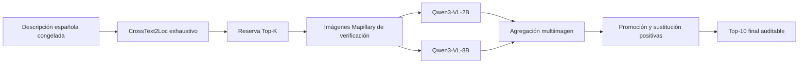

# Plan de evaluación remota VLM y promoción Top-K

## Pipeline

CrossText2Loc siempre ordena la galería completa. K limita solo los candidatos
que reciben verificación visual. GT y coordenadas de referencia se abren en el
evaluador, nunca en retrieval, VLM o promoción.

## K configurable

La infraestructura admite 10, 20, 50, 100, 200, 500 y `full` con resolución por
galería. En 50 m hay 253 candidatos: K=500 se rechaza y `full=253`; no se hace
clamping silencioso. En 25 m, `full=1115` y K=500 es posible.

El Top-100 H11-H25 existente permanece intacto. Permite diagnosticar métricas
solo hasta @100. No es posible derivar @200, @500 o galería completa sin nueva
inferencia; no se extrapolan resultados. K se elegirá con H26-H37, nunca con
H38-H61. No se ejecutará VLM sobre la galería completa sin justificarlo primero.

## Políticas visuales

- Misma entrada, asociaciones, claims y política para 2B y 8B.
- Agregación por secuencia para evitar contar frames próximos como independientes.
- `unverifiable`, sin fotografía, error VLM y conflicto no concluyente son neutros.
- Solo evidencia positiva puede promover.
- El candidato promovido y el desplazado quedan registrados.
- El ranking CT2L original se conserva y restaura por hash.
- Descarte por contradicción figura como no disponible y desactivado.

## Selección en development

H26-H37 selecciona:

- profundidad K;
- una frente a varias imágenes;
- prompt/contrato VLM;
- umbral de evidencia positiva;
- número mínimo de veredictos válidos;
- peso positivo y máximo de promociones;
- política ante precisión geográfica incierta.

Después se congelan IDs y revisiones de modelo, hashes de imágenes y claims,
política Top-K, parámetros, código y manifest del test.

## Comparaciones finales

1. CrossText2Loc baseline.
2. CT2L + reranking 2B.
3. CT2L + reranking 8B.
4. CT2L + promoción/sustitución 2B.
5. CT2L + promoción/sustitución 8B.

Se reportarán accuracy visual, macro-F1, contradicciones, falsos soportes,
falsas contradicciones, abstenciones, cobertura, GeoRecall@1/5/10 a 50 m,
sensibilidad 25/50/75/100 m, distancia Top-1, Recall exacto cuando esté definido,
promociones correctas/incorrectas, candidatos relevantes desplazados y consultas
mejoradas/empeoradas. Wilson se aplica a proporciones, McNemar a resultados
pareados binarios y bootstrap agrupado por consulta a distancias y diferencias.

La muestra de 24 test es pequeña: intervalos y numeradores/denominadores son
obligatorios. No se declarará superioridad 8B ni mejora geográfica por una
diferencia puntual sin evidencia pareada y control de regresiones.

## MVP

El MVP sigue devolviendo el baseline por defecto. La configuración congelada
`config/topn_promotion_disabled.json` es una política válida, desactivada y
reversible. Las capacidades anuncian reservas configurables y descarte no
disponible, pero el endpoint todavía no ejecuta promoción. Activar el flag provoca
fallo de arranque deliberado hasta implementar y aprobar la integración ganadora.
