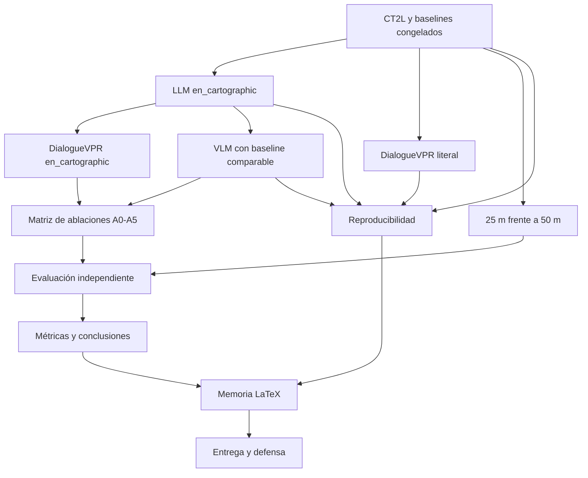

# Hoja de ruta permanente para completar el TFG

## Propósito y uso

Este documento es la referencia operativa permanente para terminar el TFG de
geolocalización a partir de descripciones y diálogo. Complementa, pero no
sustituye, el alcance de [PROJECT.md](PROJECT.md), las decisiones de
[DECISIONS.md](DECISIONS.md), el registro de [EXPERIMENTS.md](EXPERIMENTS.md) ni
las instrucciones de [AGENTS.md](../AGENTS.md).

Antes de iniciar trabajo sustancial se debe consultar esta hoja de ruta para
identificar estado, dependencias, restricciones y siguiente tarea. Después de
cada tarea sustancial se debe aplicar el [protocolo de actualización](#protocolo-obligatorio-de-actualización),
sin borrar entradas históricas ni promover propuestas a decisiones aceptadas.

Fecha de auditoría inicial: **2026-11-05**.

## Leyenda de estados

Los estados describen dimensiones diferentes y pueden coexistir.

| Estado | Significado exigido |
|---|---|
| `IMPLEMENTED` | Existe código propio utilizable para el alcance indicado. |
| `TESTED` | Hay pruebas ejecutadas o un smoke registrado; la mera existencia de tests no basta. |
| `EVALUATED` | Se aplicó un protocolo y se obtuvieron métricas sobre datos identificados. Debe indicarse si es development, exploratorio o independiente. |
| `VALIDATED` | Superó el protocolo de validación aplicable. Debe distinguirse validación técnica de científica. |
| `FROZEN` | Configuración, protocolo o artefacto tiene identidad reproducible e inmutable. |
| `BLOCKED` | Falta una dependencia, dato, decisión o autorización identificada. |
| `NOT_STARTED` | No existe todavía implementación o ejecución para ese alcance. |

Prioridades:

- **OBLIGATORIA:** necesaria para poder cerrar y defender el TFG.
- **RECOMENDADA:** aumenta la calidad o solidez, pero admite exclusión justificada.
- **OPCIONAL:** solo se realiza si no compromete evaluación, memoria y entrega.

Un checkbox `[x]` solo indica que el criterio de aceptación de esa tarea concreta
se verificó. No implica que toda la fase esté terminada.

## A. Resumen ejecutivo

El proyecto estudia la recuperación de ubicaciones de Madrid desde descripciones
libres del entorno. OpenStreetMap aporta el catálogo geográfico, sus geometrías y
representaciones raster. CrossText2Loc (CT2L), con pesos preentrenados congelados,
ordena candidatos mediante similitud texto-imagen. Qwen3-8B permite estudiar
reformulaciones `en_cartographic`; una política propia inspirada en DialogueVPR
formula hasta tres preguntas y acumula respuestas humanas. Qwen3-VL se ha probado
como verificador visual experimental, pero no ha demostrado todavía una mejora
geográfica generalizable.

El objetivo final es comparar de forma controlada CT2L, reformulación textual,
diálogo y evidencia visual, y determinar su aportación sobre un conjunto
independiente evaluable. La evaluación con una cámara Mapillary es exploratoria:
no sustituye al ground truth (GT) humano F5.4.

### Estado por componente

| Componente | Estado real | Evidencia principal | Implicación |
|---|---|---|---|
| CT2L | `IMPLEMENTED`, `TESTED`, `VALIDATED` técnicamente, `FROZEN`; `BLOCKED` para validación final Madrid | [CROSSTEXT2LOC.md](CROSSTEXT2LOC.md), [PHASE4_CLOSURE.md](PHASE4_CLOSURE.md), `results/reproductions/crosstext2loc-newyork-osm-gb10-v1/result.json` | Nueva York se reprodujo; Madrid tiene retrieval exhaustivo, no precisión oficial. |
| LLM textual | `IMPLEMENTED`, `TESTED`, `EVALUATED` en development, modelo `FROZEN`; estrategia final `BLOCKED` | [QWEN.md](QWEN.md), [PHASE5_TEXT_TRANSFORMATION.md](PHASE5_TEXT_TRANSFORMATION.md), `src/tfg_phase0/f5_text_transform.py` | `en_cartographic` existe, pero su beneficio no está validado como default. |
| DialogueVPR propio | `IMPLEMENTED`, `TESTED`, `EVALUATED` exploratoriamente, parcialmente `FROZEN` | [INTERACTIVE_DIALOGUE_MVP.md](INTERACTIVE_DIALOGUE_MVP.md), `results/generated/dialogue-v3-madrid-prueba-visual-01-phased-v4/`, evaluación Mapillary | No reproduce DQ-pilot; falta evaluación independiente y comparación cartográfica. |
| VLM | `IMPLEMENTED`, `TESTED`, `EVALUATED` en development, política Atlas v3 `FROZEN`; `BLOCKED` para generalización | [PHASE_VLM_VISUAL_RERANKING_PLAN.md](PHASE_VLM_VISUAL_RERANKING_PLAN.md), [EXPERIMENTS.md](EXPERIMENTS.md), `results/generated/mapillary/` | Viabilidad técnica demostrada; mejora geográfica general no demostrada. |
| Galería 50 m | `IMPLEMENTED`, `TESTED`, `EVALUATED` exploratoriamente, artefacto `FROZEN` | `config/madrid_f4_visual_gallery_50m.json`, bundle F4 | 253 candidatos; configuración principal actual. |
| Galería 25 m | `IMPLEMENTED`, `TESTED`, `EVALUATED` exploratoriamente, artefacto `FROZEN` | `config/madrid_f4_visual_gallery_25m.json`, bundle F4 | 1.115 candidatos; elección final frente a 50 m pendiente. |
| Evaluación | Software `IMPLEMENTED`, `TESTED`, `VALIDATED` técnicamente; evaluación final Madrid `BLOCKED` | [PHASE5_GEOGRAPHIC_EVALUATION.md](PHASE5_GEOGRAPHIC_EVALUATION.md), `src/tfg_phase0/f5_ground_truth_evaluation.py` | F5.4 tiene cero observaciones validadas; I01–I20 tiene cero casos elegibles. |
| Memoria LaTeX | Infraestructura `IMPLEMENTED`; compilación histórica; estado actual `BLOCKED` | `latex-memory/main.tex`, `latex-memory/VALIDACION.md` | Capítulos 3, 6 y 7 y anexos están vacíos; referencias/citas pendientes. |
| Reproducibilidad | `IMPLEMENTED`, `TESTED`, parcialmente `VALIDATED` y `FROZEN` en GB10; portabilidad `BLOCKED` | manifests, hashes, [EXPERIMENTS.md](EXPERIMENTS.md), `results/README.md` | Artefactos pesados son locales; falta reproducción limpia/segunda máquina. |
| Entrega y defensa | `NOT_STARTED` / `BLOCKED` | `latex-memory/recursos/FUENTES.md` | Faltan verificación administrativa, memoria final, depósito y presentación. |

## B. Principios metodológicos obligatorios

1. El GT nunca entra en inferencia, generación de consultas, preguntas,
   preselección, retrieval ni reranking.
2. Los rankings no se usan para seleccionar, localizar o fabricar GT.
3. Desarrollo, validación y test se mantienen separados por ubicación y
   procedencia; un conjunto reutilizado para diseñar reglas deja de ser test.
4. No se abren conjuntos sellados sin autorización expresa y protocolo one-shot.
5. Configuración, prompt, modelos, datos, métricas y política se congelan antes de
   evaluar.
6. En cada ablación permanecen constantes los componentes que no son objeto de
   estudio.
7. No se fabrican respuestas humanas ni se usa un LLM como observador sintético
   salvo experimento explícito y separado.
8. No se fabrican claims visuales; toda evidencia VLM conserva imagen, hash,
   procedencia, autorización y alcance.
9. La posición de una cámara no se presenta como posición del observador.
10. Una prueba exploratoria o una consulta no constituyen validación general.
11. No se modifican checkpoints, rankings, datasets o políticas congelados.
12. No se ajustan prompts, parámetros o umbrales con resultados del test.
13. Toda ejecución conserva hashes, commits, revisiones, parámetros y
    procedencia.
14. Se documentan resultados positivos, negativos, abstenciones, fallos y
    regresiones.
15. Se separan implementación, comprobación técnica, experimentación y
    conclusiones científicas.
16. Las métricas oficiales de Nueva York, basadas en 100 vecinos elegidos con GT,
    no se atribuyen a búsqueda exhaustiva en Madrid.
17. La ausencia de un objeto en OSM o en una fotografía parcial no demuestra su
    inexistencia ni contradice automáticamente una respuesta humana.

## Dependencias y orden de cierre

Reglas de dependencia:

- No se ejecuta evaluación antes de congelar protocolo y rankings.
- No se integra VLM sin baseline comparable sin VLM.
- No se usa test para seleccionar hiperparámetros.
- CT2L, preparación de memoria y saneamiento reproducible pueden avanzar en
  paralelo si no abren GT ni cambian protocolos congelados.
- Evaluación independiente, memoria y reproducibilidad son **OBLIGATORIAS**.
- La sensibilidad 25 m es **RECOMENDADA** porque la galería compatible sí existe;
  puede reducirse por recursos con justificación previa.
- GOTPR, TOLoc, HNSW, Milvus y nuevas fuentes visuales son **OPCIONALES**.

## C. Fase 1 — CT2L y baselines

**Objetivo:** conservar un baseline exhaustivo, íntegro y reproducible antes de
añadir LLM, diálogo o VLM.

| ID | Tarea | Estado / prioridad | Dependencias | Criterio de aceptación | Evidencia y artefactos | Actualización / siguiente acción |
|---|---|---|---|---|---|---|
| P1-01 | [x] Congelar checkpoint, CLIP y entorno CT2L | `FROZEN`, `VALIDATED` técnica / OBLIGATORIA | Ninguna | Hashes, commits y contexto 300 verificados | [CROSSTEXT2LOC.md](CROSSTEXT2LOC.md), `config/ct2l_isolated_runtime_cvgtext.json` | 2026-11-05. Revalidar antes de cada campaña autorizada. |
| P1-02 | [x] Materializar embeddings 25 m y 50 m | `IMPLEMENTED`, `TESTED`, `FROZEN` / OBLIGATORIA | P1-01 | 1.115 y 253 embeddings asociados a candidatos únicos | [EXPERIMENTS.md](EXPERIMENTS.md), `config/madrid_f46_retriever.json` | 2026-11-05. No regenerar salvo experimento versionado. |
| P1-03 | [x] Validar recuperación exhaustiva y similitud coseno | `IMPLEMENTED`, `TESTED`, `VALIDATED` técnica / OBLIGATORIA | P1-01, P1-02 | Universo completo, ranks, desempate y repetibilidad | [PHASE4_CLOSURE.md](PHASE4_CLOSURE.md), `src/tfg_phase0/crosstext2loc_runtime.py` | 2026-11-05. Mantener baseline en toda ablación. |
| P1-04 | [x] Congelar baseline original Madrid de la sesión piloto | `EVALUATED` exploratoria, `FROZEN` / RECOMENDADA | P1-03 | Ranking R0 de 253 candidatos y hash persistido | `results/generated/dialogue-v3-madrid-prueba-visual-01-phased-v4/checkpoints/` | 2026-11-05. Reutilizar, no recalcular. |
| P1-05 | [ ] Evaluar A0 sobre conjunto independiente | `BLOCKED` / OBLIGATORIA | P7-02, P7-03 | Rankings sin GT y métricas one-shot sobre consultas elegibles | Pendiente | Siguiente tras congelar dataset independiente. |
| P1-06 | [ ] Cerrar D007, D013 y D016 o documentar límite definitivo | `BLOCKED` / RECOMENDADA | Autores/licencias | Perfil OSM/checkpoint/licencia descritos sin sobreafirmación | [DECISIONS.md](DECISIONS.md), [LICENSES_AND_PERMISSIONS.md](LICENSES_AND_PERMISSIONS.md) | Solicitar decisión/autorización externa cuando proceda. |

## D. Fase 2 — LLM y `en_cartographic`

**Objetivo:** medir la aportación de la reformulación cartográfica inglesa, sin
presuponer mejora y separando el reformulador del LLM opcional de preguntas.

| ID | Tarea | Estado / prioridad | Dependencias | Criterio de aceptación | Evidencia y artefactos | Actualización / siguiente acción |
|---|---|---|---|---|---|---|
| P2-01 | [x] Auditar implementación real de `en_cartographic` | `IMPLEMENTED`, `TESTED` / OBLIGATORIA | Ninguna | Modelo, prompt, parámetros, topónimos y límites identificados | `src/tfg_phase0/f5_text_transform.py`, `results/generated/dialogue-v3-en-cartographic-preparation-v1/implementation-audit.json` | 2026-11-05. Auditoría cerrada. |
| P2-02 | [x] Congelar protocolo E0–E3 y negaciones de visibilidad | `FROZEN`, no ejecutado / OBLIGATORIA | P2-01, P3-02 | Prompt, inputs, parámetros, hashes y política fail-closed | `results/generated/dialogue-v3-en-cartographic-preparation-v1/` | 2026-11-05. `DIALOGUE_V3_EN_CARTOGRAPHIC_PREPARATION_PASS`. |
| P2-03 | [x] Implementar materializador y validador semántico específico | `IMPLEMENTED`, `TESTED` CPU / OBLIGATORIA | P2-02 | Tests CPU de entidad, polaridad, alcance, fuga y rondas | `src/tfg_phase0/dialogue_en_cartographic.py`, cuatro CLIs, 54 tests; `results/generated/dialogue-v3-en-cartographic-implementation-v1/` | 2026-11-05. No se ejecutaron modelos. |
| P2-04 | [ ] Generar E0–E3 una vez por ronda | `BLOCKED` por proceso GPU ajeno / OBLIGATORIA | P2-03, E0 aprobada y GPU libre | Una salida por E0–E3, cero retries, lineage y modelo/hash registrados | E0 aprobada en `dialogue-v3-en-cartographic-e0-human-review-v1.json`; preflight continuation bloqueado por PID 2433323; E1–E3 no generadas | **Esperar fin del proceso ajeno, repetir preflight y crear entonces autorización continuation-v2; no reintentar automáticamente.** |
| P2-05 | [ ] Revisar semántica, alucinaciones y pérdida de información | `NOT_STARTED` / OBLIGATORIA | P2-04 | Revisión ciega a rankings/GT; las cuatro salidas aceptadas o experimento detenido | Bundle E0–E3 revisado | No corregir salidas mirando resultados. |
| P2-06 | [ ] Auditar tokens CLIP y truncamiento | `NOT_STARTED` / OBLIGATORIA | P2-05 | `truncate=False` pasa y coincide con `truncate=True` en E0–E3 | `tokenizer-validation-plan.json` y futuro informe | Si trunca, solicitar política compacta nueva. |
| P2-07 | [ ] Ejecutar CT2L exhaustivo para E0–E3 | `BLOCKED` / OBLIGATORIA | P2-06, autorización CT2L | 4 rankings de 253 candidatos, misma identidad CT2L | Salida prevista `results/generated/dialogue-v3-en-cartographic-retrieval-v1/` | Una carga, cuatro retrievals, cero retries. |
| P2-08 | [ ] Evaluar A0 frente a A1 y congelar resultados | `NOT_STARTED` / OBLIGATORIA | P2-07 | Métricas, latencia, tokens, fallos y comparación B0 pareada | Salida prevista `results/generated/dialogue-v3-en-cartographic-evaluation-v1/` | Abrir referencia solo tras congelar rankings. |

El LLM usado por la política de preguntas es conceptualmente distinto. En el run
phased literal las preguntas fueron deterministas; no se debe describir A2 como
“sin LLM” sin comprobar la configuración concreta.

## E. Fase 3 — DialogueVPR

**Objetivo:** evaluar el efecto de aclaraciones humanas y separar el contenido de
las respuestas de la estrategia de construcción de consultas.

| ID | Tarea | Estado / prioridad | Dependencias | Criterio de aceptación | Evidencia y artefactos | Actualización / siguiente acción |
|---|---|---|---|---|---|---|
| P3-01 | [x] Verificar política de preguntas y claims | `IMPLEMENTED`, `TESTED`, parcialmente `FROZEN` / OBLIGATORIA | P1-03 | Máximo 3 preguntas, ausencia OSM no contradictoria, claims enlazados | `config/interactive_dialogue_multiturn.json`, tests multiturno | 2026-11-05. Política literal preservada. |
| P3-02 | [x] Ejecutar sesión literal R0–R3 | `VALIDATED` funcional, `FROZEN` / OBLIGATORIA | P1-03 | 3 respuestas humanas, 4 rankings exhaustivos, terminal `completed` | `results/generated/dialogue-v3-madrid-prueba-visual-01-phased-v4/` | 2026-11-05. No reabrir ni modificar. |
| P3-03 | [x] Evaluar piloto literal con referencia Mapillary | `EVALUATED` exploratoria, `FROZEN` / RECOMENDADA | P3-02 | Métricas por ronda y limitaciones explícitas | `results/generated/dialogue-v3-mapillary-evaluation-v1/` | 2026-11-05. `DIALOGUE_V3_MAPILLARY_EXPLORATORY_EVALUATION_PASS`. |
| P3-04 | [ ] Ejecutar DialogueVPR `en_cartographic` E0–E3 | `BLOCKED` / OBLIGATORIA | P2-03 a P2-07 | Mismas preguntas/respuestas; E-rankings no realimentan preguntas | Protocolo `dialogue-v3-en-cartographic-preparation-v1` | Tras completar P2. |
| P3-05 | [ ] Comparar literal frente a cartográfico por turno | `NOT_STARTED` / OBLIGATORIA | P3-04 | E0/R0…E3/R3 con error, Top-K, rank, solapamiento y latencia | Evaluación futura | No seleccionar prompt con esta consulta. |
| P3-06 | [ ] Evaluar diálogo en conjunto independiente | `BLOCKED` / OBLIGATORIA | P7-02, P5 freeze | Comparación pareada consulta única / 1 pregunta / 3 preguntas | Pendiente | Requiere respuestas humanas prospectivas o protocolo independiente. |

### Piloto existente que debe conservarse

Resultado: `DIALOGUE_V3_MAPILLARY_EXPLORATORY_EVALUATION_PASS`.

| Ronda | Error Top-1 | Rank de celda Mapillary |
|---|---:|---:|
| R0 | 468,699384 m | 72 |
| R1 | 312,680536 m | 172 |
| R2 | 213,150783 m | 166 |
| R3 | 213,150783 m | 167 |

Reducción R0→R3: **255,548601 m**. Es una sola consulta, la referencia es una
cámara Mapillary y no GT humano F5.4. El error Top-1 mejora, pero la recuperación
exacta de la celda no mejora y queda fuera del Top-10. No demuestra mejora general.

## F. Fase 4 — Integración VLM

**Objetivo:** determinar si evidencia visual autorizada aporta información útil y,
solo bajo un contrato posterior, si mejora la recuperación geográfica.

| ID | Tarea | Estado / prioridad | Dependencias | Criterio de aceptación | Evidencia y artefactos | Actualización / siguiente acción |
|---|---|---|---|---|---|---|
| P4-01 | [x] Auditar Qwen3-VL-8B, workers y políticas | `IMPLEMENTED`, `TESTED`, `EVALUATED` development / OBLIGATORIA | Ninguna | Modelo, revisión, Docker, claims, permisos y gates identificados | `src/tfg_phase0/dialogue_visual_evidence.py`, [EXPERIMENTS.md](EXPERIMENTS.md) | 2026-11-05. Auditoría incorporada al plan VLM. |
| P4-02 | [x] Congelar Atlas v3 como política development | `FROZEN`, no validada externamente / RECOMENDADA | H26–H37 development | Política y fallback reproducibles, sin abrir H38–H61 | [DECISIONS.md](DECISIONS.md), `results/generated/mapillary/` | No recalibrar con I01–I20. |
| P4-03 | [ ] Completar quality gate real independiente | `BLOCKED` / RECOMENDADA | Imágenes autorizadas y GPU | Cobertura/calidad con protocolo ciego, sin claims ni reranking | `results/generated/visual-quality-gate-v1/` contiene solo fixture | Requiere autorización específica. |
| P4-04 | [ ] Diseñar ablación A1 vs A4 | `NOT_STARTED` / OBLIGATORIA si se incluye VLM | P2-08, P5-01 | Misma consulta/ranking base; política visual congelada | Pendiente | No usar GT o rankings para elegir imágenes. |
| P4-05 | [ ] Diseñar ablación A3 vs A5 | `NOT_STARTED` / OBLIGATORIA si se incluye sistema completo | P3-05, P5-01 | Evidencia humana y visual separadas; alcance versionado | `vlm-integration-plan.json` | Contrato actual no permite mejora de ranking. |
| P4-06 | [ ] Ejecutar VLM controlado y medir coste/fallos | `BLOCKED` / RECOMENDADA | P4-03 a P4-05, autorizaciones | Cero fuga, abstenciones y regresiones informadas | Pendiente | No reutilizar `AUTH-MADRID-01` fuera de `square`. |
| P4-07 | [ ] Validar efecto geográfico independiente | `BLOCKED` / OBLIGATORIA para afirmar mejora VLM | P7-02, P4-06 | Mejora repetida, sin pérdida de métricas primarias ni regresión material | Pendiente | Si falla, VLM queda como evidencia explicativa opcional. |

El VLM nunca recibe coordenadas Mapillary, celda correcta ni GT. Los intents
`monument`, `church` y `park` requieren autorizaciones visuales específicas; una
imagen autorizada para `square` no se reutiliza automáticamente.

## G. Fase 5 — Matriz de ablaciones

La taxonomía A0–A5 se adopta en esta hoja de ruta a partir de esta fecha. No era
una convención histórica del repositorio.

| ID | Configuración | Objetivo | Estado actual |
|---|---|---|---|
| A0 | CT2L | Baseline | `IMPLEMENTED`, piloto `EVALUATED`; evaluación independiente pendiente |
| A1 | CT2L + LLM `en_cartographic` | Aportación del LLM | F5 development `EVALUATED`; Dialogue E0 `BLOCKED` |
| A2 | CT2L + DialogueVPR literal | Aportación de aclaraciones literales | Piloto `EVALUATED` exploratoriamente |
| A3 | CT2L + LLM + DialogueVPR | Diálogo con reformulación | `FROZEN` como plan, ejecución `BLOCKED` |
| A4 | CT2L + LLM + VLM | Aportación visual sin diálogo | Componentes `IMPLEMENTED`; ablación alineada `NOT_STARTED` |
| A5 | CT2L + LLM + DialogueVPR + VLM | Sistema completo | `NOT_STARTED` para efecto geográfico; evidencia paralela diseñada |

### Ficha obligatoria por configuración

| ID | Activos / desactivados | Modelo y política | Galería / entrada | Referencia y métricas | Latencia/coste | Artefactos y limitaciones |
|---|---|---|---|---|---|---|
| A0 | CT2L; sin reformulación, diálogo ni VLM | CT2L congelado; texto original | 50 m principal; sensibilidad 25 m | GT independiente futuro; Mapillary solo piloto | CT2L | F4/R0. No confundir New York con Madrid. |
| A1 | CT2L + reformulador; sin diálogo/VLM | Qwen3-8B `en_cartographic`; prompt congelado | E0, mismas galerías | Misma referencia que A0 | LLM + CT2L; registrar tokens | Protocolo P2. Riesgo de pérdida/alucinación. |
| A2 | CT2L + preguntas/respuestas; sin reformulación cartográfica/VLM | `literal_concatenation`; preguntas deterministas en piloto | R0–R3, 50 m | Por turno | CT2L por ronda + interacción | Puede usar LLM para preguntas en otras configuraciones; verificar antes de etiquetar. |
| A3 | CT2L + Qwen textual + diálogo; sin VLM | E0–E3, visibilidad preservada | 50 m; mismas respuestas | Por turno y frente a A1/A2 | Qwen + CT2L por ronda | Preparación congelada, no ejecutada. |
| A4 | CT2L + Qwen textual + VLM; sin diálogo | Política visual por congelar | Igual a A1 | Geográfica y calidad visual | Qwen + CT2L + VLM | Requiere distinguir evidencia paralela de reranking. |
| A5 | Todos | Política completa congelada antes del test | Igual a A3/A4 | Todas las métricas y coste | Total end-to-end | No implementado como protocolo geográfico final. |

Comparaciones obligatorias:

- A0 vs A1: efecto de reformulación.
- A1 vs A3: efecto del diálogo con la misma construcción cartográfica.
- A2 vs A3: efecto de construcción literal frente a cartográfica.
- A3 vs A5: efecto del VLM añadido al diálogo.
- A1 vs A4: efecto del VLM sin diálogo.
- A0 vs A5: sistema completo, con atribución causal limitada porque cambian varios
  componentes.

| ID | Tarea | Estado / prioridad | Dependencias | Criterio de aceptación | Evidencia | Actualización / siguiente acción |
|---|---|---|---|---|---|---|
| P5-01 | [ ] Congelar matriz completa antes de test | `NOT_STARTED` / OBLIGATORIA | P2, P3, P4 | Ficha completa A0–A5, presupuestos iguales y políticas hashadas | Esta sección es borrador canónico | Actualizar al cerrar cada brazo. |
| P5-02 | [ ] Ejecutar matriz sobre development sin seleccionar con test | `BLOCKED` / RECOMENDADA | P5-01, datos development | Resultados y fallos por brazo | Pendiente | No sustituye evaluación independiente. |
| P5-03 | [ ] Ejecutar brazos aprobados one-shot | `BLOCKED` / OBLIGATORIA | P7-03 | Sin tuning posterior y con denominador completo | Pendiente | Reducir brazos antes del test si recursos no permiten A0–A5. |

## H. Fase 6 — Resolución espacial 25 m frente a 50 m

| Propiedad | 25 m | 50 m |
|---|---:|---:|
| Candidatos | 1.115 | 253 |
| Manifest | `madrid-pilot-grid-v1-s25-l25` | `madrid-pilot-grid-v1-s50-l50` |
| Manifest SHA-256 | `a23d3f3b...a49f11` | `ad35d5cb...10f2aa` |
| CRS de construcción | EPSG:25830 | EPSG:25830 |
| Publicación de centros | EPSG:4326 | EPSG:4326 |
| Geometría | Celda cuadrada completa en D004 | Celda cuadrada completa en D004 |
| Embeddings CT2L | Disponibles | Disponibles |
| Retrieval exhaustivo | Compatible | Compatible |
| Evaluación oficial | No disponible | No disponible |
| Coste relativo | Mayor | Menor |

El tamaño de celda no es un umbral GeoRecall. La evaluación principal puede
mantenerse en 50 m y usar 25 m como sensibilidad, pero la decisión debe fijarse
antes del test.

| ID | Tarea | Estado / prioridad | Dependencias | Criterio de aceptación | Evidencia | Actualización / siguiente acción |
|---|---|---|---|---|---|---|
| P6-01 | [x] Verificar ambas galerías y embeddings | `FROZEN`, `VALIDATED` técnica / OBLIGATORIA | P1-01 | Counts, manifests, CRS y bundles verificados | Configuraciones F4 y [EXPERIMENTS.md](EXPERIMENTS.md) | 2026-11-05. |
| P6-02 | [ ] Congelar protocolo pareado 25/50 | `NOT_STARTED` / RECOMENDADA | P2/P5 | Mismas consultas, modelos, métricas y referencia | Pendiente | No comparar por igualdad de candidate ID entre galerías. |
| P6-03 | [ ] Ejecutar sensibilidad independiente | `BLOCKED` / RECOMENDADA | P7-02, P6-02 | Tabla pareada, coste y cobertura | Pendiente | Puede omitirse con justificación de recursos. |
| P6-04 | [ ] Resolver D003 | `BLOCKED` / OBLIGATORIA para configuración final | P6-03 o decisión justificada | 50 m principal y/o 25 m sensibilidad declarados | [DECISIONS.md](DECISIONS.md) | Decisión expresa del responsable/tutor. |

## I. Fase 7 — Evaluación independiente

Esta fase es obligatoria para conclusiones generales.

Se mantienen separados:

- **Mapillary exploratorio:** cámara proxy, una consulta, no ciego, no F5.4.
- **Evaluación independiente:** referencias autorizadas, protocolo congelado,
  rankings sin GT y apertura única.

| ID | Tarea | Estado / prioridad | Dependencias | Criterio de aceptación | Evidencia / artefactos | Actualización / siguiente acción |
|---|---|---|---|---|---|---|
| P7-01 | [x] Implementar contratos F5.4 y evaluadores | `IMPLEMENTED`, `TESTED`, `VALIDATED` software / OBLIGATORIA | P1 | Tests de asignación, Recall, GeoRecall y fallos | [PHASE5_GEOGRAPHIC_EVALUATION.md](PHASE5_GEOGRAPHIC_EVALUATION.md) | 2026-11-05. |
| P7-02 | [ ] Obtener consultas con GT o referencia independiente elegible | `BLOCKED` / OBLIGATORIA | Trabajo humano/ledger | Al menos 12 elegibles para comparación de políticas o protocolo F5.4 aprobado | I01–I20: 20 adquiridas, 0 elegibles | Completar ledger, anotación, revisión y precisión. |
| P7-03 | [ ] Congelar particiones, brazos, métricas y rankings | `NOT_STARTED` / OBLIGATORIA | P7-02, P5-01 | Descripciones antes de modelos; rankings antes de referencia | Protocolo one-shot pendiente | No abrir H38–H61 para resolver development. |
| P7-04 | [ ] Ejecutar A0–A5 o subconjunto preaprobado | `BLOCKED` / OBLIGATORIA | P7-03, autorizaciones | Denominador completo, sin ajustes posteriores | Pendiente | CT2L puro siempre se informa. |
| P7-05 | [ ] Analizar errores y variabilidad | `NOT_STARTED` / OBLIGATORIA | P7-04 | Tabla por consulta, regresiones, cobertura y dependencia | Pendiente | No ocultar casos sin ranking/imagen. |
| P7-06 | [ ] Decidir apertura de H38–H61 | `FROZEN`, `BLOCKED` / OPCIONAL | Política final y autorización | Apertura única, sin tuning posterior | Test sellado no abierto | Preferir I01–I20 elegible si se completa. |

## J. Fase 8 — Métricas

Métricas obligatorias, cuando sean aplicables:

- Recall@1/5/10 por coincidencia exacta de candidate ID.
- GeoRecall@1/5/10 con umbrales predeclarados.
- Error geográfico Top-1, media y mediana.
- Distancia mínima Top-5 y Top-10.
- Rank del candidato correcto o de la asignación exploratoria claramente etiquetada.
- Número de preguntas y respuestas informativas/no observables.
- Latencia total, LLM, CT2L y VLM.
- Número de cargas y llamadas.
- Tokens de entrada/salida y truncamiento.
- Memoria y coste computacional.

Las métricas por consulta se informan como casos; las agregadas indican
denominador, exclusiones, dispersión y dependencia. Con una sola consulta no se
calculan intervalos de confianza ni se infiere rendimiento general.

| ID | Tarea | Estado / prioridad | Dependencias | Criterio de aceptación | Evidencia | Actualización / siguiente acción |
|---|---|---|---|---|---|---|
| P8-01 | [x] Implementar métricas geográficas base | `IMPLEMENTED`, `TESTED` / OBLIGATORIA | P1 | Haversine, Recall, GeoRecall y mínimos Top-K verificados | `src/tfg_phase0/f4_evaluation.py`, tests | 2026-11-05. |
| P8-02 | [ ] Congelar contrato común A0–A5 | `NOT_STARTED` / OBLIGATORIA | P5-01, P7-03 | Mismo esquema y denominadores por brazo | Pendiente | Incluir costes y llamadas. |
| P8-03 | [ ] Generar tablas y figuras finales | `NOT_STARTED` / OBLIGATORIA | P7-05 | Datos trazables, sin sugerir significación inexistente | Pendiente | Cada figura debe tener fuente y hash. |

## K. Fase 9 — Reproducibilidad y cierre técnico

| ID | Tarea | Estado / prioridad | Dependencias | Criterio de aceptación | Evidencia / artefactos | Actualización / siguiente acción |
|---|---|---|---|---|---|---|
| P9-01 | [x] Versionar schemas, hashes y contratos principales | `IMPLEMENTED`, `TESTED` / OBLIGATORIA | Continua | Validadores y content IDs en fases críticas | `schemas/`, `src/tfg_phase0/`, tests | Mantener en cada cambio. |
| P9-02 | [ ] Ejecutar suite pertinente final | `NOT_STARTED` / OBLIGATORIA | Código final | Tests seleccionados y resultado registrado | Pendiente | No ejecutar modelos como tests unitarios. |
| P9-03 | [ ] Crear inventario portable de artefactos externos | `BLOCKED` / OBLIGATORIA | Decisiones/licencias | Rutas lógicas, hashes y obtención autorizada | `results/README.md`, `checkpoints/README.md` parciales | Eliminar dependencia de rutas absolutas versionadas. |
| P9-04 | [ ] Reproducir experimentos finales desde entorno limpio | `NOT_STARTED` / OBLIGATORIA | P7, P9-03 | Comandos, versiones, outputs y hashes coinciden | Pendiente | Idealmente en segunda máquina; si no, documentar límite. |
| P9-05 | [ ] Auditar errores, fallos y limpieza | `IMPLEMENTED` parcial / OBLIGATORIA | P9-02 | Fail-closed, cero secretos/pesos/datos staged | Runtime phased y guías | Revisar todos los runners finales. |
| P9-06 | [ ] Auditoría final del repositorio | `NOT_STARTED` / OBLIGATORIA | Todas las fases técnicas | Enlaces, Markdown, Mermaid, licencias, secretos, tamaños y estado Git | Pendiente | Antes de entrega de código. |

## L. Fase 10 — Memoria LaTeX

### Estado auditado

| Elemento | Estado real |
|---|---|
| Infraestructura LaTeX | `IMPLEMENTED`; compilación histórica documentada el 2026-10-08 |
| Introducción | Mayormente redactada, pero desactualizada respecto a Madrid actual |
| Estado del arte | Parcial; secciones OSM, SPOT y comparación pendientes |
| Análisis y requisitos | `NOT_STARTED` en contenido; capítulo vacío |
| Diseño | Parcial |
| Implementación | Casi vacío y contiene afirmaciones obsoletas |
| Evaluación | Capítulo vacío |
| Conclusiones | Capítulo vacío |
| Anexos A–C | Vacíos |
| Bibliografía | Parcial; tres citas sin entrada |
| Compilación actual | `BLOCKED`; la validación histórica no cubre el estado presente |
| Normativa tipo B | Recopilación local de fuentes; cumplimiento administrativo no acreditado |

Cada experimento completado crea una tarea de documentación en la memoria: método,
identidades, resultados, limitaciones y relación con objetivos.

| ID | Tarea | Estado / prioridad | Dependencias | Criterio de aceptación | Evidencia / ruta | Actualización / siguiente acción |
|---|---|---|---|---|---|---|
| P10-01 | [ ] Confirmar título, tipología B, metadatos y situación administrativa | `BLOCKED` / OBLIGATORIA | Dirección/secretaría | Sin `PENDIENTE`; título idéntico al aprobado | `latex-memory/metadata.tex` | Verificar con dirección. |
| P10-02 | [ ] Completar análisis y `tab:requisitos` | `NOT_STARTED` / OBLIGATORIA | Roadmap técnico | Requisitos con IDs y estados verificables | `capitulos/03_analisis.tex` | Resolver referencia rota. |
| P10-03 | [ ] Completar estado del arte y bibliografía | `IMPLEMENTED` parcial / OBLIGATORIA | Fuentes primarias | Sin placeholders ni citas ausentes | `capitulos/02_estado_del_arte.tex`, `bibliografia.bib` | Añadir OSM, SPOT, comparación y claves faltantes. |
| P10-04 | [ ] Actualizar arquitectura y diseño real | `IMPLEMENTED` parcial / OBLIGATORIA | P5 freeze | Diagrama y fronteras actualizados | `capitulos/04_diseno.tex` | Distinguir implementado/propuesto. |
| P10-05 | [ ] Documentar implementación F0–F5, LLM, diálogo y VLM | `NOT_STARTED` en memoria / OBLIGATORIA | P9 | Rutas relativas, contratos, pruebas y procedencia | `capitulos/05_implementacion.tex` | Corregir afirmación de que no hay galería Madrid. |
| P10-06 | [ ] Escribir experimentación y evaluación | `NOT_STARTED` / OBLIGATORIA | P7, P8 | Protocolos, resultados y amenazas trazables | `capitulos/06_evaluacion.tex` | Separar New York, Mapillary y evaluación independiente. |
| P10-07 | [ ] Escribir conclusiones | `NOT_STARTED` / OBLIGATORIA | P10-06 | Objetivos cumplidos/parciales, sin resultados nuevos | `capitulos/07_conclusiones.tex` | Tras cerrar evaluación. |
| P10-08 | [ ] Completar anexos de reproducción, acrónimos e IA | `NOT_STARTED` / OBLIGATORIA | P9, registro de IA | Ningún anexo vacío; coherencia con declaración institucional | `anexos/anexo_a.tex` a `anexo_c.tex` | Registrar uso de agentes y revisión humana. |
| P10-09 | [ ] Crear figuras, tablas y fórmulas finales | `NOT_STARTED` / OBLIGATORIA | P8-03 | Toda figura/tabla citada, explicada y con procedencia | `latex-memory/imagenes/` | Incluir matriz A0–A5 y resultados. |
| P10-10 | [ ] Sanear referencias y compilar limpio | `BLOCKED` / OBLIGATORIA | P10-01 a P10-09 | `latexmk` sin citas/referencias indefinidas; revisión visual | `latex-memory/VALIDACION.md` se actualizará | No compilar en este BUILD. |
| P10-11 | [ ] Verificar normativa tipo B y extensión | `BLOCKED` / OBLIGATORIA | Fuente oficial vigente | Máximo/objetivo confirmado, recuento documentado y formularios identificados | `latex-memory/recursos/FUENTES.md` | Revalidar enlaces y requisitos antes de depósito. |

## M. Fase 11 — Entrega y defensa

| ID | Tarea | Estado / prioridad | Dependencias | Criterio de aceptación | Evidencia | Actualización / siguiente acción |
|---|---|---|---|---|---|---|
| P11-01 | [ ] Revisión científica y editorial final | `NOT_STARTED` / OBLIGATORIA | P10 | Dirección aprueba versión exacta | Pendiente | Incluir revisión de afirmaciones y licencias. |
| P11-02 | [ ] Compilación definitiva y hash del PDF | `NOT_STARTED` / OBLIGATORIA | P11-01 | Build limpio, PDF inspeccionado y SHA-256 registrado | Pendiente | No modificar tras depósito. |
| P11-03 | [ ] Validar normativa, autoría e IA | `BLOCKED` / OBLIGATORIA | P10-11 | Formularios y declaración coherentes | Pendiente | Confirmar Anexos institucionales vigentes. |
| P11-04 | [ ] Preparar entrega de código y reproducción | `NOT_STARTED` / OBLIGATORIA | P9-06 | README final, artefactos permitidos y demo sin secretos | Pendiente | Pesos/datasets fuera de Git. |
| P11-05 | [ ] Preparar demostración reproducible | `NOT_STARTED` / RECOMENDADA | P11-04 | Ruta estable o vídeo/fallback sin red | Pendiente | No depender de servicios no autorizados. |
| P11-06 | [ ] Crear presentación y resumen visual | `NOT_STARTED` / OBLIGATORIA | P11-01 | Problema, aportación, método, resultados, límites y conclusiones | Pendiente | Sin logotipos corporativos no permitidos. |
| P11-07 | [ ] Ensayar defensa y preguntas del tribunal | `NOT_STARTED` / OBLIGATORIA | P11-06 | ≥3 ensayos cronometrados y respuestas sustentadas | Pendiente | Preparar preguntas de protocolo, GT, licencias e IA. |

## Riesgos y bloqueos activos

| ID | Bloqueo | Afecta | Resolución necesaria |
|---|---|---|---|
| B-01 | Cero GT humano F5.4 validado | Evaluación oficial Madrid | Recogida/autorización/evidencia/revisión. |
| B-02 | I01–I20 tiene cero observaciones elegibles | Evaluación independiente | Ledger, anotación, revisión, precisión y ≥12 elegibles. |
| B-03 | H38–H61 permanece sellado | Test one-shot alternativo | Política final y autorización expresa. |
| B-04 | Runner Dialogue `en_cartographic` implementado pero sin inferencias autorizadas | A1/A3 | Revisar P2-03 y autorizar separadamente Qwen, tokenización, CT2L y evaluación. |
| B-05 | Autorizaciones GPU separadas pendientes | Qwen y CT2L E0–E3 | Autorizar recursos, intentos y outputs exactos. |
| B-06 | VLM no tiene evidencia independiente alineada para todos los brazos | A4/A5 | Imágenes y políticas autorizadas, sin selección por GT/ranking. |
| B-07 | Perfil OSM/licencias/checkpoint abiertos | Reproducibilidad/publicación | Resolver D007/D013/D016 o documentar límite. |
| B-08 | Memoria incompleta y estado de compilación obsoleto | Depósito | Completar P10 y recompilar. |
| B-09 | Normativa/título/tipología no acreditados en repo | Entrega | Confirmación oficial con dirección/secretaría. |

## Próxima tarea recomendada

**ID:** `P2-04` — Generar una única vez E0–E3 con Qwen3-8B.

**Justificación:** P2-03 ya implementó y probó en CPU el constructor, el validador
fail-closed, el materializador, el auditor CLIP, el runner CT2L y el evaluador. La
generación E0–E3 es el siguiente gate, pero debe revisarse y autorizarse antes de
cargar Qwen.

**Dependencias:** `P2-02` y `P2-03` completadas; usar los contratos de
`results/generated/dialogue-v3-en-cartographic-preparation-v1/` y el readiness de
`results/generated/dialogue-v3-en-cartographic-implementation-v1/`.

**Autorizaciones necesarias:** autorización Qwen3-8B específica e inmutable que
fije plan, contrato, prompt, snapshot recalculado, output, una carga, cuatro
llamadas, cero retries y `stable-swap-v1`. CT2L y evaluación siguen fuera de este
alcance y requerirán autorizaciones posteriores separadas.

**Resultado esperado:** bundle E0–E3 generado una vez que:

- no lea rankings, Mapillary, GT, OSM o VLM;
- preserve entidad, polaridad y alcance de visibilidad;
- quede pendiente de revisión humana aun si pasa validación automática;
- persista prompts, inputs, outputs, identidad del modelo y hashes;
- se detenga sin retry ni fallback ante el primer rechazo.

No se debe iniciar automáticamente P2-04 sin la autorización descrita.

## Protocolo obligatorio de actualización

Al terminar cualquier tarea sustancial:

1. Leer esta hoja de ruta y localizar el ID de tarea.
2. Verificar los artefactos producidos, no solo la salida de consola.
3. Comprobar todos los criterios de aceptación.
4. Actualizar el estado usando la leyenda, sin marcar `[x]` si falta algún criterio.
5. Registrar evidencia y rutas de artefactos.
6. Registrar bloqueos nuevos y su alcance.
7. Actualizar dependencias si el trabajo las modifica.
8. Identificar una única próxima tarea recomendada.
9. Indicar autorizaciones necesarias y acciones no autorizadas.
10. Añadir una entrada al historial sin borrar ni reescribir las anteriores.
11. Registrar el experimento en [EXPERIMENTS.md](EXPERIMENTS.md) si hubo ejecución.
12. Registrar en [DECISIONS.md](DECISIONS.md) solo decisiones expresamente
    aprobadas; una propuesta sigue siendo propuesta.
13. Crear o actualizar la tarea correspondiente de la memoria LaTeX.
14. No ejecutar automáticamente la tarea siguiente: recomendarla y esperar
    autorización.

Si una tarea falla:

- mantenerla sin completar;
- registrar fase, fallo, causa conocida y evidencia conservada;
- distinguir fallo científico, contractual, de datos, autorización o
  infraestructura;
- indicar la acción mínima necesaria;
- no borrar artefactos históricos ni repetir automáticamente una inferencia.

## Historial de avances

Las entradas son append-only.

### 2026-11-06 — P2-04-CONTINUATION-BLOCKED-01

- **Tarea:** registrar aprobación humana de E0 y generar E1–E3 mediante contrato
  continuation-v2.
- **Resultado:** E0 se registró como `APPROVED_WITHOUT_CHANGES` y quedó ligada
  por hash al parent histórico. Los 71 tests CPU pasan. `stable-swap-v1` bloqueó
  antes de crear autorización por un proceso compute ajeno de otro proyecto;
  cero inferencias E1–E3.
- **Evidencia:** `results/generated/dialogue-v3-en-cartographic-e0-human-review-v1.json`
  y `results/generated/dialogue-v3-en-cartographic-continuation-blocked-v2.json`.
- **Decisiones:** no detener el proceso ajeno, no crear autorización innecesaria y
  no crear bundles de continuación o composición parciales.
- **Bloqueos:** PID 2433323, `/home/dataai/Projects/MaJor/.venv/bin/python`, con
  2.513 MiB GPU; el swap sigue casi lleno aunque estable.
- **Próximo paso:** cuando el proceso termine, repetir preflight y solicitar una
  autorización continuation-v2 nueva ligada a review, parent, runner y validador.

### 2026-11-05 — P2-04-VALIDATOR-FIX-01

- **Tarea:** corregir el falso positivo de idioma de E0 y preparar continuación
  E1–E3 sin inferencia.
- **Resultado:** `dialogue-language-evidence-v2` trata palabras compartidas como
  neutrales y exige evidencia inglesa positiva sin español inequívoco. E0 conserva
  exactamente su texto/hash y pasa controles v2 como
  `ELIGIBLE_FOR_HUMAN_REVIEW`; no está aprobada por una persona.
- **Evidencia:** `results/generated/dialogue-v3-en-cartographic-validator-fix-v2.json`,
  `src/tfg_phase0/dialogue_en_cartographic.py` y
  `scripts/continue_dialogue_en_cartographic.py`; 70 tests CPU pasan.
- **Decisiones:** no modificar el rechazo v1 ni regenerar E0. La continuación usa
  contrato v2, output separado y targets exactos E1–E3. Un bundle compuesto
  exitoso declararía cuatro llamadas en dos cargas, no una sola carga total.
- **Bloqueos:** revisión humana explícita de E0 y autorización nueva de
  continuación; no se creó autorización en este BUILD.
- **Próximo paso:** el responsable revisa E0; si la aprueba, autoriza una carga y
  máximo tres llamadas E1–E3 con cero retries.

### 2026-11-05 — P2-04-REJECTED-01

- **Tarea:** generar E0–E3 con una carga Qwen3-8B tras liberar GPU.
- **Resultado:** `stable-swap-v1` pasó; se cargó el modelo y E0 produjo `I am in
  a plaza surrounded by buildings with balconies.`. El validador fail-closed la
  rechazó por `language_mismatch`; E1–E3 no se intentaron y no hubo retry.
- **Evidencia:** `results/generated/dialogue-v3-en-cartographic-queries-v1/` y
  `results/generated/dialogue-v3-en-cartographic-qwen-rejected-v1.json`.
- **Decisiones:** conservar el bundle rechazado; no corregir ni aprobar E0 de
  forma automática. `plaza` es inglés válido, por lo que el detector presenta un
  posible falso positivo que exige revisión y versión nueva.
- **Bloqueos:** revisar tests y contrato del detector de idioma sin modificar el
  prompt ni los outputs históricos; después será necesaria autorización nueva.
- **Próximo paso:** nuevo BUILD CPU para corregir/versionar el validador; P2-04
  permanece sin completar.

### 2026-11-05 — P2-04-BLOCKED-01

- **Tarea:** ejecutar una carga Qwen3-8B y cuatro generaciones E0–E3.
- **Resultado:** `stable-swap-v1` bloqueó antes de cargar el modelo por un proceso
  compute ajeno y Ollama con `qwen3.8:latest` residente; cero generaciones.
- **Evidencia:**
  `results/generated/dialogue-v3-en-cartographic-qwen-blocked-v1.json`.
- **Decisiones:** no detener el proceso ajeno, no reintentar y no reutilizar la
  autorización consumida.
- **Bloqueos:** esperar a que el propietario descargue el modelo Ollama y volver a
  verificar GPU, Ollama, memoria y snapshot.
- **Próximo paso:** solicitar una autorización Qwen nueva cuando los recursos estén
  libres; P2-04 permanece sin completar.

### 2026-11-05 — P2-03

- **Tarea:** implementar la rama DialogueVPR `en_cartographic` E0–E3.
- **Resultado:** constructor y fuentes byte-exactas, prompt versionado, validador
  fail-closed, materializador `prepare/fake/real`, auditor CLIP, runner CT2L
  independiente y evaluador E/R implementados; 54 tests CPU pasan.
- **Evidencia:** `src/tfg_phase0/dialogue_en_cartographic.py`,
  `scripts/*dialogue_en_cartographic*.py`, `tests/test_dialogue_en_cartographic.py`
  y `results/generated/dialogue-v3-en-cartographic-implementation-v1/`.
- **Decisiones:** la equivalencia semántica siempre requiere revisión humana; los
  fixtures sintéticos no son resultados científicos; cada fase real exige una
  autorización inmutable separada.
- **Bloqueos:** no existen todavía E0–E3 reales ni auditoría CLIP real; Qwen, CT2L
  y evaluación no se ejecutaron.
- **Próximo paso:** `P2-04`, solo tras revisión y autorización Qwen explícita.

### 2026-11-05 — ROADMAP-01

- **Tarea:** crear la hoja de ruta permanente.
- **Resultado:** inventario inicial de fases P1–P11, matriz A0–A5, dependencias,
  bloqueos y protocolo de actualización.
- **Evidencia:** este documento; auditoría de README, decisiones, documentación,
  código, resultados y `latex-memory/`.
- **Decisiones:** A0–A5 se adopta como taxonomía de seguimiento desde esta fecha;
  no se presenta como convención histórica.
- **Bloqueos:** evaluación independiente y memoria final permanecen abiertos.
- **Próximo paso:** `P2-03`.

### 2026-11-05 — P2-02

- **Tarea:** preparar comparación DialogueVPR `literal_concatenation` frente a
  `en_cartographic`.
- **Resultado:** `DIALOGUE_V3_EN_CARTOGRAPHIC_PREPARATION_PASS`; no hubo
  inferencia.
- **Evidencia:** `results/generated/dialogue-v3-en-cartographic-preparation-v1/`.
- **Decisiones:** E0–E3 son una rama paralela; preservación de negaciones de
  visibilidad; cero retries.
- **Bloqueos:** falta runner, autorización Qwen y autorización CT2L.
- **Próximo paso:** `P2-03`.

### 2026-11-05 — P3-03

- **Tarea:** evaluar la sesión DialogueVPR literal con referencia de cámara
  Mapillary.
- **Resultado:** error Top-1 468,699384→213,150783 m; celda 72→167; sin hit
  Top-10 de celda.
- **Evidencia:** `results/generated/dialogue-v3-mapillary-evaluation-v1/`.
- **Decisiones:** resultado exploratorio, no GT humano F5.4 ni mejora general.
- **Bloqueos:** evaluación independiente pendiente.
- **Próximo paso:** comparación `en_cartographic`.

### 2026-11-05 — P3-02

- **Tarea:** cerrar sesión DialogueVPR v3 literal de tres preguntas.
- **Resultado:** run terminal, cuatro rankings exhaustivos y tres claims activos.
- **Evidencia:** `results/generated/dialogue-v3-madrid-prueba-visual-01-phased-v4/`.
- **Decisiones:** run congelado; no reabrir ni modificar.
- **Bloqueos:** sin GT F5.4 enlazado.
- **Próximo paso:** evaluación exploratoria separada, ya completada en P3-03.

## Checklist de cierre global

- [x] CT2L y galerías Madrid cerrados técnicamente.
- [x] Qwen3-8B y `en_cartographic` implementados y probados en development.
- [x] Piloto DialogueVPR literal completado y evaluado exploratoriamente.
- [x] VLM implementado y evaluado en development.
- [ ] Comparación DialogueVPR `en_cartographic` ejecutada y congelada.
- [ ] Matriz de ablaciones final congelada.
- [ ] Dataset independiente elegible.
- [ ] Evaluación one-shot completada.
- [ ] Reproducibilidad final auditada.
- [ ] Memoria LaTeX completa y compilada limpiamente.
- [ ] Normativa y expediente administrativo verificados.
- [ ] Entrega, presentación y defensa preparadas.
