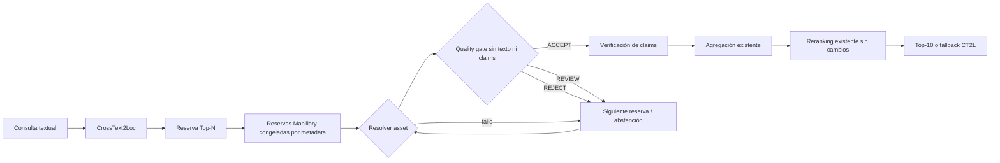

# Filtrado de calidad visual y sustitución Mapillary

## Estado

La integración está implementada como componente reutilizable y desactivada por
defecto. Se ha validado únicamente con fixtures sintéticas, sin red, GPU, Qwen,
embeddings ni evaluación geográfica.

No se aplica a I01–I20 ni modifica Atlas v3, sus pesos o su fórmula de reranking.

## Pipeline anterior

```mermaid
flowchart LR
    Q[Consulta textual] --> CT[CrossText2Loc]
    CT --> R[Reserva Top-N]
    R --> M[Asociaciones candidato-Mapillary]
    M --> A[Assets cacheados o adquiridos]
    A --> C[Claims por imagen]
    C --> V[Qwen3-VL: supported / contradicted / unverifiable]
    V --> G[Agregación por candidato y secuencia]
    G --> P[Reranking congelado]
    P --> T[Top-10 o fallback CT2L]
```



Las campañas históricas preseleccionaban imágenes por metadata y enviaban los
assets disponibles directamente al verificador de claims. El API principal usa
actualmente un bundle precalculado, no adquisición/VLM online.

## Pipeline nuevo



El orden de reservas se congela antes de abrir píxeles. Una decisión de calidad
solo puede avanzar dentro de ese orden; no desencadena una búsqueda guiada por
claims, soporte, GT o resultados del reranking.

## Punto de integración

El seam estable ya existente es `VisualPostprocessor.apply()`:

```text
CrossText2LocRetriever.retrieve_many(reserve_k)
    -> VisualPostprocessor.apply(...)
    -> Top-10 público
```

La nueva clase `QualityGatedVisualPostprocessor` implementa la misma interfaz y
compone:

1. fuente de reservas congeladas;
2. resolver offline u online;
3. quality verifier;
4. fuente de claims;
5. claim verifier;
6. política de ranking inyectada.

La fórmula y los pesos de ranking no están en el quality gate. Se inyecta una
política existente, que recibe solo evidencia procedente de imágenes `ACCEPT`.

## Etapa A: calidad

El prompt no recibe texto, claims, candidato, coordenadas, scores, ranks o GT.
Evalúa únicamente si la imagen permite una inspección visual general.

Contrato:

```json
{
  "decision": "ACCEPT | REVIEW | REJECT",
  "reason_codes": ["..."]
}
```

Razones cerradas:

- `USABLE_SCENE`;
- `BLUR`;
- `UNDEREXPOSED`;
- `OVEREXPOSED`;
- `LOW_CONTRAST`;
- `OCCLUDED`;
- `OBSTRUCTED_LENS`;
- `SEVERE_ARTIFACTS`;
- `SCENE_NOT_OBSERVABLE`;
- `PARTIAL_SCENE`;
- `AMBIGUOUS_QUALITY`.

Semántica:

- `ACCEPT` exige exclusivamente `USABLE_SCENE`.
- `REVIEW` exige ambigüedad o escena parcial y bloquea claims automáticos.
- `REJECT` exige un defecto técnico severo.
- output inválido o fallo técnico se convierte operativamente en `REVIEW`, no
  en `REJECT`.

Una imagen nítida y genérica puede ser `ACCEPT`. No mostrar el objeto de un claim
no es un criterio de calidad.

## Etapa B: claims

Solo imágenes `ACCEPT` se proyectan al plan de claims mediante
`accepted_associations()`.

La semántica existente se conserva:

- `supported`: evidencia específica visible;
- `contradicted`: evidencia explícitamente incompatible;
- `unverifiable`: ausencia, fuera de campo, oclusión, resolución o duda.

Una imagen aceptada que no muestre el objeto produce `unverifiable`, no una
contradicción automática. REVIEW, REJECT, fallo o ausencia de imagen son
neutrales para el candidato.

## Sustitución

`freeze_quality_reserves()` ordena metadata por:

1. banda de orientación;
2. distancia a candidato;
3. calidad Mapillary;
4. píxeles;
5. fecha;
6. ID.

Después intercala secuencias por oleadas: primera imagen de cada secuencia,
segunda imagen de cada secuencia, etc. Esto evita consumir repetidamente una
secuencia mientras existan alternativas.

El orquestador recorre candidatos por `candidate_id`, una oportunidad por ronda.
Cada rechazo/review/fallo consume intento y avanza a la reserva siguiente. No hay
bucle infinito ni selección adaptativa por resultado geográfico.

Estados finales:

- `complete`;
- `partial`;
- `abstain_no_accepted_image`;
- `abstain_reserves_exhausted`;
- `abstain_download_budget_exhausted`;
- `partial_claim_budget_exhausted`.

Toda abstención es neutral y conserva CT2L cuando la política posterior no puede
aplicarse.

## Configuración

`config/visual_quality_gate_v1.json` está desactivado y marcado
`proposed_not_authorized_for_real_execution`.

Límites iniciales:

| Límite | Valor |
|---|---:|
| Imágenes aceptadas objetivo/candidato | 2 |
| Inspecciones máximas/candidato | 6 |
| Sustituciones máximas/candidato | 5 |
| Secuencias máximas/candidato | 6 |
| Descargas máximas/consulta | 100 |
| Llamadas VLM de calidad | 100 |
| Llamadas VLM de claims | 1.200 |
| Tiempo máximo | 600 s |
| Bytes por asset | 8 MB |
| Bytes descargados/consulta | 800 MB |

Los límites son de operación, no parámetros calibrados para precisión.

## Caché

La identidad de calidad incluye:

- SHA-256 de imagen;
- modelo, revisión y hashes de pesos;
- dtype y attention;
- prompt y schema;
- generación;
- política de preprocessing.

Un cache hit evita la llamada VLM. No se reutiliza por ruta o `image_id` solamente.
Los bytes de imagen siguen usando `MapillaryCache`; el resolver online exige una
autorización específica y nunca persiste URLs firmadas.

## Modos

### Offline

Usa un manifest local y verifica ruta, tamaño y SHA-256. Un miss produce
abstención/sustitución; nunca abre red.

### Online

`MapillaryOnlineResolver` reutiliza caché o solicita metadata/miniatura mediante
el cliente existente. Exige `approved`, `terms_reviewed` y
`quality_filtering_permitted`, además de una política habilitada. El core reserva
presupuesto antes de descargar.

### Fixture

`ScriptedQualityVerifier` devuelve decisiones por SHA-256. Está marcado como
fixture no científica y permite probar sustitución, caché y abstenciones.

## Reproducibilidad

El resultado registra:

- política completa;
- modo;
- candidatos e inventario intentado;
- orden/reserve index;
- assets, hashes y secuencias;
- decisiones y motivos;
- sustituciones;
- claim calls;
- cobertura final;
- abstenciones;
- cache hits;
- descargas, bytes y latencia;
- ausencia de GT, texto y feedback de reranking en calidad.

Los resultados históricos permanecen intactos.

## Fixture validada

La prueba E2E sintética produjo:

- 3 candidatos;
- 6 imágenes inspeccionadas;
- 3 `REJECT`;
- 1 `REVIEW`;
- 2 `ACCEPT`;
- 2 sustituciones exitosas;
- 2 candidatos completos;
- 1 abstención;
- 2 llamadas de claims, solo para `ACCEPT`;
- 0 red, GPU o modelo real.

## Presupuesto real propuesto

Usando mediciones históricas del contrato mínimo 8B:

```text
carga: ~98 s
calidad: hasta 100 × 1,38 s = ~138 s
claims: hasta 1.200 × 1,38 s = ~1.656 s
total peor caso: ~31,5 min si calidad y claims comparten una carga
pico CUDA: ~18,1 GB
pico RSS: ~18,5 GB
```

Red máxima por consulta:

- 100 descargas;
- 800 MB;
- metadata para los assets no cacheados;
- ejecución secuencial inicial.

Para un smoke autorizado se recomienda reducir a:

- 5 candidatos de desarrollo no reservado;
- máximo 3 imágenes/candidato;
- 15 llamadas de calidad;
- sin claims en la primera ejecución;
- máximo 120 MB;
- tiempo estimado 2 minutos después de carga, más ~98 s de carga.

## Plan de validación

1. Fixture sintética y tests contractuales.
2. Preflight CPU sobre un plan de desarrollo autorizado.
3. Smoke 8B pequeño solo de calidad, sin claims/reranking.
4. Revisión humana ciega de ACCEPT/REVIEW/REJECT.
5. Congelar prompt/política si la calidad técnica es aceptable.
6. Ejecutar calidad+claims sobre desarrollo no H26–H37 y no I01–I20.
7. Comparar activado/desactivado con mismos candidatos, reservas, claims y fórmula.
8. Medir cobertura, llamadas, latencia y cambios de evidencia.
9. Evaluar geografía solo en un conjunto independiente posterior.

No se debe promover la mejora por aumentar imágenes aceptadas. El éxito operativo
es reducir imágenes técnicamente inservibles sin perder cobertura excesiva. La
mejora de GeoRecall necesita evidencia independiente.

## Comandos tras autorización

### Preflight sin GPU

```bash
.venv-geo/bin/python scripts/prepare_visual_quality_pipeline.py \
  --reserves /ruta/reserve-plan.json \
  --assets /ruta/asset-manifest.json \
  --policy /ruta/visual-quality-policy-authorized.json \
  --output /ruta/quality-preflight.json
```

### Quality gate local 8B

```bash
python scripts/run_visual_quality_gate.py \
  --reserves /ruta/reserve-plan.json \
  --assets /ruta/asset-manifest.json \
  --policy /ruta/visual-quality-policy-authorized.json \
  --authorization /ruta/quality-gpu-authorization.json \
  --model-path /ruta/Qwen3-VL-8B-Instruct \
  --output /ruta/quality-result.json
```

### Proyectar ACCEPT a claims

```bash
.venv-geo/bin/python scripts/project_quality_accepted_associations.py \
  --quality-result /ruta/quality-result.json \
  --associations /ruta/visual-associations.json \
  --output /ruta/quality-filtered-associations.json
```

Después se reutilizan los runners de claims y la fórmula de ranking ya congelada.

## Autorización pendiente

No se ha ejecutado ninguna campaña real. Para el smoke propuesto se necesita
aprobar explícitamente:

- IDs/candidatos de desarrollo exactos;
- hasta 15 inferencias 8B de calidad;
- ~18,1 GB GPU;
- ~2–4 minutos de inferencia más carga;
- 0–15 descargas, máximo 120 MB;
- revisión humana posterior;
- prohibición de claims, reranking y evaluación en ese primer smoke.
